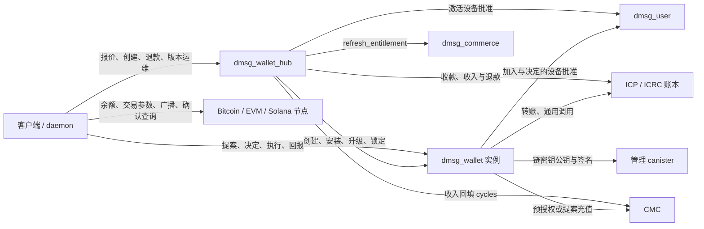
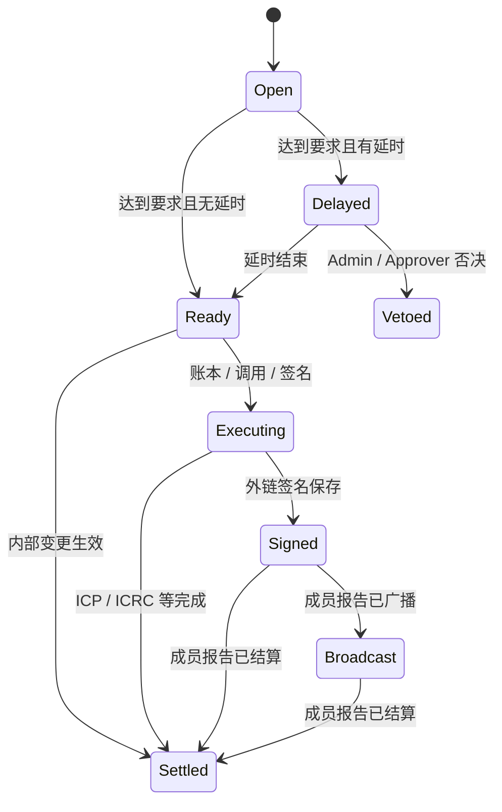

# dMsg Wallet 技术方案 v0.2 · 团队钱包实现基线

初版：2026-10-16；修订：2026-10-24。源码基线为公开仓库本地 `main` 的 `b8b8b799`，修订前工作区干净，未核对远端。本文把早期方案及 10 月 17、21、24 日的修订合并到对应章节，不再要求读者从附录推断当前规则。文件名保留初版日期，现归入 `docs/`。

产品范围见 [产品方案](dMsg_wallet_product_2026-10-16_zh.md)，精确接口见 [公开合同](protocol/wallet_zh.md)、[钱包 Candid](../src/dmsg_wallet/dmsg_wallet.did)、[hub Candid](../src/dmsg_wallet_hub/dmsg_wallet_hub.did)。私有设计按 [AGENTS.md](../AGENTS.md) 核对：本地 `dmsg-cloud` 为 `801940d4`（2026-10-23），工作区干净，未核对远端；本文只描述公开实现，不复制私有正文。

2026-10-24 的产品流程修订另见 [桌面实现与验收](dmsg_wallet_desktop_zh.md)：新增预算用量 query，队列/历史、记账备注与本机密钥测试由客户端/daemon 承载。此前验证记录仍注明其对应源码基线，不代表新改动已部署。

## 1. 组件与代码入口

| 组件 | 当前职责 / 入口 |
| --- | --- |
| `dmsg_types::wallet` | [协议类型与边界常量](../src/dmsg_types/src/wallet.rs)，供 canister 与客户端共用 |
| `dmsg_protocol::wallet` | [摘要、身份批准、策略、地址、协签验证](../src/dmsg_protocol/src/wallet/mod.rs) |
| `dmsg_wallet` | [api.rs](../src/dmsg_wallet/src/api.rs)：成员、提案与读取；[execute.rs](../src/dmsg_wallet/src/execute.rs)：执行与恢复；[chains](../src/dmsg_wallet/src/chains/mod.rs)：外链构造；[store.rs](../src/dmsg_wallet/src/store.rs)：稳定状态 |
| `dmsg_wallet_hub` | [lib.rs](../src/dmsg_wallet_hub/src/lib.rs)：激活、收入、版本与运维；[store.rs](../src/dmsg_wallet_hub/src/store.rs)：订单、索引、模块、付款作业 |
| `dmsg_client::wallet` | [mod.rs](../src/dmsg_client/src/wallet/mod.rs)、[ops.rs](../src/dmsg_client/src/wallet/ops.rs)、`desktop.rs`、`decode.rs`、`rpc.rs`、`cosign.rs`、`packets.rs`、`audit.rs` |
| daemon / CLI | [wallet_methods.rs](../src/dmsg_cli/src/wallet_methods.rs)、[wallet_commands.rs](../src/dmsg_cli/src/wallet_commands.rs)、[enclave.rs](../src/dmsg_cli/src/enclave.rs)；原付款身份模块为 `payer` |
| 桌面 / MCP | [Wallet.svelte](../src/dmsg_desktop/src/renderer/views/Wallet.svelte)、[工具目录](../src/dmsg_agent/src/tools.rs)；桌面细节见 [实现与验收](dmsg_wallet_desktop_zh.md) |
| 既有服务 | `dmsg_user` 核验设备批准；`dmsg_commerce.refresh_entitlement` 提供套餐；`dmsg_runtime` 提供账本、认证树与稳定编码等公共能力 |

hub 使用保留 ID `ghcje-dyaaa-aaaas-qg7va-cai`；钱包实例由 hub 安装，不在 `icp.yaml` 中逐个独立部署。创建、批准和链交易路径均已有代码；Safe、Squads、额外硬件后端和生产发布状态见第 13 节。

## 2. 拓扑与信任



- 钱包实例保存授权事实、构造交易并强制校验。ICP/ICRC 转账直接由实例发出；外链不做 HTTPS outcall，客户端负责读取和广播。
- user home 证明账户设备批准有效，不决定该批准是否满足钱包成员角色或阈值。Principal 成员直接以调用身份决定。
- 外链 RPC 的余额、UTXO、nonce、费用、元数据与结算结果是外部输入。构造器和解码器限定已批准意图与费用上限，但不证明 RPC 的真实性、可用性或最终性。
- 当前 hub 实现要求实例先接受精确版本，实例 controller 仅 hub；hub 自身由部署治理控制。因此接受流程仍依赖 hub 代码和治理，不是 controller 层面的密码学禁止。锁定代码通过清空 controllers 去掉常规升级能力。
- `policy.public` 控制普通查询访问。hub、controller 和成员的读取权限与公众不同；认证状态不等于加密状态。

## 3. 身份与承诺字节

### 3.1 账户成员的调用身份

客户端每台设备生成本地钱包 Ed25519 密钥，使用 LDK 加密保存，不随团队钱包共享私钥。`WalletJoin` 设备批准绑定 `(wallet, account_id, actor)`，actor 是这把钱包密钥的 Principal。每个成员最多 4 个绑定 Principal，一个 Principal 不能同时代表多个成员。

登录委托仅覆盖固定服务，不能覆盖所有动态钱包，因此登录身份用来向 user home 提交设备批准，钱包身份用来调用实例。被邀请成员首次 `join` 才变为 Active；已活跃成员新增设备绑定不改变成员票数，重复相同绑定不重复记审计。缺少 home 时可从 hub 的 `get_user_homes` 补取后核验。

`propose` 只要求已绑定成员及相应角色。账户成员的批准、拒绝、否决每次都携带 `ApplicationApproval`，经 home 的 `verify_application_authorization` 核验；Principal 成员核对 caller。设备须具备独立的 `WalletApprove` 能力。提案人的票不自动产生。

### 3.2 摘要

定义 `digest(domain, value) = SHA-256(CBOR([1, domain, value]))`，CBOR 使用协议确定性编码。

| 承诺 | domain | value |
| --- | --- | --- |
| 提案 | `dmsg-wallet/proposal/v1` | `(environment, wallet, op_id, intent, policy_version, proposer, via_agent)` |
| 决定 | `dmsg-wallet/decision/v1` | `(proposal_digest, decision)`，decision 为 Approve / Reject / Veto |
| 加入 | `dmsg-wallet/join/v1` | `(wallet, account_id, actor)` |
| 激活 | `dmsg-wallet/activation/v1` | `(quote, spec)` |
| 协签消息 | `dmsg-wallet/cosign/v1` | `(wallet, proposal_id, plan_seq, digest_index, digest)` |
| 审计事件 | `dmsg-wallet/audit/v1` | `(prev, seq, at_ms, actor, proposal, kind)` |
| 报价收款子账户 | `dmsg-wallet/deposit/v1` | `(hub, quote_id)` |

提案摘要不包含由钱包分配的 `id` 或创建时间，使用提交前可确定的 `op_id`；设备签的是具体决定摘要，不能把 Approve 的批准用于 Veto。`ApplicationApproval` 同时绑定应用、产品、service、beneficiary、actor、期限与用途；创建的 service 为 hub，加入和决定的 service 为钱包。

### 3.3 权威读取

`get_wallet_certified` 和 `get_proposal_certified` 返回认证叶。客户端以部署配置的 IC 根与时间约束验证证书、树和叶，解码完整提案并重算摘要；仅重算普通 query 附带的 digest 不构成认证。

提案叶保存的是已持久化状态；客户端结合新认证的 WalletView 授权版本及当前时间推导 Stale、Expired、Delayed/Ready 展示。审批与协签都采用这条读取路径。执行入口仍独立校验，展示状态不替代链上校验。

## 4. 地址与密钥

### 4.1 派生与默认地址

```text
derivation_path = [b"dmsg-wallet/v1", chain_tag, address_id.to_be_bytes()]
address_id: u32，钱包全局编号，最后一段为大端 4 字节
默认：0 = ICP，1 = Bitcoin P2TR，2 = EVM，3 = Solana
```

`key_name`、环境与 Bitcoin 网络来自 hub/钱包初始化配置；没有把 Production、Staging、Local 强制映射到固定 key 名。PocketIC 钱包测试的 fiduciary 子网使用 `key_1`，不是旧草案中的 `dfx_test_key`。

安装/升级后 `bootstrap` 获取三个算法的根公钥与 chain code，补齐默认外链地址；失败每分钟重试，也可手动调用。新增地址调用管理 canister 取得该路径公钥；`.await` 返回后重新检查当前版本、期限、冻结、容量、普通 CS 引用、硬件策略和 Taproot 密钥，再写地址。

客户端从认证 WalletView 的根公钥离线派生公钥并重算地址，不匹配时拒绝把地址视为已核对。ICP 编号编码为 32 字节子账户，0 使用默认子账户；AccountIdentifier 由客户端另算用于收款显示。

| 链 / 类型 | tag | 地址与签名 |
| --- | --- | --- |
| ICP | `icp` | 钱包 Principal + subaccount；直接调用账本，无链密钥签名 |
| BTC ChainKey | `btc` | P2TR，BIP-341 key-path tweak；Schnorr BIP-340，`aux = Bip341` 空脚本根 |
| BTC Segwit | `btc-segwit` | P2WPKH，BIP-143 sighash；ECDSA low-s DER + SIGHASH_ALL |
| BTC Taproot 双控 | `btc-native` | NUMS 内部密钥与承诺脚本树；BIP-341/342 script-path sighash，`aux = None` |
| EVM | `eth` | secp256k1，地址为 keccak 公钥末 20 字节，EIP-55 展示；EIP-1559 签名，恢复 y-parity |
| Solana | `sol` | Ed25519 公钥 base58；签完整 legacy message；默认 `sol_nonce = None` |

### 4.2 普通协签 CS

地址可绑定 `CosignPolicy { cosigners, threshold }`。转账、批量、提案充值与外链操作校验对应来源地址；任意 Candid 的 `CanisterCall` 不能推断唯一子账户，因此必须分别满足所有受保护 ICP 地址的阈值。

外链签名绑定上表的协签消息；ICP/ICRC/通用调用使用计划 0、摘要序号 0 和提案摘要。一个签名人要覆盖计划全部摘要才计入人数；多个地址共享密钥可复用验证结果，但每个地址阈值独立满足。

| 封装 | 验证 |
| --- | --- |
| Raw | P-256/secp256k1 为 ECDSA-SHA256；Ed25519/BIP-340 按相应算法签协签消息 |
| Fido2 | 签 `authenticator_data ‖ cosign_message`，核对 RP hash、UP、按策略 UV 与计数器 |
| WebAuthn | 签 `authenticator_data ‖ SHA-256(client_data_json)`，核对 type、challenge、origin、RP、UP/UV 与计数器 |

客户端目前可生成 macOS Secure Enclave P-256 和软件 P-256。Secure Enclave 经 daemon 的 CryptoKit 桥接，仅保存设备绑定的 opaque handle；软件密钥在本机工作区以 LDK 封存。明确请求硬件时禁止软件降级。Windows/Linux TPM、CTAP2 和桥接页 WebAuthn 适配未实现；canister 支持验签不等于客户端已有这些签名器。

`hardware` 为登记声明，不是硬件证明。`SetCosign` 可经 Admin 阈值 + 24 小时替换或移除普通地址的协签要求；移除仍被普通地址引用的密钥或成员会被拒绝，启用仅硬件策略也须保证已有地址阈值可满足。

### 4.3 Taproot 双控 NC

当前仅实现 Bitcoin：内部密钥为 BIP-341 NUMS 点；L1 为 `<ck_x> CHECKSIGVERIFY <cs_x> CHECKSIG`；L2 为 `<n> CSV DROP <ck_x> CHECKSIG`；可选 L3 为 `<m> CSV DROP <recovery_x> CHECKSIG`。树为 `{L1, L2}` 或 `{L1, {L2, L3}}`。

L1 的协签人必须是 `CosignerKind::Bip340`，直接签每个输入的链上 sighash。`ExecutionParams::Bitcoin.timelock` 可选择 L2；时间锁针对 UTXO 确认后的区块年龄，L2 到期后不再要求链外第二签。L3 由恢复密钥持有人自行构造并签名，当前钱包不提供该交易生成器。移除成员时保留其已被 Taproot 脚本承诺的协签公钥。Safe、Squads 和硬件钱包交互均不在已实现范围内。

## 5. 提案、策略与授权

协议类型直接引用源码，不维护第二份可能漂移的 Rust 伪定义。主要对象为 `Member`、`Policy`、`Address`、`Proposal`、`ExecutionPlan`、`SignedTx`、`ChainReport`、`AuditEvent`。

### 5.1 意图分类

| 类别 | 意图 | 批准与延时 |
| --- | --- | --- |
| 支出 | Transfer、Batch、Refuel | 活跃 Admin/Approver 按资产累计额度、分档和地址簿规则决定 |
| 操作 | CanisterCall、CancelEvmNonce、InitSolNonce、AddressBook | `approver_threshold`，无固定延时 |
| 一般管理 | AddAddress、AddCosigner、AddMember、UpdateMember | `admin_threshold`，无固定延时 |
| 敏感管理 | SetPolicy、RemoveMember、SetCosign、RemoveCosigner、AcceptUpgrade、LockCode、ReleaseEvmNonce | `admin_threshold` + 24 小时 |
| 解冻 | Unfreeze | `admin_threshold` + `unfreeze_delay_ms` |
| Recovery | Recovery 发起的 AddMember、RemoveMember、UpdateMember | 0 票 + 7 天；期间 Admin/Approver 可否决 |

`freeze()` 是直接入口，没有 `Intent::Freeze`；角色更新为 `UpdateMember`，不是旧草案的 `SetRole`。普通成员也可提出管理意图，但只有合格 Admin 的票满足管理要求。Recovery 只可提出成员变更。

`CanisterCall` 为独立操作类，不把任意 Candid 参数解释成转账金额，也不套用 Transfer 的资产分档。`call_targets` 的授权范围必须据此理解；它不是仅允许某一种安全方法的白名单。外链转账没有任意 calldata 入口。

### 5.2 支出窗口

提交预估当前要求；每次批准重新计算，更严格时提高票数和延时，并相应延长期限。预览和未达阈值的 Open 提案不占预算；达到要求时记录 `Spend`：

```text
window_amount = 有效的未执行预留
              + 首次执行/签名开始后仍在 24 小时窗口内的金额
              + 当前提案金额
```

`Spend.at_ms` 记录预留时间，`executed_at_ms = None` 表示尚未开始支出，不能因等待一天而清除。首次账本发出、提案充值开始或阈值签名开始才填执行时间。签名中断且没有已签交易时恢复未执行预留；部分已付批量和已有签名的失败提案仍计入执行窗口。取消、拒绝、否决、到期、版本失效或确定无出金的失败才释放对应预留。

按资产取覆盖累计金额的第一个档；超过最高档提高批准数，受活跃批准人数约束。超过 `daily_limits` 时至少需要全部活跃批准人，延时取该资产各档与当前要求的最大值。`book_only` 要求所有收款方均为过冷却期的地址簿条目；没有自动地址簿折扣。

### 5.3 状态与跨等待校验



另有 Failed、Rejected、Cancelled、Expired、Stale。不存在 Approved 或 Signing 状态值。内部变更在处理到 Ready 时应用；外部执行需调用 `execute`。等待中的状态按当前版本与时间刷新，不依赖定时器逐条推进。

`SetPolicy`、成员新增/移除/更新以及邀请首次激活推进 `policy.version`，使旧版 Open/Delayed/Ready 提案失效。首次执行通过 `execution_authorized` 重验期限、版本、冻结和当前有效票数；零票恢复要求提案人仍是活跃 Recovery。跨 home 核验、取公钥、账本或签名等待后重新读取当前状态及需要的时间，不能复用旧授权快照。

冻结只允许解冻和成员变更继续，拒绝与否决仍可进行；批量停止下一笔，签名停止下一摘要。独立的策略预授权 `refuel()` 不检查冻结。已经生成并交付的有效交易无法通过成员撤销或冻结收回。

## 6. ICP、ICRC 与通用调用

### 6.1 账本作业

`execute` 保存 `Job::Ledger` 和 Executing 状态，读取可信配置中的账本手续费并校验总手续费上限，再固定 `created_at_time`、fee、memo、来源与目的账户和金额。费用查询失败恢复 Ready；等待手续费时被冻结则暂停，不能把该提案当成无出金的终态失败释放预算。

批量逐笔调用 ICRC-1，不原子回滚；每项有独立 block，memo 由提案摘要和序号区分，避免相同金额/收款方被合并去重。已经确认的项不会重发。确定拒绝记录失败；结果未知保留作业，`reconcile(id)` 仅复用完全相同的参数，Duplicate 作为原区块成功处理。

每项在第一次发送前持久记录已尝试发送。重试收到 `TooOld` 时保留作业并返回 `ExecutionUnknown`，不能据此断定原付款没有发生，也不能换时间或 memo 新付一次。从未发送的项若在首次发送时收到 `TooOld`，则明确失败并保留批量已付款区块，不要求提供不存在的付款证明。账本去重窗口由实际账本决定，不在钱包里统一承诺为固定 24 小时。

### 6.2 区块对账

`reconcile_transfer(id: u64, item: u16, block: u64)` 供非 Viewer 成员恢复原 Ledger 作业：

1. 以原作业账本读取指定 ICRC-3 转账，调用者只提供区块编号和批量项序号。
2. 匹配钱包来源账户/子账户、目的账户、amount、fee、memo、created_at_time，并要求 `spender = None`。
3. 返回后重验调用成员及当前作业参数，补记该项 block，再继续剩余项；不接受其他转账作为证明。

该方法只处理 Ledger 转账，不是 TopUp 或任意 canister 调用的通用证明器。账本不提供所需 ICRC-3 记录、或找不到匹配区块时不能通过此入口宣布“未付款”。桌面到 daemon 的区块编号保留字符串，避免 JavaScript 大整数舍入；CLI 为 `dmsg wallet reconcile-transfer <wallet> <id> <item> <block>`。

### 6.3 通用 canister 调用

提案先核对 `call_targets`，尝试取得 ICRC-21 通用同意文本；没有文本也不意味着入口不存在，不要求目标先提供标准探测接口。批准对象包含精确 target、method、Candid arg、cycles 和实际取得的 consent。执行校验所有受保护 ICP 地址的协签。

有界等待后保存回复前 64 KiB 与完整回复哈希。明确拒绝记 Failed；`SYS_UNKNOWN` 保存 `Outcome::CallUnknown`，其提案状态为 Settled，表示此次调用记录已结束，**不证明目标操作成功**。不能把账本幂等重试规则套到任意 canister 方法。

## 7. 外链计划、签名与重试

客户端读参数 → `prepare_execution(id, params)` → 独立解码 unsigned、重算摘要并核对意图与 summary → 收集所需协签 → `execute` → 保存 SignedTx → 客户端广播 → `report(ChainReport)`。没有独立 `report_broadcast` / `report_settled` canister 方法。

有效未签计划可复用，过期或已签后才创建新计划；每计划 10 分钟，每提案最多 8 个。每日签名数在开始签名前按摘要数计入，失败或中断不退该次数。签名失败可恢复到可继续状态；重试仍受原意图、计划与首次签名约束，不保证生成相同签名字节。

### 7.1 构造校验

| 链 | 构造与费用规则 |
| --- | --- |
| BTC | 输入必须属于来源地址、无重复、最多 32 个；收款来自意图、找零回来源地址，输出使用实现的 546 sat 下限；按费率与 vsize 构造并检查总费用不超过 max_fee。P2TR/P2WPKH 支持 RBF，Taproot L2 使用承诺的相对时间锁 |
| EVM | chain ID 在白名单；原生币 to/value 或 ERC-20 transfer calldata 由意图生成；`gas_limit × max_fee_per_gas ≤ max_fee`，priority fee 不超 max fee。客户端预览与执行共用 `evm_call` 参数构造和 gas 估计，原生合约收款不固定为 21000 gas |
| SOL | 只构造意图支持的 ComputeBudget、System、SPL TransferChecked、可选 ATA 及 nonce 初始化指令；检查费用上限。有持久 nonce 时首条 AdvanceNonceAccount，blockhash 字段为 nonce 值；InitSolNonce 使用派生 seed `dmsg-wallet-nonce`，当前构造的租金存款为 1,447,680 lamports |

`max_fee` 使用相应链的原生最小单位，不是代币单位。错误 UTXO、nonce、元数据等可能导致无效交易或可用性/显示问题；实例不能据客户端参数宣称链上余额或成交已获证明。

### 7.2 替换与防止同一提案重复支付

| 链 | 不变量 |
| --- | --- |
| BTC | 后续计划与首个已签计划保持完全相同的输入集合及金额；保留已批准收款，只调整允许的费用/找零 |
| EVM | 同一地址、同一 chain ID 只有一笔待处理已签交易；同提案替换保持首签 nonce |
| SOL 持久 nonce | `PlanRecord.sol_nonce` 固定首签是否使用 nonce 账户及其值；替换必须同时符合首签和地址当前模式 |
| SOL 普通 blockhash | 已签后禁止新 blockhash 重签，只能重广播原字节；等待 150 秒或之后初始化 nonce 均不解除限制 |

构造计划时、签名前和签完后均核对重签约束；预先构造多个计划不能绕过首签约束，并发冲突的后完成者不返回已签交易。InitSolNonce 本身不提供换 blockhash 重签入口。

`CancelEvmNonce` 明确包含 address、chain_id、原 proposal、nonce、max_fee；创建、准备及执行检查当前待处理对象。取消签同 nonce 的零值自转，客户端独立解码时也核对交易 nonce 与批准意图一致。`ReleaseEvmNonce` 同样绑定精确对象，走 Admin 阈值 + 24 小时，仅解除实例内锁，不使原链交易失效。

外链回报由成员提交，钱包没有独立链证明。取消提案的 Settled 回报只处理仍匹配的 pending 对象，不把原付款改成 Failed，也不释放原付款已执行支出计数；旧回报不能影响新 nonce。已经签名的付款不能因回报失败就当作从未可能出金。

## 8. 工厂激活、收入与退款

### 8.1 报价与创建

`quote_activation_preview(account_id)` 只读配置、版本和各套餐剩余额度；`quote_activation` 调 commerce 的 `refresh_entitlement`，未有记录按 Free，配额取 `HubPricing.quotas`。未列出的套餐为 0，不硬编码 Plus/Pro/Max 数量。额度为 0 仍可返回 remaining=0 的报价，由创建入口拒绝。

报价有效 15 分钟，包含调用者、账户、固定 ICP 价格、账本费、初始 cycles、模块版本和专属收款子账户。客户端的报价调用者是本机钱包身份，真实付款身份可以不同。创建前客户端检查批准资格、余额和费，并先完成 home 核验再付款。

`create_wallet` 检查报价调用者、有效期、暂停/退款、规格、WalletCreate 批准及专属子账户余额；不是要求客户端提供一笔付款区块。每次外部调用后重读需要的期限和状态；接受付款后记 Paid 并占用配额。随后创建实例、分块安装报价固定版本，状态为 Created → Ready。hub 以自己的 cycles 支付创建及初始注入，实例 freezing_threshold 配为 365 天。

同一报价由 Busy 互斥；已有订单的同规格请求继续原订单，`reconcile_activation` 也可续做。创建前检查模块存在；Created 时若状态已有模块，视为先前安装成功但回复丢失，继续登记而不重装。这依赖未登记实例仅由 hub 控制的创建流程。

### 8.2 模块引用与终止

`VERSION_USES` 持久记录各版本最新报价到期时间和未完成激活数。未过期报价或 Paid/Created 订单引用的版本不能删除，即使该版本已退役；旧 hub 升级仅在索引尚不存在时回填。

`abort_activation(quote_id)` 仅报价调用者可用，只接受 Paid/Created。已有空实例须先核对没有 module_hash，再停止、删除；随后订单 Failed，释放配额与未完成激活引用，允许单独领取退款。已安装代码的实例不接受终止，防止拿到可用钱包后退还激活价。

### 8.3 收入与退款分开记账

Ready 订单加入 `collectable_activations`，维护方逐单 `collect_revenue`。归集金额固定为 `quote.price_e8s`，不是子账户全部余额：一腿将 cycles_share 以 `TPUP` memo 送往 CMC 回填 hub，另一腿将扣费后的剩余报价款送往收入账户。未知转账复用原作业参数；CMC 退款按对应结果记录，不伪装为已铸 cycles。

收入作业和退款作业分开存储。`get_activation_reserve` 返回保护金额：未过期未开单报价的固定价格、已开单尚未归集价格，或已经建立收入作业中未发送各腿及手续费之和。失败/已退订单与已完成归集没有剩余预留。

`claim_activation_refund(quote_id, to)` 仅报价调用者领取余额减预留再扣手续费的部分，to 必须在 hub 之外。它覆盖超额、迟到及可退的失败/过期款；不能取走仍受保护的激活收入。

退款从余额/手续费读取起持有同一报价互斥。首次创建作业时固定 to、fee、memo 和 created_at_time，未完成时只续做这些参数；完成且无新增可退款余额时返回原区块，有新款再建独立退款，使用新的时间与 memo。新 Payout 固定 fee；兼容读取旧记录时才使用缺省字段的处理。客户端保留已付款报价，不因创建或退款完成删除追踪记录。

## 9. Cycles、版本与代码锁定

`Refuel` 提案从指定 ICP 地址向 CMC 充值；公开 `refuel()` 按 `RefuelRule { from, min_cycles, icp_e8s, max_per_day }` 预授权执行，低于余额阈值且未超 UTC 日次数才启动。固定转账时间与 TPUP memo，保存转账区块后续做 `notify_top_up`；自动充值使用保留作业键 0。它不要求逐次成员批准，也不受钱包冻结阻止；配置规则时已授予这项权限。

看门狗为外部维护方：用 hub `list_wallets` 遍历，调用实例 `refuel()`，不需要 hub 转调方法。`wallet_stats` 与 `wallet_health` 提供余额/消耗等运行信息。365 天 freezing_threshold 是冻结储备计算参数，不保证 cycles 耗尽后保留一年；不能以固定美元签名费推算保证续航。

Wasm 暂存允许 controller、governance 或指定 uploader；登记版本、退役、删除和价格等管理方法由 controller/governance 授权，并有 `validate_*`。模块最多 4 MiB、保留最多 16 版本，版本号单调不复用。上传暂存不等于治理登记。

升级流程：

1. 实例以 `AcceptUpgrade { version, module_hash }` 经 Admin 阈值 + 24 小时接受。
2. 任何人调用 hub `upgrade_wallet`；hub 获取每钱包互斥，读准确接受记录并核对已登记模块。
3. hub 调实例 `claim_code(expected)` 原子领取；仅 settings.hub 可调用，必须匹配当前接受记录。持久 `code_busy` 期间不能再接受升级/锁定。
4. stop → 分块 Upgrade 安装 → start。安装成功即记录版本；停止/安装失败尝试重新启动并在可调用时释放领取。
5. 钱包 post_upgrade 清除领取；只有传入版本匹配已接受版本时才清除接受记录，并重建认证状态、补齐 bootstrap。

锁定用同一 per-wallet 互斥和 claim_code，要求已接受 LockCode，并在 `canister_status == Running` 时才清空 controllers；避免停止实例被永久锁死。`release_code()` 仅 hub 可用。代码锁定不是永久存活或无漏洞的承诺，hub 治理信任边界见第 2 节。

## 10. 存储、容量与认证

稳定记录采用整数键的紧凑 CBOR，协议摘要和认证叶仍使用确定性协议编码。钱包与 hub 的 `STABLE_SCHEMA` 当前为 1；升级时校验布局版本，不能用字段名或估算体积替代实际编码测试。

| 钱包区域 | 内容 |
| --- | --- |
| StableCell Wallet | 设置、成员、策略、地址、协签人、冻结、代码接受/领取、根公钥、支出预留与执行时间、nonce 状态、计数和审计头 |
| proposals / op_id 索引 | 提案与提交幂等关系 |
| plans | 计划、共享签名规格、组装数据、首签 Solana nonce 模式 |
| jobs | 原样重试所需 Ledger/TopUp 参数及在途步骤；未知账本结果保留 |
| address_book | canonical Destination 键的地址簿 |
| audit | 只追加哈希链 |
| CertMap | `wallet` 和 `proposal/` + 提案 ID 大端 8 字节的认证叶 |

hub memory 0–11 依次为配置、报价、订单、收入 payout、钱包记录、成员索引、配额占用、模块、上传暂存、待归集索引、版本引用、退款 payout。成员索引通过任何人可调用的 `sync_wallet` 拉取实例 `member_ids` 刷新，不依赖钱包回调 hub。

| 限制 | 当前值 |
| --- | --- |
| 成员 / 地址 / 协签人 / 地址簿 | 64 / 256 / 64 / 4,096 |
| 每成员调用 Principal / Agent ID | 4 / 8 |
| 每提案计划 / 计划期限 | 8 / 10 分钟 |
| 批量项 / BTC 输入 | 批量最多 32，BTC 收款项另限 16；BTC 输入最多 32，EVM 不支持 Batch |
| 提案 TTL | 策略范围 1 小时至 90 天；客户端默认策略为 7 天 |
| 策略延时与冷却 | tier、解冻、地址簿冷却均最多 30 天；固定敏感动作 24 小时，Recovery 7 天 |
| 阈值签名预算 | 每 UTC 日 1–1,000，按策略配置 |

提案总数超过 10,000 才触发有界清理：扫描最旧 200 条，先刷新期限，跳过仍在执行/待回报等非终态；显式 prune 最多删 100，新提案附带最多删 2。10,000 不是全部提案的硬上限，也不保证永远恰好保留 10,000 条终态。审计仍追加保存；hub 没有旧草案宣称的“订单硬上限 100 万”。`active_proposals` 统计仅扫描最近 200 条，不是全量活动提案总数。

## 11. 客户端、桌面与 MCP

### 11.1 网络与审批边界

钱包网络步骤集中在 `wallet::ops`，通过 `Hold::with` 同步读写 Client，等待 IC/RPC 时不持全局锁。daemon 对同一钱包的变更单独串行，审批任务也按资源串行。硬件等待在取出句柄后进行，锁定后返回的结果不能重新写回密钥缓存；账户切换清除相关连接与视图状态。

批准任务保存认证 WalletView 与提案；协签任务保存已独立解码的计划。签名前后重新核验状态。协签包绑定包版本、钱包、提案摘要、计划编号及计划承诺，导入重新核验每个签名及资格，重复不增票，收集以 LDK 加密保存；达到阈值后由 `cosign_execute` 单独执行。

### 11.2 当前入口

| daemon 方法组 | 用途 |
| --- | --- |
| wallet/list、show、proposals、proposal、assets、receive、book | 钱包、提案、资产与收款读取 |
| wallet/readiness、quote_preview、quote、create、join | 批准资格、报价、创建与加入 |
| wallet/activation、activation_continue、activation_abort、deposits、refund | 激活进度、续做、终止、超额/迟到款追踪与领取 |
| wallet/preview、transfer、change | 结构化转账和已知管理提案；Renderer 不暴露任意 wallet/propose |
| wallet/approve、reject、veto、cancel、freeze | 成员决定、撤回与冻结 |
| wallet/prepare、execute、broadcast、report、reconcile、reconcile_transfer | 计划、执行、回报及原作业恢复 |
| wallet/cosign、cosign_status、cosign_import、cosign_execute | 同计划多设备协签 |
| wallet/versions、health、upgrade、lock_code、refuel | 版本与运行维护 |
| wallet/rpc、rpc_set、rpc_check、audit_page、channel、notify | 本机端点配置、审计页、频道绑定与通知重试 |

CLI 对应能力位于 `dmsg wallet`，付款身份在 `dmsg payer`；CLI 保留通用 `wallet propose` 输入，但链上权限仍完整检查。创建/加入/决定/本机协签转为审批中心任务，`approval/respond` 只接受人工响应。

桌面按概览、资产与地址、交易与提案、团队与安全组织，历史/审计及运行管理作为对应任务的次级入口。统一 `WALLET_CREATION_PAUSED = true` 同时阻止 UI 和主进程的报价/预览/创建入口；已有钱包和历史激活仍可用，CLI/daemon/hub 不受此桌面开关限制。

资产金额及大区块编号跨 UI 使用字符串，余额附来源与时间。RPC 仅接受 HTTPS，Local 额外接受回环 HTTP，拒绝 URL 用户名/密码；EVM 诊断核对 chain ID。原生币及 ERC-20 的预览与执行共享最终调用参数估 gas。

### 11.3 频道、审计与智能体

`dmsg-wallet-event/1` 为成员客户端发送的加密提示，ID 绑定钱包与审计头，频道失败留下 notification_error，不回滚资金操作。收件人和深链接只导航并重新读取认证状态。

客户端保存已验链头、长度和每 200 条检查点，按新认证审计头核对增量，历史页在已验证检查点之间核对。导出标明页范围与时刻，不声称单页包含完整历史或外链结算证明。

MCP 只有 `dmsg_wallet_list|balances|propose_transfer|proposal_status|execute|report_broadcast`，分别受 wallet.read、wallet.propose:<wallet>、wallet.execute:<wallet> 能力约束。via_agent 还须登记在发起成员的 agent_ids；没有代人批准工具。完整桌面行为与性能调整见 [桌面文档](dmsg_wallet_desktop_zh.md)。

## 12. 发布与运维顺序

新部署需配置 hub、账本、CMC、commerce、home、key 名、网络、价格/配额和 hub 以外的收入账户；治理登记应用/产品、管理方法及钱包模块后才能走激活。价格、网络和 key 可用性必须按实际环境核对，不能沿用初版的固定费用与吞吐假设。

**从未实现 claim_code 的旧版本升级时，先通过旧 hub 登记并升级钱包实例，再更新依赖 claim_code 的 hub，最后更新客户端。**已有锁定实例不能升级；不得把仅更新客户端视为已经改变 canister 的授权或重签规则。旧版未绑定目标的 EVM 取消/释放提案须重新创建。

发布须同时覆盖钱包 Wasm、hub Wasm、Candid 与客户端恢复入口。常规维护使用 `collectable_activations`/`collect_revenue`、`list_wallets`/实例 refuel，并查看未完成激活、可退余额、cycles 和版本。本文未执行生产部署、SNS 提案或收入账户切换。

## 13. 验证证据与后续工作

### 13.1 已有测试与最近记录

| 层 | 覆盖与最近验证边界 |
| --- | --- |
| 协议与向量 | [wallet 向量](../tests/vectors/wallet/README.md) 由实现生成并逐字节比对；固定承诺、地址、计划和篡改样例，不能独自证明编码器正确 |
| 独立实现核对 | 钱包单测用 bitcoin、alloy、solana-message 等核对 BTC sighash/见证/txid、EVM 解码/签名人和 Solana message |
| PocketIC | [wallet.rs](../tests/dmsg_integration/tests/control_plane/wallet.rs) 与 [wallet_review.rs](../tests/dmsg_integration/tests/control_plane/wallet_review.rs) 覆盖授权、预留、重签、nonce、协签、冻结、账本未知恢复、激活/退款、版本引用、升级领取和认证读取；CMC 为测试替身 |
| 实际本地外链 | 2026-10-24 已显式运行 Solana validator 单提案至多一次付款用例、Anvil 原生币合约收款 gas 用例；是本地测试链，不是生产验证 |
| 双 daemon | desktop_wallet 经本地私有中继验证创建/加入/批准/转账、软件 P-256 多设备协签及审计；不代表真实硬件验收 |
| Electron / 静态检查 | 2026-10-24 记录：92 项桌面 Node 测试、类型检查、构建与模拟 daemon 冒烟通过；原生 macOS 全屏切换未通过环境检查，本轮以 `DMSG_DESKTOP_NATIVE_FULLSCREEN=0` 跳过 |
| Rust 发布检查 | 最近修复已运行相关 Rust 单测、Clippy、格式、Wasm 构建和 Candid 一致性；结果对应 `b8b8b799` 的修复验证，不表示本次文档修订重新运行全部程序测试 |

常用复跑入口（先按 [集成测试说明](../tests/dmsg_integration/README.md) 准备 Wasm、PocketIC 与中继）：

```sh
cargo test --locked -p dmsg_protocol --lib wallet
cargo test --locked -p dmsg_wallet --lib
cargo test --locked -p dmsg_wallet_hub --lib
cargo test --locked -p dmsg_client --lib wallet
cargo test --locked -p dmsg_integration --features pocketic-tests --test control_plane wallet::
pnpm --dir src/dmsg_desktop test
pnpm --dir src/dmsg_desktop check
pnpm --dir src/dmsg_desktop build
```

外链用例默认 ignored，需运行隔离的本地节点，设置 `DMSG_SOLANA_RPC_URL` 或 `DMSG_EVM_RPC_URL` 后按完整用例名显式运行 `--ignored --exact`。默认 PocketIC 测试通过不包含它们。完整仓库检查入口是 `scripts/test-dmsg.sh`，其范围大于钱包专项。

### 13.2 独立待办与验收

| 工作 | 完成条件 |
| --- | --- |
| BTC 本地链闭环 | regtest 广播 P2TR/P2WPKH 和 Taproot L1/L2，核对时间锁前后与恢复支出；不以离线验签替代广播 |
| 硬件与多平台 | Secure Enclave 实机；实现并实测 Windows/Linux TPM、CTAP2、WebAuthn 适配及链硬件钱包，验证拒绝、取消、密钥丢失与轮换 |
| Safe / Squads | 新增各链双控地址、独立解码、部署/执行/替换/恢复流程，本地链证明缺一签不可支出及恢复条件 |
| attest_* / 透明页 | 明确外链证明与最终性模型；公开页验证证书并遵守 public 读取权限，不把成员回报显示成独立链证明 |
| 容量与发布 | 大规模提案清理场景、真实 CMC/SNS 运维、生产灰度、各平台桌面发布与原生全屏/辅助功能验收；桌面新建经单独发布决策重新开放 |

本轮文档同步没有新增上述能力、运行真实硬件或执行生产变更。
