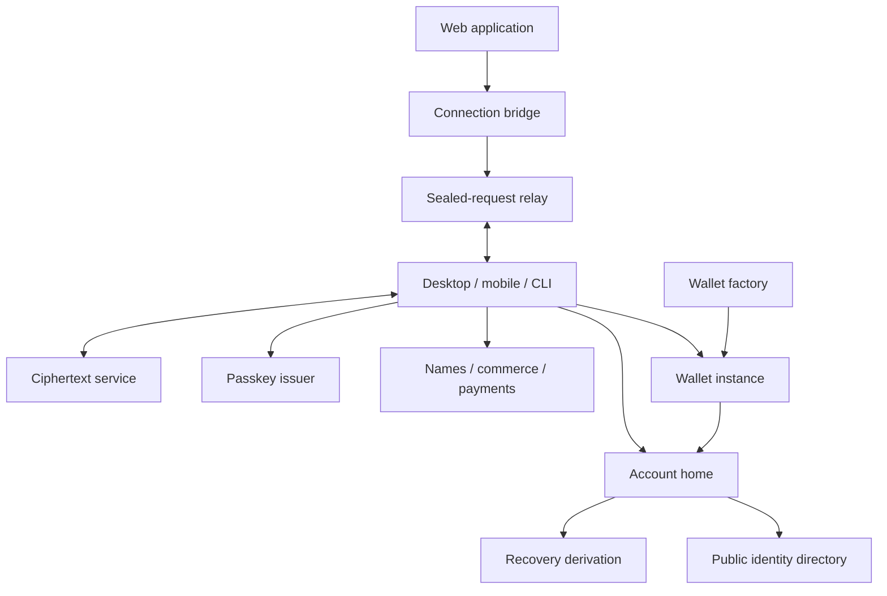

# dMsg architecture

English | [简体中文](dmsg_architecture_zh.md)

This document explains the current public source: responsibilities, data flow and scaling boundaries. See the [documentation index](README.md) for the review baseline. Deployment and capacity measurements need their own evidence. Candid, public types and [protocol contracts](protocol/README.md) define the precise interfaces.

## 1. Design principles

- **Clients encrypt; the cloud stores ciphertext.** Authorized devices generate and use content roots, object keys and file keys.
- **Control and final financial decisions live on ICP.** Canisters hold accounts, devices, names, root commitments, attestation receipts, entitlements and escrow state.
- **Ordinary content operations do not write to ICP per operation.** Messages, files, vault edits and channel control do not require an update, vetKD derivation or threshold signature for each operation. Certified security snapshots are queried as needed.
- **Accounts are partitioned by home.** Adding a user home does not reroute existing accounts. Shared registries enforce name uniqueness and neuron commitments.

## 2. Trust domains

| Component | Responsibility | Trust boundary |
| --- | --- | --- |
| Desktop, CLI, MCP | Share a Rust daemon for keys, workspaces, sync and approvals | The unlocked process and operating system can access plaintext |
| iOS, Android | Call `dmsg_mobile` / `dmsg_client` directly through UniFFI; native hosts supply platform features | No desktop daemon; hardware protection depends on platform capabilities |
| connect.dmsg.net | Relays browser requests and holds pairing and result-decryption keys | Cannot approve requests or access account keys; relayed origin is not cryptographic proof |
| Private cloud | Ciphertext storage and delivery, channels, inboxes, quotas, notifications and connection relay | Sees operational metadata and can withhold service or updates; does not grant account control |
| ICP canisters | Account/device authority, certified evidence, funds and entitlements | Depend on IC certificates, deployment configuration and controller/governance upgrade powers |

Encryption does not hide accounts, devices, sizes, timing or relationships needed by the service. Signatures and locally known versions detect some tampering and rollback, but cannot prove the relay supplied all current history. Governance can upgrade control services; the server-side master key for `unlock_secret` is part of that trust domain. See [encryption](dmsg_encryption.md).

## 3. Components

| Service | Authoritative state and responsibility | Instance relationship |
| --- | --- | --- |
| [dmsg_auth](../src/dmsg_auth/README.md) | Passkey identities, hardware login sessions, 12-hour IC delegations | Fixed issuer; at most 16 sessions per identity |
| [dmsg_user](../src/dmsg_user/README.md) | Authentication bindings, devices, root commitments, recovery, attestation receipts and monthly execution accounting | 1–64 homes per deployment |
| [dmsg_cose](../src/dmsg_cose/README.md) | Content-root vetKD public key and recovery derivation | One instance may serve several homes; no ordinary document signing |
| [dmsg_handle](../src/dmsg_handle/README.md) | Names, legacy claims, fees, transfers and home discovery | Shared deployment registry |
| [dmsg_directory](../src/dmsg_directory/README.md) | Certified PrincipalDocument publication | Directory for a fixed principal origin |
| [dmsg_payment](../src/dmsg_payment/README.md) | Paid-inbox escrow, funding, settlement and refunds | Each home binds one instance |
| [dmsg_commerce](../src/dmsg_commerce/README.md) | Apps/products, checkout, subscriptions, grants and resource entitlements | Each home belongs to one instance |
| [membership](../src/membership/README.md) | PANDA SNS eligibility, cross-product neuron commitments and product decisions | One shared commitment service per SNS |
| [dmsg_wallet_hub](../src/dmsg_wallet_hub/README.md) | Wallet activation, versions, upgrades and member index | Factory for independent wallet instances |
| [dmsg_wallet](../src/dmsg_wallet/README.md) | Members, policy, proposals, funds, chain-key signing and audit | One canister per wallet |

Shared libraries: `dmsg_types` defines data, `dmsg_protocol` implements encoding and verification, and `dmsg_runtime` supplies stable storage, certified trees and call utilities. See the [canister index](dmsg_canisters.md) for source and interfaces.

## 4. Main flows

### 4.1 Registration and account discovery

Clients read authoritative `user_homes` and the registration subset `registration_homes` from `dmsg_handle.get_handle_config()`. Login queries every home's `my_account` concurrently and, after all succeed, selects the first match in registry order. Any failed query leaves discovery unknown rather than starting registration. A new account chooses a registration home randomly and obtains an admission ticket bound to that home and login Principal when required.

An account's `home_user` and `home_cose` are fixed. Clients read commerce, membership, payment and other service addresses from that home's `user_config`; they no longer depend on the old web configuration's single-instance addresses.

### 4.2 Devices, content roots and recovery

Account changes require a login identity and device approval bound to version, sequence, purpose and expiration. A client generates the content root, wraps it with HPKE for certified active `VaultUnlock` devices, uploads it and commits its on-chain reference. On-chain recovery is disabled for new accounts; a vetKD IBE recovery envelope is added only after the user enables it.

Changes to root recipients or the recovery switch require rekeying. If recovery was enabled before all devices were lost, a bound login may request recovery. The default delay is three days, configurable to 1–7 days; an existing device may dispute it. The replacement device derives the current generation's recovery key, opens the root and rekeys. See [accounts and roots](protocol/account_root.md).

### 4.3 Attestation

A device signs a COSE statement and submits `attest` / `attest_app_action`. The user home validates approval, signature and quota, then stores the artifact and certified receipt. It first refreshes the commercial lease or validates an application action when needed, rechecking time and state after external waits.

A public-key signature proves only that the key signed those bytes; the certified receipt binds account authorization. Server results expire, so clients retain encrypted artifacts and receipts. Exported `dmsg-attestation/1` bundles support independent verification. See [statements](protocol/README.md).

### 4.4 Certified reads and content

`security_snapshot_batch` accepts 1–64 accounts and returns at most 256 KiB. Consumers verify the IC certificate, witness, device commitment and freshness of at most 60 seconds from certificate time. Previously observed higher versions must not roll back.

The cloud stores encrypted content. Ordinary files can use short-lived S3 GET URLs issued by an authenticated API; clients still verify digests and AEAD. Root, vault and epoch envelopes retain authenticated reads. See the [cloud contract](protocol/cloud.md).

### 4.5 Names, paid inbox and membership

- Name operations consume exact authorization from the account home. New registrations charge through the PANDA ledger; legacy names use frozen ownership evidence.
- `dmsg_payment` escrows paid-inbox funds. Cloud acceptance receipts trigger settlement; unsettled expired orders can refund. These orders are separate from membership checkout.
- `dmsg_commerce` handles cash checkout, Apple / Google Play facts and fixed-duration grants from authorized issuers, then publishes certified entitlements.
- `membership` verifies PANDA SNS eligibility and neuron commitments before submitting product decisions. Eligibility leases last at most one day; ordinary content does not query SNS per operation.

See [commerce](protocol/commerce.md).

### 4.6 Agent identities

The account home manages PrincipalDocument and controller public keys; the directory publishes certified documents. Controller private keys live in the client vault, Delegation events are signed locally, and ordinary grant/revoke operations stay off-chain. Agent Profile and services such as Mail use their own protocol identities. See [Agent contracts](protocol/agent.md).

### 4.7 Multisig wallets

The hub verifies creation approval and payment before creating an independent instance. Wallet policy and member approvals govern execution: ICP/ICRC transfers run directly, while clients independently check, broadcast and report signed BTC/EVM/SOL plans. Upgrades and locking require an accepted administrative proposal. Desktop currently disables new-wallet creation while retaining existing-wallet operations. See [wallet scope](dMsg_wallet.md) and [contract](protocol/wallet.md).

### 4.8 Credential use and local data

Local policies constrain Agent credential use. Process delivery, SSH, file mounts and snapshot sharing have explicit approval scopes. Unknown external results are not automatically resent. CLI, desktop and MCP do not share unconditional plaintext-secret access. See [Secrets](protocol/secrets.md).

A `.dmsgvault` file is an independently password-encrypted backup of ordinary vault content, importable into an unlocked workspace. It does not back up account control or device identity. See the [backup format](protocol/vault_backup.md).

### 4.9 Login renewal

Clients support II and Passkey. Production configuration includes `dmsg_auth`; availability also depends on platform hardware, origin and deployment configuration. Passkey sessions renew on demand, with each delegation valid for 12 hours. Locking is distinct from logging out. Revoking a session does not immediately invalidate issued delegations. See [Passkey](protocol/passkey-v1_zh.md).

## 5. On-chain work

| Operation | ICP work |
| --- | --- |
| Messages, files, vault, channel control | Security queries as needed; no per-operation business update |
| Login unlock | `unlock_secret` query, with login renewal when needed |
| Accounts, devices, root policy, public profile | Low-frequency updates; profiles also publish to directory |
| Attestation | User-home update; quota refresh or application verification when needed |
| Recovery after losing all devices | Replacement device invokes vetKD through user → COSE |
| Names, inbox payment, membership, wallets | Their own authorization, ledger, eligibility or chain-key calls |

Keeping ordinary content off-chain does not mean the entire client or cloud service never calls update methods.

## 6. Storage and upgrades

Business records and certified indexes primarily live in stable memory. Public wire encoding is separate from compact internal storage. Routine upgrades reload configuration and certified roots; migrations may traverse records, such as the handle schema 10 → 11 owner index and directory 6 → 7 document tree.

The current user schema is 18, with data-preserving upgrades from 14–17. Legacy accounts retain recovery policy and their existing certified leaf; new accounts and explicit recovery policies use schema 5 security leaves. Wallet schema 1 → 2 preserves member bindings. Stable-layout and wire-schema versions are different numbers.

Accounts, root secrets, funds and accounting must survive upgrades; reinstalling is not migration. See [canister upgrade boundaries](dmsg_canisters.md#persistence-and-upgrades).

## 7. Capacity

| Service | Code ceiling | Measurement source |
| --- | --- | --- |
| user | 21 million accounts per home; 100,000 new accounts per UTC day | [Account capacity](../src/dmsg_user/README.md#容量与成本) |
| handle | 10 million active names | [Name capacity](../src/dmsg_handle/README.md#容量与成本) |
| COSE | 1 million accounts with recovery derivations, across all homes | [Recovery capacity](../src/dmsg_cose/README.md#容量与扩展) |
| payment | 10 million lifetime orders, without archival | [Payment capacity](../src/dmsg_payment/README.md#上限) |
| commerce | 10 million beneficiaries and 10 million lifetime orders | [Commerce](../src/dmsg_commerce/README.md) |
| membership | 1 million full records, 10 million lifetime operations | [Membership](../src/membership/README.md) |
| directory | 64 KiB per document; no total-count constant | [Directory](../src/dmsg_directory/README.md) |
| wallet | 64 members, 256 addresses, 64 cosigners | [Wallet](../src/dmsg_wallet/README.md) |

These are protective limits, not production throughput guarantees. Historical PocketIC fixtures reached one million user accounts and ten million handle names. Their workload, schema, storage and cycles measurements remain in component READMEs. New fields and transaction types require new measurements; historical unit costs are not current capacity guarantees.

## 8. Multiple instances and scaling

### 8.1 Routing

Account Xids contain `timestamp[4] ‖ allocator fingerprint[5] ‖ counter[3]`. The fingerprint derives from environment, issuer namespace and creating home. Service `user_homes` lists are append-only, contain at most 64 entries and reject fingerprint collisions. Adding a home does not reroute existing accounts.

### 8.2 Instance strategy

Users partition accounts. Each home binds one commerce, payment and COSE instance; homes may share these services or a new home may use another set. Handle preserves name uniqueness, membership preserves cross-product neuron commitments, and directory preserves fixed principal URLs. Clients select service addresses by home; the cloud must also accept the corresponding certificate authorities and routes.

### 8.3 Adding a home

1. Install the home and check environment, namespace and dependencies.
2. Register it in handle, COSE, directory, payment and commerce home lists.
3. Update commerce product beneficiary authorities and membership `commerce_homes`.
4. Configure cloud home admission, service mappings and certificate authorities.
5. Verify routing before adding it to `registration_homes`. Old homes may stop registration while continuing to serve existing accounts.

Component READMEs document exact parameters and `validate_*` methods.

### 8.4 Scaling decisions

Monitor actual load through `*_stats`, home configuration, ledger limits, stable memory and cycles. Adjust quotas within code limits first; when adding instances, route new homes to them. Canisters on one subnet still share resources. Hotspots, cross-subnet calls and ledger throughput need separate testing.

### 8.5 Unsupported operations

There is no existing-account home handoff, global login-Principal uniqueness across homes, or name sharding. Lifetime payment orders and permanent commerce deduplication records still consume capacity. Discovering several homes does not provide account migration.

## 9. Limits and failure handling

Registration, approvals, recovery derivation, ledger and SNS calls have separate limits defined in service configuration and public types. Admission tickets constrain registration cost without granting content access. `canister_inspect_message` provides early rejection; method bodies still perform full authorization.

After external waits, recheck time, state and versions. Preserve original IDs and parameters for unknown results. Do not change timestamps to blindly retry funds transfers, or equate completed uploads with committed business operations.

## 10. Governance and operations

Administrative calls require controller/governance authorization. Validation methods help review parameters but do not prove deployment. Before upgrading, check supported schemas, wait for in-flight calls and preserve snapshots; COSE's unbounded derivation calls particularly require stopping the instance first.

Execution pruning, unresolved payouts, directory refresh, membership cleanup and wallet cycles each have maintenance methods. Commerce automatically collects and dispatches some funds, which does not imply other services automatically finish their pending work. Follow each canister README for operating procedures.

## 11. Validation boundaries

[Integration tests](../tests/dmsg_integration/README.md), [client vectors](../tests/vectors/client/README.md), platform validation records and source reviews cover different scopes. Mock ledgers, PocketIC, software hardware substitutes and protocol vectors do not establish real-funds behavior, hardware protection, production capacity or deployed module state.

This review focuses on source and documentation checks; checks actually run are listed in the commit description. Historical test records retain their dates and scope.

## 12. Further reading

- [Canisters](dmsg_canisters.md): interfaces and upgrade entry points.
- [Encryption](dmsg_encryption.md): local protection, content keys and recovery boundaries.
- [Protocols](protocol/README.md): signatures, cloud, devices, commerce and Agent contracts.
- [Client core](../src/dmsg_client/README.md), [mobile core](../src/dmsg_mobile/README.md): implementation and validation.
