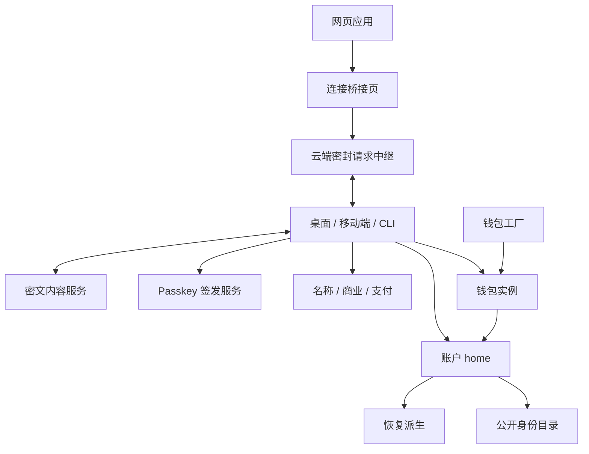

# dMsg 技术架构

[English](dmsg_architecture.md) | 简体中文

本文说明当前公开源码的职责、数据流和扩容边界。审查基线见[文档索引](README_zh.md)；部署状态与容量测量须另查对应记录。精确接口以 Candid、公开类型和[协议合同](protocol/README_zh.md)为准。

## 1. 设计原则

- **客户端加密，云端保存密文。** 内容根、对象钥匙与文件钥匙由授权设备生成和使用。
- **控制权与资金终态上链。** ICP 保存账户、设备、名称、根承诺、认证回执、商业权益和托管资金状态。
- **普通内容操作不逐条写链。** 消息、文件、保险库编辑和频道控制不逐条调用 ICP update、vetKD 或阈值签名；认证安全快照通过 query 按需读取。
- **账户按 home 分区。** 新增 user home 不改变已有账户的路由；需要全局唯一性的名称与神经元占用分别由注册表管理。

## 2. 信任域

| 组件 | 职责 | 信任边界 |
| --- | --- | --- |
| 桌面、CLI、MCP | 共用 Rust daemon，负责密钥、工作区、同步和审批 | 解锁后的进程与操作系统可接触明文 |
| iOS、Android | 经 UniFFI 直接调用 `dmsg_mobile` / `dmsg_client`，系统能力由原生宿主提供 | 不运行桌面 daemon；硬件保护取决于平台能力 |
| connect.dmsg.net | 转述网页请求，保存配对与结果解封密钥 | 不持有账户密钥、不批准请求；转述的 origin 不是密码学证明 |
| 私有云端 | 密文存储与投递、频道、收件箱、资源配额、通知与连接中继 | 可见业务元数据，可拒绝服务或隐藏更新；不能据此授予账户控制权 |
| ICP canisters | 账户和设备权威、认证证明、资金与权益 | 依赖 ICP 证书、部署配置及 controller / governance 的升级权限 |

加密不隐藏账户、设备、尺寸、时序及服务执行所需的关系信息。签名与本地版本检查能发现部分篡改和回滚，不能证明中继给出了全部最新历史。治理能升级控制服务；`unlock_secret` 的服务端主密钥也属于这一信任域。详见[加密说明](dmsg_encryption_zh.md)。

## 3. 组件

| 服务 | 权威数据与职责 | 实例关系 |
| --- | --- | --- |
| [dmsg_auth](../src/dmsg_auth/README.md) | Passkey 身份、硬件登录会话、12 小时 IC delegation | 固定 issuer；每身份最多 16 个会话 |
| [dmsg_user](../src/dmsg_user/README.md) | 认证绑定、设备、根承诺、恢复、正式回执与执行月账 | 每部署 1–64 个 home |
| [dmsg_cose](../src/dmsg_cose/README.md) | 内容根 vetKD 公钥与恢复派生 | 一个实例可服务多个 home；不签普通文档 |
| [dmsg_handle](../src/dmsg_handle/README.md) | 名称、旧名认领、收费、转移、home 列表 | 部署内共享注册表 |
| [dmsg_directory](../src/dmsg_directory/README.md) | 认证发布 PrincipalDocument | 固定 principal origin 对应的目录 |
| [dmsg_payment](../src/dmsg_payment/README.md) | 付费来信托管、入金、结算与退款 | 每个 home 绑定一个实例 |
| [dmsg_commerce](../src/dmsg_commerce/README.md) | 应用/产品、结账、订阅、赠予及资源权益 | 每个 home 属于一个实例 |
| [membership](../src/membership/README.md) | PANDA SNS 资格、神经元跨产品占用与授益决定 | 每个 SNS 共享一个登记服务 |
| [dmsg_wallet_hub](../src/dmsg_wallet_hub/README.md) | 钱包激活、版本、升级与成员索引 | 工厂管理独立钱包实例 |
| [dmsg_wallet](../src/dmsg_wallet/README.md) | 成员、策略、提案、资金、链密钥签名与审计 | 每个钱包一个 canister |

共享库：`dmsg_types` 定义数据，`dmsg_protocol` 负责编码与验证，`dmsg_runtime` 提供稳定存储、认证树和调用工具。源码和接口入口见 [canister 索引](dmsg_canisters_zh.md)。

## 4. 主要流程

### 4.1 注册与定位账户

客户端从 `dmsg_handle.get_handle_config()` 取得权威 `user_homes` 和可注册子集 `registration_homes`。登录时并行查询全部 home 的 `my_account`，全部成功后选择列表中首个命中；任一失败均视为未知，不转去注册。新账户随机选择一个可注册 home，配置要求时先取得绑定 home 与登录 Principal 的准入票据。

账户的 `home_user`、`home_cose` 固定。客户端从所在 home 的 `user_config` 读取 commerce、membership、payment 等服务地址；不再依赖旧网页配置中的单实例地址。

### 4.2 设备、内容根与恢复

账户变更需要登录身份与设备批准，绑定版本、序号、用途和期限。内容根由客户端随机生成，按认证设备表 HPKE 封装给持有 `VaultUnlock` 的活跃设备，再上传并提交链上承诺。新账户默认关闭链上恢复；主动开启后才添加 vetKD IBE 恢复信封。

设备接收者或恢复开关变化后需要换根。已开启恢复且全部设备丢失时，绑定登录可申请恢复，等待默认 3 天（可设 1–7 天），旧设备可争议取消；完成后新设备派生当前代恢复钥匙、解开根并换根。详见[账户与根](protocol/account_root_zh.md)。

### 4.3 正式认证

设备先签署 COSE 声明，再提交 `attest` / `attest_app_action`。user home 核验设备批准、签名与额度，保存产物和认证回执；必要时先刷新商业租约或核验应用动作。外部等待后重新检查时间与状态。

公钥验签只证明该钥匙签过这些字节；认证回执才绑定账户授权。服务端结果有保留期限，客户端保存加密产物与回执；导出的 `dmsg-attestation/1` 证据包可独立验证。见[声明协议](protocol/README_zh.md)。

### 4.4 认证读取与内容

`security_snapshot_batch` 每批 1–64 个账户、最多 256 KiB。读取方验证 IC certificate、witness、设备承诺和从证书时间起最多 60 秒的新鲜度。更高已知版本不能回退。

云端保存加密内容；普通文件可经认证 API 获取短期 S3 GET URL 直读密文，客户端仍验证摘要和 AEAD。根、vault、epoch 信封继续认证读取。详见[云端合同](protocol/cloud_zh.md)。

### 4.5 名称、付费来信与会员

- 名称操作消费账户 home 中的精确授权；新注册通过 PANDA 账本收费，旧名按冻结权属认领。
- 付费来信由 `dmsg_payment` 托管资金，云端受理收据触发结算；逾期未结算可退款，与会员订单独立。
- `dmsg_commerce` 处理现金结账、Apple / Google Play 事实和授权发放方的固定时长赠予，发布认证权益。
- `membership` 验证 PANDA SNS 资格和神经元占用，再向产品提交决定；资格租约最多一天，普通内容操作不逐条读取 SNS。

详见[商业合同](protocol/commerce_zh.md)。

### 4.6 Agent 身份

账户 home 管理 PrincipalDocument 与 controller 公钥，directory 负责认证发布。controller 私钥在客户端 vault 中，Delegation 事件本机签名，普通 grant/revoke 不上链。Agent Profile 与 Mail 等服务使用各自协议身份。见 [Agent 合同](protocol/agent_zh.md)。

### 4.7 多签钱包

hub 核验创建批准与付款，创建独立实例。钱包按成员批准和策略执行：ICP/ICRC 直接转账，BTC/EVM/SOL 签名计划由客户端复核、广播并回报。升级与锁定先经钱包管理提案接受。桌面当前暂停新建，已有钱包继续使用。见[钱包范围](dMsg_wallet_zh.md)与[合同](protocol/wallet_zh.md)。

### 4.8 凭据使用与本机数据

本地策略约束 Agent 的凭据使用；进程交付、SSH、文件挂载和快照分享各有明确批准范围。结果不确定时不自动重发外部动作。CLI、桌面和 MCP 不共享无条件明文取密权限。见 [Secrets](protocol/secrets_zh.md)。

`.dmsgvault` 是普通保险库内容的独立口令加密备份，可导入已解锁的工作区；它不备份账户控制权或设备身份。见[备份格式](protocol/vault_backup.md)。

### 4.9 登录续期

客户端支持 II 与 Passkey。生产配置已包含 `dmsg_auth`；Passkey 是否可用还取决于平台硬件、origin 与部署配置。Passkey 登录会话按需续期，每份 delegation 有效 12 小时；锁定不等于退出登录。撤销会话不使已签发 delegation 立即失效。见 [Passkey](protocol/passkey-v1_zh.md)。

## 5. 链上负载

| 操作 | ICP 工作 |
| --- | --- |
| 消息、文件、vault、频道控制 | 按需 query 安全证据，无逐条业务 update |
| 登录解锁 | 查询 `unlock_secret`；必要时先续期登录 |
| 账户、设备、根策略、公开资料 | 低频 update；资料另发布到 directory |
| 正式认证 | user home update；必要时刷新额度或核验应用动作 |
| 全设备丢失恢复 | 恢复设备经 user → COSE 执行 vetKD |
| 名称、来信、会员、钱包 | 各自批准、账本、资格或链密钥调用 |

普通内容路径不写链，不等于整个客户端或云端服务从不调用 update。

## 6. 存储与升级

业务记录与认证索引主要放在 stable memory，公开 wire 编码与内部紧凑编码分开。常规升级重新加载配置和认证根；迁移可能另有遍历，例如 handle schema 10 → 11 建 owner 索引、directory 6 → 7 建文档认证树。

当前 user schema 为 18，支持从 14–17 保留数据升级；旧账户保留恢复状态和原有认证叶，新账户或显式恢复策略使用 schema 5 安全叶。钱包 schema 1 → 2 保留成员绑定。稳定布局版本与 wire schema 不是同一编号。

已有账户、根秘密、资金和账务必须保留，不能用重装代替迁移。升级脚本与边界见[canister 文档](dmsg_canisters_zh.md#持久化与升级)。

## 7. 容量

| 服务 | 代码上限 | 测量入口 |
| --- | --- | --- |
| user | 每 home 最多 2,100 万账户；每日新账户最多 10 万 | [账户容量](../src/dmsg_user/README.md#容量与成本) |
| handle | 1,000 万活跃名称 | [名称容量](../src/dmsg_handle/README.md#容量与成本) |
| COSE | 100 万个做过恢复派生的账户，所有 home 合计 | [恢复容量](../src/dmsg_cose/README.md#容量与扩展) |
| payment | 1,000 万累计订单，不归档 | [支付容量](../src/dmsg_payment/README.md#上限) |
| commerce | 受益主体和累计订单各 1,000 万 | [商业服务](../src/dmsg_commerce/README.md) |
| membership | 完整记录 100 万、累计操作 1,000 万 | [资格服务](../src/membership/README.md) |
| directory | 单文档最多 64 KiB，未设总数常量 | [目录](../src/dmsg_directory/README.md) |
| wallet | 成员 64、地址 256、协签人 64 | [钱包](../src/dmsg_wallet/README.md) |

这些是防护上限，不是生产吞吐承诺。历史 PocketIC 样本中，user 测到 100 万账户，handle 测到 1,000 万名称；负载构成、schema、存储和 cycles 原始记录留在组件 README。新增字段与交易类型须重新测量，不把历史单价外推成当前容量保证。

## 8. 多实例与扩容

### 8.1 路由

账户 Xid 是 `时间戳[4] ‖ 分配器指纹[5] ‖ 计数[3]`。指纹来自环境、issuer namespace 与创建 home；各服务的 `user_homes` 只追加、最多 64 项，并拒绝指纹冲突。新 home 不重映射已有账户。

### 8.2 实例策略

user 按账户分区；每个 home 绑定一个 commerce、payment 和 COSE。多个 home 可共用这些实例，也可为新 home 配置另一组。handle 维持名称唯一性，membership 维持神经元跨产品占用，directory 维持固定 principal URL。客户端按 home 读取服务地址；云端也须接受对应证书权威和路由。

### 8.3 新增 home

1. 安装 home，核对环境、命名空间和依赖实例。
2. 在 handle、COSE、directory、payment、commerce 的 home 列表登记它。
3. 更新 commerce 产品的受益权威，以及 membership 的 `commerce_homes`。
4. 配置云端接受的 home、服务映射和证书权威。
5. 验证路由后再加入 `registration_homes`。旧 home 可停止接收新账户，但继续服务已有账户。

具体管理参数和 `validate_*` 入口见各组件 README。

### 8.4 扩容依据

通过 `*_stats`、home 配置、账本限流、stable memory 与 cycles 监控实际负载。先在代码上限内调整额度；需要新增实例时让新 home 使用新实例。同一子网仍共享资源，热点、跨子网与账本吞吐须分别测试。

### 8.5 尚未支持

没有已有账户的 home handoff、跨 home 登录 Principal 全局唯一性或名称分片。payment 的终身订单和 commerce 的永久去重记录仍计入容量。客户端发现多个 home 不等于提供账户迁移。

## 9. 限流与失败处理

账户注册、批准、恢复派生、账本和 SNS 调用各有独立限额；详见服务配置与公开类型。准入票据约束注册成本，不授予内容权限。`canister_inspect_message` 只做提前拒绝，入口仍须完整鉴权。

跨服务等待后重新校验时间、状态和版本。调用结果未知时保存原 ID 与参数对账；资金调用不换时间戳盲重试，内容上传不以传输完成代替业务提交。

## 10. 治理与运维

管理调用受 controller / governance 授权；验证入口帮助审核参数，不证明部署成功。升级前核对支持的 schema，等待在途调用并保留快照；COSE 使用无界等待的跨 canister 派生，升级前须先停止实例。

执行记录清理、未决出金对账、目录刷新、membership 清理和钱包补充 cycles 都有各自维护入口。commerce 有自动归集与派发流程，不能据此假定其他服务的未决任务会自动完成。操作步骤以各 canister README 为准。

## 11. 验证边界

[集成测试](../tests/dmsg_integration/README.md)、[客户端向量](../tests/vectors/client/README.md)、平台验证记录和源码审查覆盖不同范围。模拟账本、PocketIC、软件硬件替身与协议向量不证明真实资金、真机保护、生产容量或线上模块状态。

本次审查以源码和文档检查为主；实际执行的检查在提交说明中列出。历史测试记录保留其日期和适用范围。

## 12. 继续阅读

- [Canisters](dmsg_canisters_zh.md)：接口与升级入口。
- [加密](dmsg_encryption_zh.md)：本地保护、内容密钥和恢复边界。
- [协议索引](protocol/README_zh.md)：签名、云端、设备、商业和 Agent 合同。
- [客户端核心](../src/dmsg_client/README.md)、[移动核心](../src/dmsg_mobile/README.md)：客户端实现与验证。
