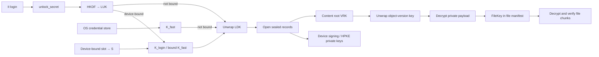

# dMsg encryption design and implementation boundaries

English | [简体中文](dmsg_encryption_zh.md)

> Reviewed 2026-10-25 against public source `fcfcc46d`. This follows actual call paths through the public canister, desktop and cloud contracts; it is not deployment evidence or a complete security audit. Locate internal designs through [AGENTS.md](../AGENTS.md). Only encryption mechanisms explained by public source and necessary cloud interface boundaries are documented here.

## 1. How to read this document

Three states are distinguished: **implemented in the client** means callable local workspace flows; **implemented in service/SDK** means service/library code exists but may not be wired into the client; **awaiting acceptance** means local tests passed but real-environment validation remains.

Key conclusions:

1. Login authentication, device authorization, content decryption and formal attestation are separate. Neither names nor login Principals are content keys.
2. Local content uses a random content root and a random key per immutable version. The account-issued login unlock secret or platform fast-unlock key protects the local data key; macOS uses Secure Enclave, other supported platforms a random credential-store key. Devices with a credential store and supported hardware bind by default on login, requiring local hardware for every unlock; an explicit unbind preserves the compatibility path.
3. Roots are HPKE-wrapped per device and, only with on-chain recovery enabled, vetKD-IBE-wrapped per generation for recovery. Registration, adding devices and rotation make no chain-key service call; recovery after losing all devices performs one vetKD derivation.
4. There is no local unlock password, recovery code or service-independent offline recovery package. File export/sharing is not account recovery. On-chain recovery defaults off; opting in grants final recovery authority to the login identity plus an on-chain waiting period; losing that identity and every device makes content unrecoverable.
5. Devices sign formal documents and the user home records certified receipts and charges usage. Agent controller keys remain in the vault and sign locally. Neither path uses threshold signing anymore.
6. An account can turn on hardware approval: account, device and Agent principal control (optionally payments and formal attestations) then also needs a signature from the device's approval key, a P-256 key in the macOS Secure Enclave, which the user home verifies. Login recovery is not blocked by it and retires every approval key when it completes.

## 2. Trust boundaries and data location

| Component | Responsibilities | Encryption and authority boundary |
| ------------------------------------ | ----------------------------------------------------------- | ------------------------------------------------------------------------------------------ |
| Daemon (`dmsg daemon`) | Login, unlock, encryption/decryption, root wrapping, approval/execution and sync | Holds unlocked keys in memory; CLI/desktop obtain display plaintext through loopback and owner credentials. Binary/runtime are trusted endpoints |
| Workspace (SQLite) | Key envelopes, encrypted objects/chunks, sealed records, sync jobs and runtime metadata | Private payload encryption does not hide every index or state |
| OS credential store | Owner credential, fast-unlock key or Secure Enclave handle, device-bound slot, resident Agent ID copies, hint token | Stores what opens the workspace and what resident services need while locked; with `secure_storage = "file"` the owner credential is an owner-readable file and there is no fast unlock, device binding, resident Agent ID or Secure Enclave key |
| Secure Enclave (macOS) | Agreement keys for fast unlock and device binding, approval keys, wallet cosigner keys | Private keys cannot be exported and are used only with `secure_storage = "system"`; every use needs presence (Touch ID or the Mac password; fingerprint-only keys accept only Touch ID) |
| Bridge (connect.dmsg.net) | Relays web requests, keeps local operation index and result-unsealing keys | No account/device keys; requests/results are sealed from the relay |
| `dmsg_user` (account home) | AccountId, bindings, devices, approval keys and hardware policy, root commitments, recovery, receipts and unlock secrets | Stores public keys, commitments and `master_secret`, not plaintext content roots or RootBundle bodies; approval keys only as public keys |
| `dmsg_cose` | Content-root vetKD public key and recovery derivation | Derives the current generation only for the completed-recovery device until rotation, returning transport-encrypted results; not ordinary content decryption |
| `dmsg_handle` / `dmsg_payment` | Name ownership / minimal fund contract | Hold no content keys; name ownership or payment does not grant decryption |
| Public cloud service | Authenticated access, ciphertext storage/delivery, online channel/object control | Client checks identity, authority and integrity; encryption alone does not prove latest or complete history |

On ordinary private-content paths, plaintext and content keys stay on clients. Services see routing, account/device IDs, sizes, timing and the membership, recipient, contact and authorization relationships needed to operate. Formal attestation is separate: the text profile submits text to the canister, while digest profiles submit digests. Formal signing is not confidential computation.

AEAD prevents keyless ciphertext tampering, not refusal to deliver, hidden records or replayed valid copies. Key-holding endpoints, login identities, client updates, and control-service code/governance are separate trust boundaries. MLS, Double Ratchet and complete forward-secrecy/post-compromise recovery guarantees are not provided.

## 3. Identities and key roles

### 3.1 Distinct identifiers

| Identifier | Meaning |
| ------------------------- | -------------------------------------------------------------------------------------- |
| ICP Principal | Authenticated caller; accounts may bind independent login identities |
| On-chain `AccountId` | 12-byte Xid, canonical 20-character text, allocated by `dmsg_user`; bytes 4..9 identify its allocating home |
| Content `subjectId` | Account Xid in content AAD; there is no content before device binding |
| `deviceId` | 32-byte device identifier, a separate field from the device public key |
| Handle | Transferable name, never a key-derivation root |
| `account.issuer` | Account URI under an explicit namespace; formal statement signer identity |

### 3.2 Key inventory

| Key | Source and holder | Use |
| ---------------------- | ------------------------------------------------------------------------------------------------------------------------- | ----------------------------------------------------- |
| `unlock_secret` | User home: `digest("dmsg/unlock-secret/v1", (master_secret, account_id, device_id))`, issued only by login Principal for nonrevoked devices | Derives local unlock key |
| Local unlock key `LUK` | `HKDF(unlock_secret, ["dmsg/local-unlock/2", name])`, daemon memory only | Wraps LDK |
| Fast-unlock key `K_fast` | macOS: `HKDF(ECDH(Secure Enclave key, software peer), ["dmsg/fast-unlock/1", name])`, storing only the SE handle and peer public key; other platforms: random 32 bytes in OS credentials | Second LDK wrap, enabled by default after login unlock |
| Device-bound secret `S` | Default on hardware-capable platforms: a Secure Enclave key-agreement secret; the credential-store slot `<name>:device-bound` holds only the handle and peer public key; `K_login = HKDF(LUK‖S, …)`, `K_fast = HKDF(S, …)` | Replaces the wrap under the LUK alone, so every unlock needs this device's hardware |
| Approval key | Optional, macOS: a Secure Enclave P-256 signing key, at most one registered per device; handle sealed under the LDK, public key registered in the user home | Signs an approval's hardware commitment `dmsg/hardware-approval/v1`; required for the purposes the account's policy names |
| Provisional key | Random 32 bytes before binding, stored in plaintext in workspace | Protects new device keys before content exists |
| `LocalDataKey` / `LDK` | Client-generated random 32 bytes | Seals device private keys, roots, file jobs and operation journals |
| Content root `VRK_g` | Administrator-device-generated random 32 bytes | Wraps each object-version key |
| Object-version key | Random 32 bytes per `write()` | Encrypts vault items, channel-key records and other payloads |
| File-version key | Random 32 bytes per new import | Encrypts chunks of one version; stored in encrypted manifest |
| Device signing seed | Random 32 bytes, LDK-sealed | Ed25519 account approvals, documents, root bundles and cloud commands |
| Device HPKE seed | Random 32 bytes, LDK-sealed | X25519 root envelopes, channel epochs and web requests |
| II session key | Generated each login; presence-protected fast unlock may LDK-seal the restricted login | II delegation session key, usable before unlock |
| Controller key | Random 32 bytes in a vault entry | Local Agent Delegation signing, synced under the root |
| Hosted Agent ID seed | Random 32 bytes in a vault entry whose ID its label determines; a resident Agent ID keeps a copy in the credential store | The Agent ID's Ed25519 signatures; while locked only resident Agent IDs sign |
| Wallet cosigner key | macOS: a Secure Enclave P-256 key; otherwise a software P-256 key sealed under the LDK and declared non-hardware | Team wallet cosigning; see the [wallet contract](protocol/wallet.md) |
| vetKD derived public key | COSE fixed-context public key; client checks name/fingerprint | IBE recovery-envelope encryption |

Local protection chain:



Like legacy `myIV`, `unlock_secret` is a canister-held secret: subnet node operators can read it, controller/SNS upgrades can expose `master_secret`, and API boundary nodes relay it as an ordinary query response in plaintext. These parties also need a device workspace copy for it to be useful; with device binding on, a copy made after binding also needs this Mac's Secure Enclave. `master_secret` has no rotation mechanism. Issuance depends on login Principal, not a device signature, which would let someone with a stolen workspace use its device key to fetch the secret.

## 4. Primitives, encoding and context

Implementation starts in `dmsg_client`'s [crypto.rs](../src/dmsg_client/src/crypto.rs) and [codec.rs](../src/dmsg_client/src/codec.rs); [`tests/vectors/client/`](../tests/vectors/client/README.md) defines the bytes.

| Purpose | Parameters |
| --------------------- | ---------------------------------------------------------------------------------------------- |
| Randomness | OS randomness (`getrandom`); keys/local object IDs default to 32 bytes |
| Symmetric encryption | AES-256-GCM, 96-bit nonce, 128-bit tag; untagged COSE_Encrypt0 |
| Local derivation `D(K,C)` | HKDF-SHA-256, 32 zero-byte salt, info=`CBOR(C)`, 32-byte output |
| HPKE | X25519 / HKDF-SHA-256 / AES-256-GCM Base mode; context is both info and AAD |
| IBE | `ic-vetkeys` BLS12-381 IBE; COSE-derived public key and identity `CBOR([AccountId, generation])` |
| Device signature | Ed25519, with purpose-specific signing structure |
| Approval-key signature | P-256 ECDSA-SHA256 over a 32-byte digest, 64-byte `r‖s`, low S only |
| Digest | SHA-256; Agent events use SHA3-256 |
| Serialization | Canonical CBOR; JSON fields specify hex, unpadded base64url or Xid text |

Let `E(K,P,C)` denote the current `seal()`:

```text
protected = CBOR({1: 3})                          // alg = A256GCM
Enc_structure = CBOR(["Encrypt0", protected, CBOR(C)])
result = base64url(CBOR([
  protected, {5: nonce_12_bytes}, AES-GCM(K, nonce, P, Enc_structure)
]))
```

`open()` checks header structure, algorithm, IV length and authentication tag. Ordinary envelopes use random nonces; file chunks use section 7's deterministic nonce. Business context enters Enc_structure as external AAD. Local `codec::decode` rejects duplicate keys, indefinite lengths, noncanonical encoding, floats and trailing bytes, with limits of 24 levels and 50,000 nodes.

## 5. Local initialization, unlock and storage

### 5.1 Initialization and binding

A new workspace (`dmsg_client::workspace`) generates the device ID, signing/HPKE seeds, LDK and provisional key:

```text
provisional = random32                                    // plaintext in workspace; deleted after binding
wrappedKey  = E(provisional, LDK, ["dmsg/local-key/2", "provisional:" + hex(deviceId)])
device      = E(LDK, CBOR({signing, hpke}), ["dmsg/local-private/1", hex(deviceId), "device"])
name        = "dmsg:" + environment + ":" + account + ":" + deviceId   // after account binding
```

Other records, including current/historical roots, import plans, rotation jobs, account/approval journals and MCP events, are LDK-sealed under `["dmsg/local-private/1", hex(deviceId), record_name]`. Writes before binding are rejected, so the provisional key protects only device keys not yet recognized by an account. First use requires II through dmsg.net ([dmsg-login/1](protocol/login-v1.md)): create a new account at a registration home with its initial device, or have an administrator device approve pairing to an existing account in the approval center (high-risk; with presence hardware the person must confirm, and approving adds the device and rotates the root). The client then queries `unlock_secret(account, device)`, rewraps the same LDK with `LUK` under `["dmsg/local-key/2", name]`, and deletes the provisional key.

Local key cleanup (2026-10-31 addition): account binding, device binding and replacement or removal of an LDK wrapping must complete `wal_checkpoint(TRUNCATE)` after commit before reporting success. `secure_delete` clears old records in current database pages but does not itself erase historical WAL pages. Opening an existing writable workspace and releasing its unlocked keys also perform this cleanup, covering older releases and interruptions after commit. A blocking database reader makes cleanup fail; a committed hardware binding keeps its credential-store slot so a later unlock can retry. Moved copies opened as read-only import sources remain unchanged. This does not erase earlier workspace copies, filesystem snapshots or keys already obtained.

### 5.2 Everyday unlock

- General path: II login with a daemon-generated/held session key independent of unlock → `unlock_secret` → LUK → LDK → sealed records, all in memory; repeat after lock. `login_unlocked_at` records the time.
- Fast path: defaults on after login unlock, remaining off if disabled, and wraps a second LDK copy with `["dmsg/local-key/2", "fast:" + name]`. On macOS, Secure Enclave P-256 agreement recovers `K_fast`. The SE key uses `.userPresence`: Touch ID, or the Mac password when unavailable, is required each time. Its CryptoKit `dataRepresentation` handle opens only on the same SE, without a keychain entry or entitlement. No answer within 60 seconds withdraws the prompt and counts as refusal. When the Secure Enclave reports that it cannot ask now (for example, no usable Touch ID), fast unlock stays on; only a key that can no longer be used turns it off and asks for a login. Other platforms store a random 32-byte K_fast without presence checks; reading it permits unlock. More than 30 days after login unlock, the general path is required. Online fast unlock verifies the certified device table and clears local data if revoked.
- Login retention: with presence-required fast unlock, login unlock seals the target-restricted login key and 30-day delegation chain as `login` under LDK. Lock clears memory only; fast unlock restores it until expiry. Devices without presence checks do not save login. Disabling fast unlock or resetting deletes it.
- Device binding (default with a credential store and supported hardware): keeps the same LDK; a Secure Enclave key-agreement secret `S` from a credential-store slot of its own joins the LUK to derive the login wrapping key, and alone derives the fast-unlock wrapping key. The wrap under the LUK alone is deleted in the same transaction, so login and fast unlock both need this Mac's hardware and the person's presence; the 30-day login limit still applies. Signing out, disabling fast unlock and failures never delete the slot or fall back to the old wrap; only resetting the workspace or unbinding deletes it, and unbinding wraps the LDK under the LUK again. It protects only copies made after binding: earlier copies still open the same LDK with a login. The device signing key kept in memory for background online and resident Agent IDs' credential-store copies are outside it, and turning it on lists them. Exact encoding is in the [account contract](protocol/account_root.md#local-unlock).
- Fingerprint-only (optional): the device-bound slot and approval keys can use `.biometryCurrentSet`, accepting only the fingerprints enrolled at creation and never the Mac password; the client stores the SHA-256 of `evaluatedPolicyDomainState` from then. After the enrolled fingerprints change the key is lost for good (reported as an integrity failure); when Touch ID cannot ask now it is only reported unavailable. Neither case deletes the slot or key or falls back.

Default binding (2026-10-31 addition): joining after registration, pairing or recovery, and logging into an existing account, reuse the current `unlock_secret` query result to bind; there is no extra update or everyday vetKD derivation. The new hardware key must first open with user presence before content keys are released. Cancellation, creation failure and hardware errors do not fall back to login-only unlock. An existing hardware anchor distinguishes temporarily unavailable presence from unsupported hardware. Old unbound fast unlock requires a login to migrate. An explicit unbind persists `bound_declined`; manually binding again clears it. Devices without a credential store or supported hardware keep the compatibility path. Desktop and mobile hosts run confirmation outside the client executor and recheck the account, session and device state before accepting it.

Migration scope: while the old device is available, unlock it and use device approval plus `dmsg-device-transfer/1` to transfer local data securely; the new device has independent device keys and hardware binding. Without the old device, previously enabled login recovery restores content already uploaded to the cloud; a copied hardware-bound workspace cannot recover its unuploaded local files. Default binding first verifies and reuses an existing hardware fast-unlock key when present, preserving its evidence about a moved copy. A newly created key cannot establish the origin of an older hardware anchor.

### 5.3 Plaintext storage boundary

Each account workspace is `<environment>/accounts/<account>/` under home; unbound logins use `logins/<principal>/`, renamed once an account is obtained. `workspace.sqlite` stores sealed records, objects, sync chunks and jobs. Library ciphertext chunks live separately in `blobs/`, with independent reference tracking/collection. Accounts share neither workspace, device keys nor LDK; different logins of one account share its workspace.

| Data | At-rest protection |
| ---------------------------------------------------------------------------- | ------------------------------------------------ |
| Device signing/HPKE seeds, current/historical roots | LDK-sealed |
| Vault titles, tags, item types, bodies, hidden fields and controller private keys | Object-version encryption in `objects` / `chunks` |
| Library folders, names and version manifests including file keys | LDK-sealed; indexed in memory while unlocked |
| Library chunks | Per-version FileKey encryption, stored in `blobs/` by ciphertext SHA-256 |
| Import plans, FileKey, rotation jobs, account/approval journals, web operations, MCP events, the kept login, approval-key handles, software cosigner keys, Agent grants and Agent Mail keys | LDK-sealed in `sealed` |
| Received web requests | Original envelopes encrypted to local device HPKE key; opened after unlock |
| Sync jobs | Ciphertext, signatures and progress only in `jobs` |
| Provisional key before binding; workspace metadata including environment, device ID/public keys, account/time; object envelopes, approval state/deadlines and job indexes | Plaintext |

Hosted Agent ID connector state lives in `agents.sqlite` beside the account workspace and contains no private keys; see [`dmsg_agent`](../src/dmsg_agent/README.md).

### 5.4 Locking

Unlocked keys reside only in daemon memory (`Zeroizing`); a file lock permits one daemon per home. Default idle lock is 15 minutes (`idle_lock_minutes`) and discards login/account-content keys. Explicit background-online mode retains the device signing key to submit already-sealed versions and receive hints, not read content. Resident Agents may separately retain authorized-service keys; Mail watch subscription keys contain no account content root, as described in [Mail events](protocol/mail_events.md). CLI/desktop use loopback and owner credentials; renderers obtain necessary display plaintext through the daemon. This is process isolation: the Secure Enclave keeps only the keys listed in section 2, while the unlocked LDK and content keys stay in daemon memory.

Sources: [workspace.rs](../src/dmsg_client/src/workspace.rs), [store.rs](../src/dmsg_client/src/store.rs), [client.rs](../src/dmsg_client/src/client.rs), [secure.rs](../src/dmsg_client/src/secure.rs), [daemon.rs](../src/dmsg_cli/src/daemon.rs), [enclave.rs](../src/dmsg_cli/src/enclave.rs).

## 6. Object versions, AAD and local messages

Each `write()` creates a random `revision` and fresh `K_v`. Edits/deletions make new versions while preserving old ones; concurrent branches become visible conflicts, and resolving one is another write.

```text
ContentAAD = ["dmsg/content/1", environment, subjectId, generation,
              objectId, revision, deviceId, kind, parent, tombstone]
WrapAAD = ["dmsg/wrap/1", subjectId, objectId, generation, revision,
           "item-version"]

ciphertext  = E(K_v, CBOR(payload), ContentAAD)
keyEnvelope = E(VRK_generation, K_v, WrapAAD)
digest      = hex(SHA256(CBOR([ContentAAD, ciphertext, keyEnvelope])))
```

Reads check the digest, unwrap the version key and decrypt. After rotation, historical roots open older generations; new writes use the current root. Public recomputable digests check consistency but do not establish authorship independently. Cloud channel/message/file rules are in [cloud](protocol/cloud.md) and [channel contract](protocol/channel_migration.md).

## 7. File encryption and integrity

Plaintext chunks are 1 MiB; every new file version has a fresh random FileKey, file ID and version. Whole-file `files.rs` entry points allow 100 MiB. The desktop library imports in chunks with a configurable `files_max_bytes` default of 4 GiB. Cloud backups, sharing and secret snapshot packages still allow 100 MiB; local import limits do not imply equal upload limits.

```text
nonce_i = 0x644d7367 || uint64_be(i)
ChunkAAD_i = ["dmsg/file-chunk/1", fileId, version, i, chunkCount, plaintextLength_i]
chunk_i = E(FileKey, plaintext_i, ChunkAAD_i, nonce_i)
chunkDigest_i = SHA256(decoded COSE_Encrypt0 bytes)
```

Resumption requires matching name/size, verifies persisted plaintext chunk digests and reuses ciphertext. The manifest holds name, MIME, total size, whole-file SHA-256, ordered chunk IDs/ciphertext digests/plaintext sizes and FileKey. The library LDK-seals it locally; explicit backup encrypts it under the account root. Channel/link sharing creates copies with independent keys/identities. Attachment manifests inside ordinary objects use the object-version key. Download verifies chunk ID/order, ciphertext digest, AEAD, individual/total lengths and whole-file plaintext digest.

Library files stay local by default; backup and cloud-copy deletion are explicit. Downloads obtain short-lived S3 GET URLs via authenticated APIs and verify ciphertext/decrypted content; root/vault/epoch envelopes retain authenticated reads. Share-session expiry, revocation and password wrapping are in the [cloud contract](protocol/cloud.md). Revoking a link cannot recall already obtained plaintext or keys.

## 8. Content roots, rotation and recovery

### 8.1 RootBundle v3

Each generation wraps for active `VaultUnlock` devices, plus its vetKD recovery identity only when on-chain recovery is enabled. Legacy v2 bundles remain readable. Exact bytes are in the [account/root contract](protocol/account_root.md):

```text
device_envelope = HPKE.Seal(device.hpke_pub, VRK_g, ["dmsg/device-root/1", environment, account, g, device_id])
recovery_envelope = IBE.Encrypt(dpk, CBOR([AccountId, g]), VRK_g)
previous  = E(VRK_g, VRK_{g-1}, ["dmsg/previous-root/1", account, g, g-1, previous.digest])
commitment = SHA256(HKDF(VRK_g, ["dmsg/root-commitment/1"]))
```

On-chain `ContentRootRef` binds `recipients_digest` (sorted recipient IDs, generation and recovery mode), `body_digest` and `bundle_digest`. `CommitRoot` recomputes the current recipient set and requires the approver to be included. Revoked/non-VaultUnlock devices receive no new root; unapproved devices cannot be inserted. Rotation reserves, wraps, uploads and CAS-commits without chain-key derivation.

### 8.2 Recovery scope

New accounts start with on-chain recovery off; existing accounts retain their policy. Security settings submit one device approval and automatically rotate the root after a mode change, pausing writes until completion. Disabling cancels pending recovery and rejects takeover and derivation. Previously delivered keys and copied content cannot be recalled. Device-approved migration and encrypted cloud backups remain available while recovery is off.

| Situation | Recoverable scope |
| ------------------------------- | --------------------------------------------------------------------------------------------------------- |
| Local data remains and a bound II login is accessible | `unlock_secret` opens local content and device keys; with device binding on, this Mac's Secure Enclave slot is needed too |
| Local data remains with fast unlock enabled | Unlock without login for 30 days; macOS requires Touch ID/password and restores login. Afterwards login is required |
| Device-bound slot lost or invalid (such as a fingerprint-only key after the fingerprints change) | This copy no longer opens and does not fall back to the old wrap; reset the workspace and recover the content as a new device through pairing or recovery |
| New device with an administrator device available | Administrator approves pairing in the approval center (high-risk) and rotates; the new device downloads and opens its envelope. If the account requires hardware approval, the administrator device's approval key is needed too |
| Hardware approval required and a device's approval key lost | That device cannot perform protected operations; it can make a new key and token locally for an administrator device with a key to register; with no usable key left, only previously enabled login recovery remains |
| All devices lost, II retained, recovery enabled beforehand | Request recovery → waiting period (default 3 days, cancellable by any old device) → replace devices/bindings, retire every approval key and turn hardware approval off → one vetKD derivation opens recovery envelope → rotate |
| All authorized devices lost with recovery off | Content is unrecoverable even with the login |
| II and all devices lost | Unrecoverable |
| dMsg service unavailable | No service-independent recovery path |

Only the device registered by `complete_recovery` may derive the current generation. Before rotation, a new approval may derive again, consuming daily execution count; rotation removes that authority. When recovery is enabled, the waiting period mitigates stolen II: no device response during the delay exposes content.

Sources: [root.rs](../src/dmsg_client/src/root.rs), [client account.rs](../src/dmsg_client/src/account.rs), [account.rs](../src/dmsg_user/src/account.rs), [recovery.rs](../src/dmsg_user/src/recovery.rs), [COSE](../src/dmsg_cose/README.md).

## 9. On-chain permissions

`dmsg_user` verifies actual caller login binding, device signature/state/sequence, security epoch, expiry, role and entry-point capability such as `RootManage`, `FormalApprove`, `PaymentOffer` or `WalletApprove`. Cloud `ContentSign` and `VaultUnlock` govern ciphertext writes/reads respectively; root envelopes likewise include only active VaultUnlock devices, enforcing revocation cryptographically for new roots. Changes to devices, bindings, the recovery delay and execution policy, approval keys and the hardware policy advance security_epoch and clear candidate roots, invalidating approvals in flight. Recipient changes, recovery mode changes or login recovery mark the committed root `RekeyRequired`; other bindings/capabilities do not require rotation. On-chain changes do not themselves re-encrypt client history.

Security evidence uses certified values: `SecuritySnapshot` schema 5 includes explicit `recovery_enabled`; legacy accounts without it retain enabled recovery and schema 4. The leaf uses the single raw AccountId path; `devices_root = digest("dmsg/devices/v1", devices)` for the full device map; plus `recovery_delay_ms`, `pending_recovery_digest`, root generation/digests, `vault_write_state` and `principal_updated_at`. Match device records to the commitment before using public keys. Certificate time may lead the local clock by at most 10 seconds, and now must be before certificate time +60 seconds.

Hardware approval is verified only in the user home's device-approval check; exact encoding is in the [account contract](protocol/account_root.md#approval-keys):

```text
key_id = digest("dmsg/hardware-key/v1", public_key)                         // SEC1 compressed point
H      = digest("dmsg/hardware-approval/v1", (approval_message, key_id))     // the device's Ed25519 signs approval_message
Approval.hardware = { key_id, signature = P256(approval_key, H) }
```

- A purpose the account's policy requires needs a valid proof by the currently registered key; a proof that comes along otherwise is verified too. Only account state decides what is required, so once on, old clients (Candid without the `hardware` field) are refused.
- Purposes: `AccountControl` (approval keys, both policies, recovery delay, login bindings), `DeviceControl` (adding and revoking devices, changing capabilities) and `PrincipalControl` (enabling the Agent principal, registering and retiring controllers) are always included once on; `Payment` (cash checkout and PANDA subscription application approvals, `AuthorizeHandle`) and `Attestation` (`attest`, `attest_app_action`, third-party authentication) are optional. Root rotation, recovery disputes, the principal display document, controller renames and compromise marks, team wallet approvals and recovery derivation are not protected.
- Registration needs the new key's proof of possession over `digest("dmsg/approval-key/v1", (home, account, device_id, public_key))`, and one key cannot be registered to two devices. Any active device manages its own key; registering or retiring another device's key needs an administrator. Revoking a device retires its key. Turning the policy on needs a valid proof from the approving device itself.
- Approval keys and the policy live in account state and are returned by `AccountInfo`; they are not in `Device`, `devices_root` or the security leaf, so cloud and `dmsg_directory` security evidence is unchanged. The user home's stable layout is schema 17 (device successions, likewise only in account state), upgraded in place from 14, 15 and 16.

## 10. Device signatures, formal attestation and external requests

The device Ed25519 key signs COSE Sig_structure with kid equal to its RFC 9679 thumbprint, then approves `(statement, origin, signature)` under `dmsg/attest/v1`. User-home `attest` / `attest_app_action` verifies, charges monthly allowance and stores a schema 2 certified receipt. Artifacts are standard tagged COSE_Sign1 and public-only COSE_Key. Without a receipt, a signature proves mathematical validity, not dMsg authorization.

Web requests use [dmsg-connect/1](protocol/connect-v1.md), sections 6.2 and 6.4. The bridge encrypts `COSE_Sign1(ConnectRequest)` with a random cek, HPKE-Base-wrapped for every unrevoked account device with `FormalApprove`:

```text
aad        = ["dmsg/connect-request/v1", account_id, pairing_id, request_id]
ciphertext = AES-256-GCM(cek, nonce, COSE_Sign1(ConnectRequest), aad)
wrapped    = HPKE.Seal(device.hpke_pub, cek, info = aad = ["dmsg/connect-wrap/v1", account_id, pairing_id, request_id, device_id])
sealed     = HPKE-Auth.Seal(skS = responding_device_hpke_private_key, pkR = result_key, ConnectResponse,
                            info = aad = ["dmsg/connect-response/v1", account_id, pairing_id, request_id, version, device_id])
```

Locked devices retain original envelopes, opening and checking pairing grants/page signatures only after unlock before approval. Replies use HPKE Auth to the bridge's per-operation non-exportable result key: relays cannot read them and parties without the responding device HPKE key cannot forge them. Page origin is a pairing-key-signed bridge claim displayed after registration checks, not cryptographic origin proof. MCP Events are likewise relay-sealed to device HPKE keys and signature-checked before LDK storage. Login requests a 30-day target-restricted delegation including ledgers; the session key is discarded, while the restricted key remains in memory and is persisted under LDK only for presence-required fast unlock. Signatures prove device approval of fixed data, not that a human read it.

Where the account requires an approval key (section 9), the person answers once: without holding the client lock, the daemon obtains presence through the approval key (an evaluated Secure Enclave `LAContext`), then assembles the approval, signs Ed25519, and signs `H` with the same answer, so waiting for the person holds no device sequence and no second prompt appears. Formal attestations the account protects likewise ask before signing. Without a registered key on this device, a protected operation is refused locally before submission (`APPROVAL_KEY_REQUIRED`). Once the policy is on, a device without a usable key can make a key locally and sign a `dmsg-approval-key/1` token with its proof of possession; an administrator device with a key checks the device ID and approves the registration. Hardware approval means a stolen device software key and login together cannot immediately perform protected operations, but previously enabled login recovery can still take over after its waiting period, during which any old device can dispute it. It proves that the registered key took part in the approval, not the model of hardware holding it or the person's intent.

## 11. Verification boundaries

| Area | Source and test entry points | Separate evidence still needed |
| --- | --- | --- |
| Login/fast unlock | `workspace`, `client`, `secure`, unit tests and desktop login/lock flows | Real II origin, Touch ID, platform credentials and distribution builds |
| Approval keys/device binding | `dmsg_user` unit tests and PocketIC (enforcement, old Candid, recovery, schema 15 upgrade); `approval_key`, `workspace`, `client` unit tests (software stand-ins); P-256 vectors checked independently in JS | Real Touch ID, Secure Enclave access control and error codes, fingerprint-change detection, the desktop key UI |
| Root bundles/recovery | `root` / `recovery`, PocketIC; desktop request/cancel/complete/rotate flows | Real-user loss-of-all-devices drills and production vetKD configuration/cost |
| Multiple homes | `account::find_account` queries all homes in parallel; any failure means unknown | Production failures/throughput; cross-home Principal uniqueness is intentionally not guaranteed |
| Files/credential use | `library` / `secrets` chunk integrity, independent sharing, approval/revocation tests; the development-signed production macOS FSKit module tested for real | Developer ID-distributed and notarized mount module, Linux FUSE, real external services and already obtained copies |
| Agent Mail | Atomic connector state/encrypted Mail-key persistence and interrupted publication recovery | Production relay and specific MCP host scheduling |

This was documentation/source review; cryptography, PocketIC, desktop and platform suites were not rerun. Existing tests do not mean this review ran them successfully or replace independent auditing.

## 12. Source and verification entry points

Full commands and platform limits are in the [integration guide](../tests/dmsg_integration/README.md), [client README](../src/dmsg_client/README.md) and [credential-use contract](protocol/secrets.md). Historical test counts are not current acceptance criteria.

| Topic | Evidence |
| ------------------------ | ---------------------------------------------------------------------------------------------------------------------------------------------------------------------------------------------------------------------------------------------------------------------- |
| Primitives/encoding | [crypto.rs](../src/dmsg_client/src/crypto.rs), [codec.rs](../src/dmsg_client/src/codec.rs), [client vectors](../tests/vectors/client/README.md) |
| Local keys/content/files/roots | [workspace.rs](../src/dmsg_client/src/workspace.rs), [content.rs](../src/dmsg_client/src/content.rs), [files.rs](../src/dmsg_client/src/files.rs), [library](../src/dmsg_client/src/library), [root.rs](../src/dmsg_client/src/root.rs) |
| Storage/locking | [store.rs](../src/dmsg_client/src/store.rs), [client.rs](../src/dmsg_client/src/client.rs), [daemon.rs](../src/dmsg_cli/src/daemon.rs) |
| Accounts/devices/recovery/root commit | [User types](../src/dmsg_types/src/user.rs), [account.rs](../src/dmsg_user/src/account.rs), [recovery.rs](../src/dmsg_user/src/recovery.rs), [client account.rs](../src/dmsg_client/src/account.rs) |
| Recovery derivation/attestation | [COSE types](../src/dmsg_types/src/cose.rs), [COSE API](../src/dmsg_cose/src/api.rs), [attest.rs](../src/dmsg_client/src/attest.rs), [protocol](protocol/README.md) |
| Web requests | [connect.rs](../src/dmsg_client/src/connect.rs), [dmsg-connect/1](protocol/connect-v1.md) |
| Hardware approval/device binding | [hardware.rs](../src/dmsg_protocol/src/hardware.rs), [approval_key.rs](../src/dmsg_client/src/approval_key.rs), [workspace.rs](../src/dmsg_client/src/workspace.rs), [enclave.rs](../src/dmsg_cli/src/enclave.rs), [Enclave.swift](../src/dmsg_cli/swift/Enclave.swift), [account contract](protocol/account_root.md) |
| Tests | `dmsg_client`'s `*_tests.rs` and `vectors.rs`, `dmsg_user`'s [tests.rs](../src/dmsg_user/src/tests.rs), [hardware.rs](../tests/dmsg_integration/tests/control_plane/hardware.rs), [desktop.rs](../tests/dmsg_integration/tests/desktop.rs), [test-dmsg-hardware-upgrade.sh](../scripts/test-dmsg-hardware-upgrade.sh) |
