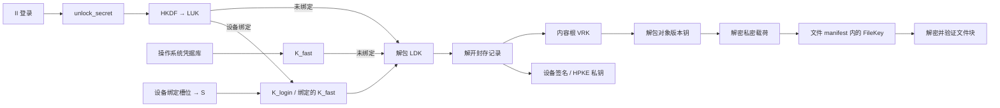

# dMsg 加密设计与实现边界

[English](dmsg_encryption.md) | 简体中文

> 核对日期：2026-10-25，公开源码基线 `fcfcc46d`。本文沿 canisters、桌面客户端和云端的公开合同核对实际调用链，不是生产部署证明或完整安全审计。内部设计文档按 [AGENTS.md](../AGENTS.md) 定位；本文只记录公开源码能够解释的加密机制及必要的云端接口边界。

## 1. 阅读方式

本文区分三种状态：**客户端已实现**指当前工作台可调用的本地流程；**服务/SDK 已实现**指已有服务入口或库代码，未必接入客户端；**待验收**指只在本地测试通过、尚未在真实环境验证的流程。

核心结论：

1. 登录认证、设备授权、内容解密、正式认证分开。名称和登录 Principal 都不是内容密钥。
2. 本地内容采用随机内容根 → 每个不可变版本的随机内容密钥。本机数据密钥由账户服务按登录身份发放的解锁秘密或平台快速解锁密钥保护；macOS 使用 Secure Enclave，其他受支持平台使用凭据库中的随机密钥。macOS 可选设备绑定，此后每次解锁还需本机 Secure Enclave。
3. 内容根按设备用 HPKE 封装、按代次用 vetKD IBE 封装恢复信封；日常注册、新设备、换根都不调用链上密钥服务，只有全设备丢失恢复做一次 vetKD 派生。
4. 没有本地解锁口令、恢复码或服务外离线恢复包；文件导出与分享不等于账户恢复。登录身份加链上等待期是最终恢复权；登录身份和全部设备都丢失则内容不可恢复。
5. 正式文档由设备密钥签名，user home 记录认证回执并计费；Agent controller key 保存在 vault 中并在本机签名。链上阈值签名已退出这两条路径。
6. 账户可开启硬件批准：账户、设备与 Agent 主体的控制操作（可选付款与正式认证）另需设备批准钥匙（macOS Secure Enclave 中的 P-256 钥匙）签名，由 user home 核验。登录恢复不受它阻挡，完成时退役全部批准钥匙。

## 2. 信任边界与数据位置

| 组件                                 | 当前职责                                                    | 加密与权限边界                                                                             |
| ------------------------------------ | ----------------------------------------------------------- | ------------------------------------------------------------------------------------------ |
| daemon（`dmsg daemon`）              | 登录、解锁、加解密、根封装、审批与执行、同步                | 解锁后在内存中持有密钥；CLI 与桌面应用经回环网关和 owner 凭证取得需显示的明文。二进制和运行环境属于可信端点 |
| 工作区（SQLite）                     | 密钥封装、密文对象/文件块、封存记录、同步任务、运行元数据   | 私密载荷加密，不代表所有索引和状态都隐藏                                                   |
| 操作系统凭据库                       | owner 凭证、快速解锁密钥（或其 Secure Enclave 句柄）、设备绑定槽位、常驻 Agent ID 的副本、提示令牌 | 保存打开工作区与锁定时常驻服务所需的秘密；`secure_storage = "file"` 时 owner 凭证改为只有所有者可读的文件，没有快速解锁、设备绑定、常驻 Agent ID 与 Secure Enclave 钥匙 |
| Secure Enclave（macOS）              | 快速解锁与设备绑定的密钥协商钥匙、批准钥匙、钱包协签钥匙    | 私钥不可导出，只在 `secure_storage = "system"` 时使用；每次使用要求在场（Touch ID 或 Mac 登录密码，仅当前指纹的钥匙只认 Touch ID） |
| 桥接页（connect.dmsg.net）           | 网页请求的转述、本地操作索引与结果解封密钥                  | 不持有账户或设备密钥；请求与结果对中继密封                                                 |
| `dmsg_user`（账户所在 home）         | AccountId、认证绑定、设备、批准钥匙与硬件批准政策、根承诺、恢复、认证回执、解锁秘密 | 保存公钥、承诺和一个 `master_secret`，不保存内容根明文或 RootBundle 正文；批准钥匙只存公钥 |
| `dmsg_cose`                          | 内容根 vetKD 公钥与恢复派生                                 | 只为已完成恢复登记的设备派生当前代根（直到它换根），返回传输加密结果；不是普通内容解密服务 |
| `dmsg_handle` / `dmsg_payment`       | 名称权属 / 最小资金合同                                     | 不持有内容密钥；名称权属、支付成功不自动授予内容解密权                                     |
| cloud 对外服务                       | 认证访问、密文保存/投递、频道与对象的在线控制               | 客户端须核验身份、权限和内容完整性；加密本身不证明服务返回的是最新、完整历史               |

正常私密内容路径中，明文和内容密钥留在客户端；服务可见路由、账户/设备标识、尺寸、时序，以及执行所需的成员、接收者、联系和授权关系。正式认证是另一条路径：文本 profile 的待签正文会提交给 canister，摘要 profile 提交摘要，不能把正式签署当作秘密计算。

AEAD 防止密文被无钥篡改，不能防止服务拒绝投递、隐藏记录或提供旧的合法副本。持钥终端、登录身份、客户端更新，以及控制服务的代码和治理，都属于不同的信任边界。当前不提供 MLS、Double Ratchet 或完整前向保密/失陷后自动恢复保证。

## 3. 身份与密钥角色

### 3.1 不混用的标识

| 标识                      | 当前含义                                                                               |
| ------------------------- | -------------------------------------------------------------------------------------- |
| ICP Principal             | 认证调用者；账户可有独立认证绑定                                                       |
| 链上 `AccountId`          | 12 字节 Xid，文本为规范 20 字符；由 `dmsg_user` 发号，字节 4..9 是分配它的 home 的指纹 |
| 内容主体 `subjectId`      | 内容 AAD 中的主体，即账户 Xid；设备绑定账户前没有内容                                  |
| `deviceId`                | 32 字节设备标识，与设备公钥不是同一字段                                                |
| handle                    | 可转移的名称；不作为任何密钥的派生根                                                   |
| `account.issuer`          | 明确命名空间下的账户 URI；正式声明的签署者标识                                         |

### 3.2 密钥清单

| 密钥                   | 来源与持有者                                                                                                              | 用途                                                  |
| ---------------------- | ------------------------------------------------------------------------------------------------------------------------- | ----------------------------------------------------- |
| `unlock_secret`        | user home：`digest("dmsg/unlock-secret/v1", (master_secret, account_id, device_id))`，只按登录 Principal 对未撤销设备发放 | 派生本机解锁钥                                        |
| 本地解锁钥 `LUK`       | `HKDF(unlock_secret, ["dmsg/local-unlock/2", name])`；只在 daemon 内存                                                    | 包装 LDK                                              |
| 快速解锁钥 `K_fast`    | macOS：`HKDF(ECDH(Secure Enclave 密钥, 软件对端), ["dmsg/fast-unlock/1", name])`，凭据库只存 SE 句柄与对端公钥；其他平台：随机 32 字节，存于操作系统凭据库 | 包装 LDK 的第二份封装（登录解锁后默认开启） |
| 设备绑定秘密 `S`       | 可选，macOS：Secure Enclave 密钥协商秘密，凭据库独立槽位 `<name>:device-bound` 只存句柄与对端公钥；`K_login = HKDF(LUK‖S, …)`、`K_fast = HKDF(S, …)` | 开启后替换只靠 LUK 的封装，每次解锁都需本机硬件       |
| 批准钥匙               | 可选，macOS：Secure Enclave P-256 签名钥匙，每台设备至多登记一把；句柄由 LDK 封存，公钥登记在 user home                    | 签署批准的硬件承诺 `dmsg/hardware-approval/v1`，账户政策要求的用途必须带 |
| 临时键                 | 绑定账户前的随机 32 字节，明文保存在工作区                                                                                | 保护尚无内容的新设备密钥                              |
| `LocalDataKey` / `LDK` | 客户端随机 32 字节                                                                                                        | 加密设备私钥、根、文件任务、操作日志等封存记录        |
| 内容根 `VRK_g`         | 管理员设备随机 32 字节                                                                                                    | 包装每个对象版本的内容密钥                            |
| 对象版本钥             | 每次 `write()` 随机 32 字节                                                                                               | 加密保险库条目、频道密钥记录等载荷                     |
| 文件版本钥             | 每次新文件导入随机 32 字节                                                                                                | 同一文件版本的分块加密，放在加密 manifest 中          |
| 设备签名种子           | 随机 32 字节，LDK 封存                                                                                                    | Ed25519：账户批准、正式文档签名、根包签名、云端命令   |
| 设备 HPKE 种子         | 随机 32 字节，LDK 封存                                                                                                   | X25519：接收根信封、频道 epoch 密钥、网页请求         |
| II 会话钥              | daemon 每次登录生成；受在场验证保护的快速解锁可在 LDK 下封存限定登录 | Internet Identity delegation 的会话密钥，解锁前即可用 |
| controller key         | vault 条目中的随机 32 字节                                                                                                | Agent Delegation 事件签名，随根同步                   |
| 托管 Agent ID 种子     | vault 条目中的随机 32 字节，条目 ID 由标签决定；常驻 Agent ID 另在凭据库保留副本                                          | Agent ID 的 Ed25519 签名；锁定时只有常驻 Agent ID 能签 |
| 钱包协签钥匙           | macOS：Secure Enclave P-256 钥匙；没有时为 LDK 封存的软件 P-256 钥匙，声明为非硬件                                        | 团队钱包协签，见[钱包合同](protocol/wallet_zh.md)     |
| vetKD 派生公钥         | COSE 固定 context 的公钥，客户端核对 key 名与指纹                                                                                 | IBE 加密恢复信封                                      |

本地保护链：



`unlock_secret` 与旧版 `myIV` 一样是 canister 持有的秘密：子网节点运营者能读到它，controller 与 SNS 可以通过升级读出 `master_secret`，它作为普通 query 响应经 API 边界节点明文中转；这些方还需要设备的工作区副本才有用，开启设备绑定后，绑定之后复制的副本还需要这台 Mac 的 Secure Enclave。`master_secret` 没有轮换机制。它只按登录 Principal 发放，不按设备签名发放，否则偷到工作区的人用里面的设备 key 就能自己去取。

## 4. 原语、编码与上下文

实现入口为 `dmsg_client` 的 [crypto.rs](../src/dmsg_client/src/crypto.rs) 和 [codec.rs](../src/dmsg_client/src/codec.rs)，字节规则以 [`tests/vectors/client/`](../tests/vectors/client/README.md) 为准。

| 用途                  | 实际参数                                                                                       |
| --------------------- | ---------------------------------------------------------------------------------------------- |
| 随机数                | 操作系统随机源（`getrandom`）；密钥/本地对象 ID 默认 32 字节                                   |
| 对称加密              | AES-256-GCM，96 bit nonce，128 bit 认证标签；不带 CBOR tag 的 COSE_Encrypt0                    |
| 通用本地派生 `D(K,C)` | HKDF-SHA-256，salt 为 32 个零字节，info=`CBOR(C)`，输出 32 字节                                |
| HPKE                  | X25519 / HKDF-SHA-256 / AES-256-GCM，Base mode；context 同时作为 info 和 AAD                   |
| IBE                   | `ic-vetkeys` BLS12-381 IBE；   公钥为 COSE 派生公钥，身份为 `CBOR([AccountId, generation])` |
| 设备签名              | Ed25519；具体待签结构由用途决定                                                                |
| 批准钥匙签名          | P-256 ECDSA-SHA256，对 32 字节摘要签名，64 字节 `r‖s`，只接受低 s                              |
| 摘要                  | SHA-256；Agent 事件为 SHA3-256                                                                 |
| 序列化                | 规范 CBOR；JSON 边界采用各字段规定的 hex、无填充 base64url 或 Xid 文本                         |

令 `E(K,P,C)` 表示当前 `seal()`：

```text
protected = CBOR({1: 3})                          // alg = A256GCM
Enc_structure = CBOR(["Encrypt0", protected, CBOR(C)])
result = base64url(CBOR([
  protected, {5: nonce_12_bytes}, AES-GCM(K, nonce, P, Enc_structure)
]))
```

`open()` 核对头结构、算法、IV 长度和认证标签。普通封装随机生成 nonce；文件块采用第 7 节的确定性 nonce。业务上下文作为 external AAD 进入 Enc_structure。本地内容入口使用 `codec::decode`，拒绝重复键、不定长、非规范编码、浮点及尾随字节，限制 24 层和 50,000 节点。

## 5. 本地初始化、解锁与存储

### 5.1 初始化与绑定

新工作区（`dmsg_client::workspace`）生成设备 ID、设备签名/HPKE 种子、LDK 和临时键：

```text
provisional = random32                                    // 明文保存在工作区，绑定后删除
wrappedKey  = E(provisional, LDK, ["dmsg/local-key/2", "provisional:" + hex(deviceId)])
device      = E(LDK, CBOR({signing, hpke}), ["dmsg/local-private/1", hex(deviceId), "device"])
name        = "dmsg:" + environment + ":" + account + ":" + deviceId   // 绑定账户后
```

其他封存记录（根与历史根、文件导入计划、换根任务、账户与审批日志、MCP 事件等）同样以 `["dmsg/local-private/1", hex(deviceId), 记录名]` 封存在 LDK 下。绑定前写入被拒绝，因此临时键只保护尚未被任何账户承认的设备密钥。首次使用必须经 dmsg.net 登录页登录 Internet Identity（[dmsg-login/1](protocol/login-v1_zh.md)）：新账户在注册 home 创建（初始设备随之登记），已有账户则由管理员设备在审批中心批准配对请求（高风险；有在场硬件时须在场确认，批准即登记设备并换根）。之后客户端查询 `unlock_secret(account, device)`，用 `LUK` 以 `["dmsg/local-key/2", name]` 重封同一把 LDK 并删除临时键。

本地密钥清理（2026-10-31 增补）：账户绑定、设备绑定以及 LDK 封装的替换或删除，提交后必须成功执行 `wal_checkpoint(TRUNCATE)` 才返回成功。`secure_delete` 只清除当前数据库页中的旧记录，不能单独清除 WAL 的历史页。打开已有可写工作区及释放其解锁密钥前也会执行清理，覆盖旧版本和提交后中断的情况；清理被其他数据库读取者阻挡时返回失败，已提交的硬件绑定保留其凭据槽位，稍后解锁重试。迁入副本作为只读导入源时保持原样。此过程不保证擦除此前复制的工作区、文件系统快照或已经取得的密钥。

### 5.2 日常解锁

- 通用路径：II 登录（会话私钥由 daemon 生成并持有，不依赖解锁）→ `unlock_secret` → LUK → LDK → 封存记录，全部只在内存；锁定后重复。`login_unlocked_at` 记录时间。
- 快速路径：登录解锁后默认开启（人关闭后保持关闭），以 `["dmsg/local-key/2", "fast:" + name]` 封装 LDK 的第二份副本。macOS 上 `K_fast` 由 Secure Enclave 的 P-256 密钥协商恢复：SE 密钥带 `.userPresence` 访问控制，每次解锁先要 Touch ID（无 Touch ID 时为 Mac 登录密码），句柄是 CryptoKit 的 `dataRepresentation`，只有本机 SE 能打开，不需要钥匙串条目或 entitlement；无人应答 60 秒后撤回并视为拒绝。Secure Enclave 报告暂时不能询问（如没有可用的 Touch ID）时保留快速解锁，只有钥匙确定无法使用时才关闭并要求登录。其他平台的 `K_fast` 是存于凭据库的随机 32 字节，没有用户在场验证，凭据库中的密钥被读出即可解锁。距上次登录解锁超过 30 天时拒绝，必须走通用路径；快速解锁后一旦联网就核对认证设备表，本机已撤销则清空数据。
- 设备绑定（可选，macOS）：保留同一 LDK，另用凭据库独立槽位中的 Secure Enclave 密钥协商秘密 `S` 与 LUK 共同派生登录封装钥，`S` 单独派生快速解锁封装钥，并在同一事务中删除只靠 LUK 的封装；此后登录解锁与快速解锁都需要本机硬件和在场确认，30 天登录期限照旧。退出登录、关闭快速解锁或任何错误都不删除槽位，也不回退旧封装，只有重置工作区或解除绑定才删除；解除绑定重新以 LUK 封装 LDK。它只防开启之后复制的工作区：之前的副本仍可凭登录打开同一个 LDK；后台在线时内存中的设备签名钥匙与常驻 Agent ID 的凭据库副本不受其保护，开启时如实列出。精确编码见[账户合同](protocol/account_root_zh.md#本机解锁)。
- 仅当前指纹（可选）：设备绑定槽位与批准钥匙可改用 `.biometryCurrentSet`，只认创建时录入的指纹，不接受 Mac 登录密码；客户端保存当时 `evaluatedPolicyDomainState` 的 SHA-256。指纹集合变化后钥匙永久失效（报告完整性失败），Touch ID 暂时不能询问时只报告不可用；两种情况都不删除槽位或钥匙，也不回退。
- 登录保留：需要人在场的快速解锁开启时，登录解锁后把限定 targets 的登录钥匙与 delegation 链（30 天）用 LDK 封存为 `login` 记录；锁定只清内存，之后的快速解锁从中恢复登录直到过期。没有人在场验证的设备不保存登录；关闭快速解锁或重置工作区时删除。

### 5.3 存储的明文边界

每个账户的工作区位于 home 下的 `<environment>/accounts/<account>/`（没有账户的登录为 `logins/<principal>/`，有了账户后整个目录改名）。`workspace.sqlite` 保存封存记录、对象、同步块与任务；本地文件库的密文块单独保存在 `blobs/`，由库自己的引用和回收流程管理。账户之间不共用工作区、设备密钥或 LDK；同一账户的不同登录共用该账户的工作区。

| 数据                                                                         | 落盘保护                                         |
| ---------------------------------------------------------------------------- | ------------------------------------------------ |
| 设备签名/HPKE 种子、内容根与历史根                                           | LDK 封存                                         |
| 保险库标题、标签、条目类型、正文、隐藏字段、controller 私钥 | 对象版本钥加密（`objects`、`chunks` 表） |
| 文件库目录、名称、版本 manifest（含文件 key） | LDK 封存；解锁时建立内存索引 |
| 文件库块 | 每个文件版本的 FileKey 加密，按密文 SHA-256 存在 `blobs/` |
| 文件导入计划、FileKey、换根任务、账户与审批日志、网页操作、MCP 事件、保留的登录、批准钥匙句柄、软件协签钥匙、Agent 授权与 Agent Mail 密钥 | LDK 封存（`sealed` 表）                          |
| 收到的网页请求                                                               | 原样保存密封信封（加密给本机设备 HPKE 公钥），解锁后解封 |
| 同步任务                                                                     | 只含密文、签名与进度（`jobs` 表）                |
| 临时键（绑定前）、工作区元数据（环境、设备 ID 与公钥、账户、时间）、对象外层、审批状态与期限、任务索引 | 明文                                             |

托管的 Agent ID 的连接器状态在账户工作区目录的 `agents.sqlite`，不含私钥（见 [`dmsg_agent`](../src/dmsg_agent/README.md)）。

### 5.4 锁定

解锁后的密钥只在 daemon 内存中（`Zeroizing`），每个 home 只运行一个 daemon（文件锁）。默认 15 分钟无操作锁定（`idle_lock_minutes`）；锁定丢弃登录与账户内容密钥。显式开启“后台在线”时保留设备签名私钥，用于提交已封存的版本与收取提示，不能读取账户内容。常驻 Agent 可另保留其已授权服务所需的独立密钥；Mail watch 的订阅专用密钥不包含账户内容根，见 [Mail 事件合同](protocol/mail_events_zh.md)。CLI 与桌面应用经回环网关和 owner 凭证访问 daemon；桌面渲染进程只经 daemon 取得需显示的明文。这是进程隔离：Secure Enclave 只保管第 2 节所列钥匙，解锁后的 LDK 与内容密钥仍在 daemon 内存中。

依据：[workspace.rs](../src/dmsg_client/src/workspace.rs)、[store.rs](../src/dmsg_client/src/store.rs)、[client.rs](../src/dmsg_client/src/client.rs)、[secure.rs](../src/dmsg_client/src/secure.rs)、[daemon.rs](../src/dmsg_cli/src/daemon.rs)、[enclave.rs](../src/dmsg_cli/src/enclave.rs)。

## 6. 对象版本、AAD 与本地消息

每次 `write()` 创建随机 `revision` 和新对象版本钥 `K_v`。编辑/删除生成新版本，旧版本保留；并发分支成为可见冲突，解决冲突也是一次新写入。

```text
ContentAAD = ["dmsg/content/1", environment, subjectId, generation,
              objectId, revision, deviceId, kind, parent, tombstone]
WrapAAD = ["dmsg/wrap/1", subjectId, objectId, generation, revision,
           "item-version"]

ciphertext  = E(K_v, CBOR(payload), ContentAAD)
keyEnvelope = E(VRK_generation, K_v, WrapAAD)
digest      = hex(SHA256(CBOR([ContentAAD, ciphertext, keyEnvelope])))
```

读取先核对摘要，再解包版本钥和解密内容。换根后旧代对象用历史根索引中的旧根打开，新写入使用当前根。公开可重算的摘要用于一致性检查，不能独立证明作者身份。频道、消息和文件的云端协议见 [cloud_zh.md](protocol/cloud_zh.md) 与 [channel_migration_zh.md](protocol/channel_migration_zh.md)。

## 7. 文件加密与完整性

明文每块 1 MiB，每个新文件版本生成独立随机 FileKey、file ID 和 version。`files.rs` 的整文件入口上限为 100 MiB；桌面文件库使用分块导入，默认上限由 `files_max_bytes` 配置为 4 GiB。当前云端备份、分享和秘密快照包仍限 100 MiB；本地导入上限不表示同等大小可以上传。

```text
nonce_i = 0x644d7367 || uint64_be(i)
ChunkAAD_i = ["dmsg/file-chunk/1", fileId, version, i, chunkCount, plaintextLength_i]
chunk_i = E(FileKey, plaintext_i, ChunkAAD_i, nonce_i)
chunkDigest_i = SHA256(解码后的 COSE_Encrypt0 字节)
```

断点恢复要求文件名和大小一致，逐块核对已持久化部分的明文摘要并复用保存的密文。manifest 包含文件名、MIME、总长度、全文件 SHA-256、按序排列的块 ID/密文摘要/明文长度以及 FileKey。文件库在本机用 LDK 封存 manifest，显式备份将其加密给账户根；频道和外链分享创建使用独立 key/身份的加密副本。普通内容对象内的附件 manifest 则随对象版本钥加密。下载依次校验块 ID/顺序、密文摘要、AEAD、单块长度、总长度和全文件明文摘要。

文件库默认只保存在本机，备份与删除云端副本均需显式操作。下载先通过认证 API 领取短期 S3 GET URL，再校验密文与解密结果；根/vault/epoch 信封保持认证读取。分享会话的期限、撤销和密码封装见[云端合同](protocol/cloud_zh.md)。已经接收的明文或密钥不能靠撤销链接收回。

## 8. 内容根、换根与恢复

### 8.1 RootBundle v2

每代根包封装给持有 `VaultUnlock` 的活跃设备和该代的 vetKD 恢复身份；精确字节见[账户与根合同](protocol/account_root_zh.md)：

```text
设备信封  = HPKE.Seal(device.hpke_pub, VRK_g, ["dmsg/device-root/1", environment, account, g, device_id])
恢复信封  = IBE.Encrypt(dpk, CBOR([AccountId, g]), VRK_g)
previous  = E(VRK_g, VRK_{g-1}, ["dmsg/previous-root/1", account, g, g-1, previous.digest])
commitment = SHA256(HKDF(VRK_g, ["dmsg/root-commitment/1"]))
```

链上 `ContentRootRef` 绑定 `recipients_digest`（接收者 ID 升序 + 代次）、`body_digest` 与 `bundle_digest`；`CommitRoot` 用当前接收者集合重算，并要求批准设备本身是接收者，已撤销或没有 `VaultUnlock` 的设备收不到新根，未批准设备不能被塞进根包。换根按预留、封装、上传与 CAS 提交执行，不调用链上密钥派生。

### 8.2 恢复范围

| 场景                            | 当前可恢复范围                                                                                            |
| ------------------------------- | --------------------------------------------------------------------------------------------------------- |
| 本机数据仍在，能登录绑定过的 II | `unlock_secret` 解锁本机内容与设备密钥；开启设备绑定时还需本机 Secure Enclave 槽位                        |
| 本机数据仍在，启用了快速解锁    | 30 天内可不登录解锁（macOS 要 Touch ID 或登录密码，并恢复登录）；之后须登录                               |
| 设备绑定槽位丢失或失效（如仅当前指纹的钥匙在指纹变化后） | 本机副本无法再打开，不回退旧封装；重置工作区后以新设备经配对或恢复取回                |
| 新设备，已有管理员设备在手      | 管理员在审批中心批准配对（高风险）并换根，新设备下载根包解开自己的信封；账户要求硬件批准时还需管理员设备的批准钥匙 |
| 账户要求硬件批准，某设备的批准钥匙丢失 | 该设备不能执行受保护操作；可在本机生成新钥匙与令牌，由有钥匙的管理员设备批准登记；没有任何可用钥匙时只能经登录恢复 |
| 所有设备丢失，II 仍在           | 登录申请恢复 → 等待期（默认 3 天，任一旧设备可取消）→ 替换设备与绑定，退役全部批准钥匙并关闭硬件批准 → 一次 vetKD 派生解开恢复信封 → 换根 |
| II 和全部设备都丢失             | 不可恢复                                                                                                  |
| dMsg 服务不可用                 | 没有服务外恢复路径                                                                                        |

恢复派生只允许 `complete_recovery` 登记的设备对当前代次进行；换根前可凭新批准再次派生（计入每日执行次数），换根后权利消失。等待期是对 II 被盗的唯一缓解：延迟期内所有设备都没响应即内容泄露。

依据：[root.rs](../src/dmsg_client/src/root.rs)、[客户端 account.rs](../src/dmsg_client/src/account.rs)、[account.rs](../src/dmsg_user/src/account.rs)、[recovery.rs](../src/dmsg_user/src/recovery.rs)、[COSE](../src/dmsg_cose/README.md)。

## 9. 链上权限

`dmsg_user` 核对实际 caller 的认证绑定，以及设备签名、设备状态、序号、security epoch、期限、角色和入口要求的 capability（如 `RootManage`、`FormalApprove`、`PaymentOffer`、`WalletApprove`）；`ContentSign`、`VaultUnlock` 由云端分别用于放行账户密文的写入与读取，内容根也只封装给持有 `VaultUnlock` 的活跃设备，所以撤销这项能力在密码学上同样生效。设备、认证绑定、恢复延迟与执行政策、批准钥匙和硬件批准政策的变化都会递增 security_epoch、清除候选根，在途的旧批准随之失效；只有根包接收者变化（持有 `VaultUnlock` 的设备增减）和登录恢复会让已提交的根置为 `RekeyRequired`，认证绑定与其他能力的变化不需要换根。链上状态变化本身不会重加密客户端历史。

账户安全证据以认证值为准：`SecuritySnapshot` schema 4，认证叶路径为单段原始 AccountId；`devices_root` 是完整设备 map 的 `digest("dmsg/devices/v1", devices)`；另含 `recovery_delay_ms`、`pending_recovery_digest`、根代次与摘要、`vault_write_state`、`principal_updated_at`。使用设备公钥前须把设备记录与该承诺匹配。证书时间最多领先本机时钟 10 秒，且当前时刻小于证书时间 +60 秒。

硬件批准只在 user home 的设备批准检查中核验，精确编码见[账户合同](protocol/account_root_zh.md#批准钥匙)：

```text
key_id = digest("dmsg/hardware-key/v1", public_key)                         // SEC1 压缩点
H      = digest("dmsg/hardware-approval/v1", (approval_message, key_id))     // 设备 Ed25519 签的是 approval_message
Approval.hardware = { key_id, signature = P256(approval_key, H) }
```

- 账户政策要求的用途必须带当前登记钥匙的有效证明；未要求时附带的证明同样核验。是否要求只看账户状态，开启后旧客户端（Candid 没有 `hardware` 字段）被拒绝。
- 用途：`AccountControl`（批准钥匙、两种政策、恢复延迟、登录绑定）、`DeviceControl`（添加、撤销设备与修改能力）、`PrincipalControl`（启用 Agent 主体、登记与退役 controller）开启即必含；`Payment`（现金结账与 PANDA 订阅的应用批准、`AuthorizeHandle`）与 `Attestation`（`attest`、`attest_app_action`、第三方认证）可选。换根、争议恢复、principal 展示文档、controller 改名与标记失陷、团队钱包批准和恢复派生不受保护。
- 登记时新钥匙要对 `digest("dmsg/approval-key/v1", (home, account, device_id, public_key))` 签持有证明，同一钥匙不能登记给两台设备。任何有效设备可管理自己的钥匙，为其他设备登记或退役需要管理员；撤销设备时其钥匙一并退役。开启政策需要批准设备自己的有效证明。
- 批准钥匙与政策保存在账户状态，经 `AccountInfo` 返回，不进入 `Device`、`devices_root` 或安全叶，云端与 `dmsg_directory` 的安全证据不变。user home 稳定布局为 schema 17（继任表同样只在账户状态中），从 14、15、16 原地升级。

## 10. 设备签名、正式认证与外部请求

正式文档由设备 Ed25519 密钥签 COSE Sig_structure（kid = 设备公钥的 RFC 9679 指纹），再由设备批准 `dmsg/attest/v1` 的 `(statement, origin, signature)`，user home 的 `attest` / `attest_app_action` 验签、扣减当月额度、写入 schema 2 认证回执。签名产物是标准 tagged COSE_Sign1 和 public-only COSE_Key。没有回执的签名只证明数学有效，不证明 dMsg 授权。

网页请求经 [dmsg-connect/1](protocol/connect-v1_zh.md)（§6.2、§6.4）。桥接页把 `COSE_Sign1(ConnectRequest)` 用随机 cek 加密，cek 以 HPKE Base 模式封装给账户中每台持有 `FormalApprove` 的未撤销设备：

```text
aad        = ["dmsg/connect-request/v1", account_id, pairing_id, request_id]
ciphertext = AES-256-GCM(cek, nonce, COSE_Sign1(ConnectRequest), aad)
wrapped    = HPKE.Seal(device.hpke_pub, cek, info = aad = ["dmsg/connect-wrap/v1", account_id, pairing_id, request_id, device_id])
sealed     = HPKE-Auth.Seal(skS = 应答设备的 HPKE 私钥, pkR = result_key, ConnectResponse,
                            info = aad = ["dmsg/connect-response/v1", account_id, pairing_id, request_id, version, device_id])
```

锁定的设备只取回并原样保存信封，解锁后才解封、核对配对 grant 与页面签名，再进入审批中心。回复以 Auth 模式密封给桥接页为每个操作生成的不可导出结果密钥：中继读不到，不持有应答设备 HPKE 私钥的一方也伪造不了。页面 origin 是桥接页用配对密钥签名的陈述，设备核对应用登记后显示，不是密码学证明。MCP Events 的投递同样由中继密封给设备的 HPKE 公钥，设备核对签名后在 LDK 下封存。登录 delegation 限制目标 canisters（含 ledger）、申请 30 天；会话私钥用后即弃，限定后的登录钥匙在内存中，只在快速解锁需要人在场时以 LDK 封存落盘。签名只能证明某设备批准了确定数据，不能密码学证明真人阅读了内容。

账户要求批准钥匙时（第 9 节），人只回答一次：daemon 在不持客户端锁时经批准钥匙取得在场授权（Secure Enclave 已评估的 `LAContext`），随后组装批准、签 Ed25519，并用同一授权签 `H`，等待人时不占设备序号，也不弹第二次确认；账户要求时，正式认证同样先询问再签名。本机没有登记钥匙时，受保护操作在提交前即被本机拒绝（`APPROVAL_KEY_REQUIRED`）。启用政策后没有可用钥匙的设备，可在本机生成钥匙并以持有证明签出 `dmsg-approval-key/1` 令牌，由一台有钥匙的管理员设备核对设备 ID 后批准登记。硬件批准使设备软件钥匙与登录同时失窃时不能立即执行受保护操作，但登录恢复仍可在等待期后接管，期间任一旧设备可争议；它证明登记的钥匙参与了批准，不证明钥匙所在硬件的型号或人的意图。

## 11. 验证边界

| 事项 | 当前源码与验证入口 | 仍需独立证据 |
| --- | --- | --- |
| 登录与快速解锁 | `workspace`、`client`、`secure` 及其单元测试，桌面登录/锁定流程 | 真实 II origin、Touch ID、各平台凭据库及分发构建 |
| 批准钥匙与设备绑定 | `dmsg_user` 单元测试与 PocketIC（强制、旧 Candid、恢复、schema 15 升级），`approval_key`、`workspace`、`client` 单元测试（软件替身），JS 独立核对 P-256 向量 | 真机 Touch ID、Secure Enclave 访问控制与错误码、仅当前指纹的失效判定、桌面钥匙界面 |
| 根包与登录恢复 | `root` / `recovery` 和 PocketIC；桌面已接入申请、取消、完成与恢复后换根 | 真实用户全设备丢失演练、生产 vetKD 配置与费用 |
| 多 home 路由 | `account::find_account` 并行查询注册表中的全部 homes；任一失败即返回未知 | 生产多实例故障与吞吐；跨 home Principal 唯一性按设计不保证 |
| 文件与凭据使用 | `library`、`secrets` 的分块完整性、独立分享、审批与撤销测试；开发签名的 macOS FSKit 正式模块实测 | Developer ID 分发与公证的挂载模块、Linux FUSE、真实外部服务、用户已取得副本的处理 |
| Agent Mail | connector 状态与加密邮件 key 原子保存，恢复中断发布 | 生产中继及具体 MCP 宿主的事件调度 |

本次为文档与源码核对，没有重跑密码学、PocketIC、桌面或平台测试；既有测试定义不等于本次运行通过，也不能替代独立安全审计。

## 12. 源码与验证入口

完整测试命令及平台限制见[集成测试指南](../tests/dmsg_integration/README.md)、[客户端 README](../src/dmsg_client/README.md) 和[凭据使用合同](protocol/secrets_zh.md)。历史测试数量不作为当前验收标准。

| 主题                     | 主要证据                                                                                                                                                                                                                                                               |
| ------------------------ | ---------------------------------------------------------------------------------------------------------------------------------------------------------------------------------------------------------------------------------------------------------------------- |
| 原语 / 字节编码          | [crypto.rs](../src/dmsg_client/src/crypto.rs)、[codec.rs](../src/dmsg_client/src/codec.rs)、[客户端向量](../tests/vectors/client/README.md)                                                                                                                              |
| 本地密钥、内容、文件、根 | [workspace.rs](../src/dmsg_client/src/workspace.rs)、[content.rs](../src/dmsg_client/src/content.rs)、[files.rs](../src/dmsg_client/src/files.rs)、[library](../src/dmsg_client/src/library)、[root.rs](../src/dmsg_client/src/root.rs)                                                                            |
| 落盘和锁定               | [store.rs](../src/dmsg_client/src/store.rs)、[client.rs](../src/dmsg_client/src/client.rs)、[daemon.rs](../src/dmsg_cli/src/daemon.rs)                                                                                                                                   |
| 账户、设备、恢复与根提交 | [user 类型](../src/dmsg_types/src/user.rs)、[account.rs](../src/dmsg_user/src/account.rs)、[recovery.rs](../src/dmsg_user/src/recovery.rs)、[客户端 account.rs](../src/dmsg_client/src/account.rs)                                                                      |
| 恢复派生与认证           | [COSE 类型](../src/dmsg_types/src/cose.rs)、[COSE API](../src/dmsg_cose/src/api.rs)、[attest.rs](../src/dmsg_client/src/attest.rs)、[公开协议](protocol/README_zh.md)                                                                                                   |
| 网页请求                 | [connect.rs](../src/dmsg_client/src/connect.rs)、[dmsg-connect/1](protocol/connect-v1_zh.md)                                                                                                                                                                             |
| 硬件批准与设备绑定       | [hardware.rs](../src/dmsg_protocol/src/hardware.rs)、[approval_key.rs](../src/dmsg_client/src/approval_key.rs)、[workspace.rs](../src/dmsg_client/src/workspace.rs)、[enclave.rs](../src/dmsg_cli/src/enclave.rs)、[Enclave.swift](../src/dmsg_cli/swift/Enclave.swift)、[账户合同](protocol/account_root_zh.md) |
| 测试                     | `dmsg_client` 的 `*_tests.rs` 与 `vectors.rs`、`dmsg_user` 的 [tests.rs](../src/dmsg_user/src/tests.rs)、[hardware.rs](../tests/dmsg_integration/tests/control_plane/hardware.rs)、[desktop.rs](../tests/dmsg_integration/tests/desktop.rs)、[test-dmsg-hardware-upgrade.sh](../scripts/test-dmsg-hardware-upgrade.sh) |
