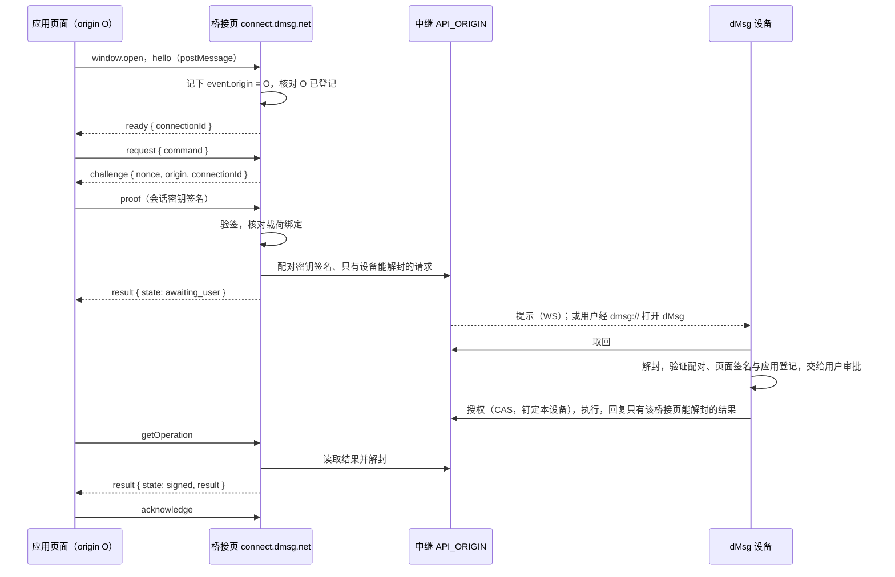
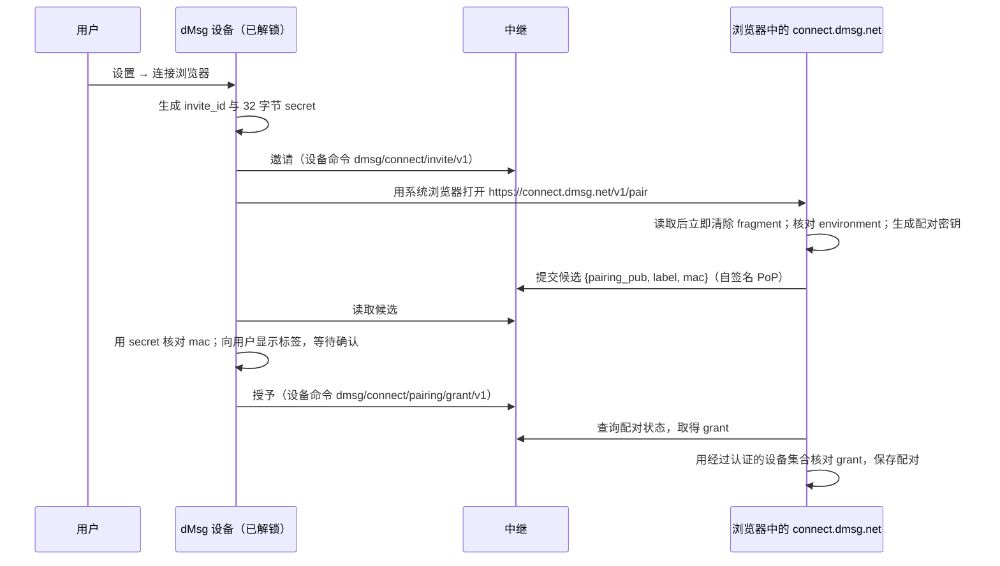

# dmsg-connect/1：网页应用接入协议

2026-10-12 起草，同日按实现修订。中继、设备端（`dmsg_protocol::connect`、`dmsg_client::connect`）、桥接页（`src/dmsg_connect`，资产 canister `dmsg_connect`）与页面 SDK（`dmsg-sdk/connect`）已实现；`connect.dmsg.net` 的部署（自定义域名与中继生产 `API_ORIGIN`）尚未完成。本协议取代已退役的扩展桥 `dmsg-extension/4`（差异见第 9 节）：dMsg 不再提供浏览器扩展，网页应用经 `https://connect.dmsg.net` 桥接页，把请求交给用户的 dMsg 桌面端（以后也包括移动端）审批。字节格式以测试向量 [`tests/vectors/client/connect-v1.json`](../../tests/vectors/client/connect-v1.json) 为准。

不变的部分：三种文档 profile 与应用动作的签名字节、设备执行批准与认证回执（见 [公开协议](README_zh.md)）、`AuthenticationRequest`、`AppAction`、`CheckoutRequest` 与商业合同，以及应用在 `dmsg_commerce` 的登记（`AppRegistration`）。改变的只有三件事：页面与 dMsg 之间的传输、来源的核实方式、操作的恢复方式。

## 1. 角色与流程

| 角色 | 是什么 | 持有 |
| --- | --- | --- |
| 应用页面 | 已在 `dmsg_commerce` 登记的应用网页，origin 记为 O | 页面会话密钥（不可导出的 P-256），由应用自己保存 |
| 桥接页 | `https://connect.dmsg.net/v1/`，由独立的 ICP 资产 canister 提供，只承载桥接代码；没有登录态，不接触 Internet Identity | 浏览器配对密钥（不可导出的 P-256）、每个操作的结果解封密钥（不可导出的 X25519） |
| 中继 | dmsg-cloud API，下称 `API_ORIGIN` | 配对记录、请求邮箱、密封回复；只能看到元数据和密文 |
| 设备 | 用户账户中持有 `FormalApprove` 的 dMsg 桌面端或移动端 | 设备 Ed25519 签名钥与 X25519 HPKE 钥；唯一能批准和签名的一方 |



## 2. 信任模型

### 2.1 来源从哪里来

页面 origin 由浏览器写入 `MessageEvent.origin`，页面无法自报。桥接页只接受来自 `window.opener` 的消息，并只向该 origin 回复（`postMessage` 的 `targetOrigin`）。

设备收到的 origin 是桥接页用配对密钥签名的陈述。设备能验证"这是已配对的桥接页说的"，但不能独立验证浏览器来源。已退役的扩展转述的是 Chrome 的 sender，现在由桥接页转述浏览器给出的 `event.origin`，信任链的形状相同。设备签名与执行回执中记录的 origin 仍然只是"dMsg 客户端核实过的来源"，不是密码学证明。

### 2.2 各方被攻破时的后果

| 被攻破的一方 | 能做 | 不能做 |
| --- | --- | --- |
| 应用页面，或冒充它的站点 | 以自己真实的 origin 发起请求 | 冒充其他 origin；未登记的 origin 在桥接页和设备两处都被拒绝 |
| 桥接页（connect.dmsg.net 的代码或域名） | 在已配对的浏览器中伪称任意 origin 发起请求，而且不限于用户正在使用应用的时刻——配对密钥随时可用；读取经过该浏览器的请求与结果 | 批准、签名或付款（只有设备能做，每次都要人确认）；读取秘密库；在未配对的浏览器中做任何事 |
| 中继 | 看到第 2.4 节列出的元数据；扣留、延迟或丢弃消息；作为取消与授权竞争的裁决者，可以无视页面的取消（设备仍只在用户批准后执行） | 读取或篡改请求与结果（已密封并签名）；伪造配对（需要设备签名）；替用户批准；伪造回复（回复由设备 X25519 密钥认证，见 6.4） |

桥接页是新增的可信网页面。部署要求：

- 独立 canister 与独立子域名；只包含桥接代码；不列入任何 II `ii-alternative-origins`，因此即使被攻破也无法为用户申请 II delegation。
- 响应头：不得发送 `Cross-Origin-Opener-Policy: same-origin`（会切断桥接页自己的 `window.opener`），使用 `unsafe-none`；不设置 COEP；`Content-Security-Policy` 为 `default-src 'none'; script-src 'self'; style-src 'self'; img-src 'self'; connect-src <IC 网关> <API_ORIGIN>; frame-ancestors 'none'; base-uri 'none'; form-action 'none'`；`X-Frame-Options: DENY`；`Referrer-Policy: no-referrer`。资产 canister 的默认安全策略若注入与此冲突的头，必须覆盖。
- 不加载第三方脚本；不渲染用户提供的内容；构建可复现，发布记录资产哈希。
- 审批界面标明"来源由浏览器经 connect.dmsg.net 转述"，并显示配对标签与请求时间，让用户能察觉不在使用应用时出现的请求。
- 产品文档必须披露这一信任点。

### 2.3 配对为什么能抵抗钓鱼

谁持有配对密钥，谁就能向设备陈述 origin，所以配对仪式必须证明密钥生成于真实的 `connect.dmsg.net` 页面。本协议只允许设备发起配对：设备生成 32 字节一次性秘密，并亲自打开 `https://connect.dmsg.net/v1/pair#…`，把秘密放在 URL fragment 中。fragment 不会发往服务器，只有真实来源的页面能读到。桥接页用该秘密对新的配对公钥计算 HMAC，设备核对后签发授权。钓鱼站点拿不到这个秘密，也就无法让设备接受它的密钥。网页一侧不能发起配对，只能请用户打开 dMsg。

### 2.4 中继可见的元数据

中继看不到 origin、应用、方法或载荷。它能看到：账户、配对 ID 与标签（用户可见的浏览器名称）、请求 ID 与种类（create/read/open）、接收设备列表、大小、时间、粗粒度状态，以及哪台设备授权或回复了请求。提示通道（7.5）还让中继持续看到锁定设备的在线状态。

## 3. 编码

- 页面帧是可结构化克隆的普通对象，字段集合闭合，多余或缺失的键一律拒绝。文本编码：ID、nonce、摘要用小写 hex；公钥、载荷、签名用规范的标准 base64；大整数用十进制字符串。单帧序列化为 JSON 后不超过 150,000 字节。
- 中继 body 与签名对象使用 RFC 8949 core deterministic CBOR（键按长度优先、再按字节序排序），二进制为 bstr；URL 中的 ID 用小写 hex，AccountId 用规范 Xid 文本；时间为 Unix 毫秒。
- `digest(domain, value) = SHA256(CBOR([1, domain, value]))`，与其他 dMsg 合同相同。
- `environment` 字段取 `dmsg_types::Environment` 的 Serde 文本表示：`"Local"`、`"Staging"`、`"Production"`。
- origin 规则与 `dmsg_protocol::validate_origin` 相同：精确的 HTTPS origin，不超过 256 字节；只有 Local 部署接受环回 HTTP origin。

## 4. 页面与桥接页

### 4.1 打开窗口

应用必须在用户手势（如 click）的同步处理函数中打开桥接页：

```js
const popup = window.open('https://connect.dmsg.net/v1/', 'dmsg-connect', 'popup,width=440,height=680')
```

- 页面不能设置 `Cross-Origin-Opener-Policy: same-origin`，否则 opener 关系会被切断；可以使用 `same-origin-allow-popups` 或不设置。
- 页面应作为顶层文档运行。桥接页无法确认 opener 是否为 iframe，应用应以 `frame-ancestors` 防止被其他站点嵌入。
- 弹窗被拦截时 SDK 返回 `POPUP_BLOCKED`；弹窗被关闭时，所有未完成的调用返回 `DISCONNECTED`。关闭窗口不会取消已经创建的操作。
- **浏览器基线**：Chrome/Edge 133、Firefox 130、Safari 17 及以上。基线来自 WebCrypto 对不可导出 X25519 密钥的支持；桥接页不提供纯 JavaScript 的 X25519 回退，低于基线时显示"浏览器不受支持"并回复 `UNSUPPORTED_BROWSER`。
- **Safari 的存储保护**：Safari 可能删除 7 天内没有第一方用户交互的站点存储。桥接页记录最近一次用户在弹窗内的点击时间；在 Safari 中，若距上次点击超过 5 天，创建类方法先在弹窗内要求用户点击"继续"，再继续处理。

### 4.2 握手

1. 页面每 100 毫秒向弹窗发送 `{protocol: "dmsg-connect/1", type: "hello", appId}`，`targetOrigin` 固定为 `https://connect.dmsg.net`，直到收到 `ready`，或 15 秒后超时。
2. 桥接页接受第一条满足以下条件的 hello：`event.source === window.opener`；`event.origin` 符合第 3 节；`appId` 格式合法。随后读取 `dmsg_commerce` 中经过认证的应用登记，要求该 origin 在 `origins` 中、环境与桥接页构建一致、应用未暂停。
3. 桥接页生成 32 字节的 `connectionId`，回复 `{protocol, type: "ready", connectionId, origin, appId, methods}`，`targetOrigin` 为该 origin。登记不符时回复 `{protocol, type: "rejected", error}` 并停止处理。
4. 连接建立后，桥接页忽略来自其他 origin 或其他 source 的消息，并每秒检查 `window.opener`：opener 已关闭或不可访问时结束连接。opener 导航到其他 origin 后，`targetOrigin` 会让回复无法送达。

一个弹窗同一时刻只服务一个连接。页面应复用已打开的弹窗；新的 hello 会结束旧连接。

### 4.3 命令帧与证明

命令对象有六个键，必填且集合闭合：

```text
command = { method, appId, operationId, publicKey, payload, resultDigest }
```

- `appId` 必须等于握手时的 appId。
- `operationId` 为非零的 32 字节小写 hex。
- `publicKey` 为 91 字节 P-256 SPKI DER 的标准 base64。
- 创建类方法的 `payload` 为标准 base64，解码后不超过 65,536 字节；其他方法为 null。
- 只有 `acknowledge` 的 `resultDigest` 为 32 字节 hex，其他方法为 null。

帧：

```text
页面 → 桥接页   { protocol, type: "request", requestId, command }
桥接页 → 页面   { protocol, type: "challenge", requestId, nonce, origin, connectionId }
页面 → 桥接页   { protocol, type: "proof", requestId, signature }
桥接页 → 页面   { protocol, type: "result", requestId, ok: true, value }
                { protocol, type: "result", requestId, ok: false, error }
页面 → 桥接页   { protocol, type: "capabilities", requestId }   // value 为 { protocol, methods }
```

`requestId` 是页面生成的 32 字节随机 hex，只用于在本连接内关联帧。页面签名前必须核对 challenge 中的 `origin` 等于自己的 `location.origin`，`connectionId` 等于握手时收到的值，然后签署：

```text
proof_message = digest("dmsg/connect-proof/v1", [
  "dmsg-connect/1", nonce_bytes, origin, connection_id_bytes, command
])
```

`command` 按其 JSON 值编码为第 3 节的规范 CBOR map：六个文本键，值为文本或 CBOR null，不做 base64/hex 解码。签名是 ECDSA P-256/SHA-256 对这 32 字节消息的签名，采用 64 字节 IEEE P1363 格式，以标准 base64 发送。

nonce 为 32 字节，每个请求一个，只能使用一次，15 秒后过期，连接断开即作废。每个连接最多有 16 个等待证明的请求。除 `capabilities` 外，每个命令都需要新的证明。

操作承诺：

```text
operation_digest = digest("dmsg/connect-operation/v1", [
  origin, appId, operationId, method, public_key_der, payload_bytes
])
```

`operationId` 以文本参与摘要，`public_key_der` 与 `payload_bytes` 为解码后的字节。

### 4.4 方法

| 方法 | 载荷 | 桥接页的处理 | 设备不在线时 |
| --- | --- | --- | --- |
| `authenticate` | 规范 CBOR `AuthenticationRequest` | 按 4.5 创建 | 照常创建，状态为 `awaiting_user` |
| `signDocument` | UTF-8 JSON `SignatureRequest` | 同上 | 同上 |
| `signAction` | 规范 CBOR `AppAction` | 同上 | 同上 |
| `checkout` | 规范 CBOR `CheckoutRequest` | 同上 | 同上 |
| `getOperation` | null | 有本地记录时从中继读取该操作最新的密封回复并解封；没有时按下文发 `read` 请求 | 有本地记录则不受影响；没有时返回 `DEVICE_UNAVAILABLE` |
| `openOperation` | null | 向设备发 `open` 请求，让设备重新展示该操作（用于解锁后继续或对账），并返回当前状态 | 返回当前状态，设备上线后再展示 |
| `cancelOperation` | null | 在中继上把请求从 pending 改为 cancelled | 不受影响 |
| `acknowledge` | null，`resultDigest` 必填 | `resultDigest` 必须等于本桥接页（本地记录）实际交付过的结果摘要，然后提交确认 | 不受影响 |

除创建类方法外，所有方法都要求 `publicKey` 与该操作原始的会话公钥一致，由桥接页本地记录或设备核对。

**没有本地记录时的 `read`/`open`**：桥接页向每个已配对账户各发一个 `read`（或 `open`）请求，然后以 `wait=20000` 长轮询一次中继。只要有一个请求返回了设备的密封回复，就解封并返回；返回 `unknown`（见 7.4）的账户没有这个操作；20 秒内没有任何回复则返回 `DEVICE_UNAVAILABLE`。已发出的 `read` 请求在 2 分钟有效期内、在同一个桥接窗口里复用：页面重试 `getOperation` 时不新建请求，只再次长轮询（`read` 请求不写入 IndexedDB，窗口重开后会新建）。全部账户都返回 `unknown` 时返回 `NOT_FOUND`。

### 4.5 创建规则

桥接页在提交前完成以下核对；设备收到后会全部重新核对（6.3）。

1. **能力**：应用登记具备对应能力（`Authenticate`、`SignDocument`、`SignAction`、`Checkout`）；文档 profile 在登记的 `profiles` 内。
2. **载荷绑定**：
   - `authenticate`：`validateAuthentication` 通过（含 `app_config_version` 等于当前登记版本）；`origin` 等于连接 origin，`app_id` 等于 appId，`operation_id` 等于 operationId，`session_key_hash` 等于 `SHA-256(publicKey DER)`，环境与期限有效。
   - `signDocument`：闭合的 `SignatureRequest`，`protocol` 为 `"dmsg-connect/1"`，`method` 为 `"signature.request"`，`requestId` 等于 operationId，另有 `accountId`、`nonce`、`expiresAt` 与 `statement`。`statement` 使用现有的文本、摘要或文件声明字段；签名的 `issuedAt` 为秒，执行期限 `expiresAt` 为毫秒，两者都是经过检查的十进制字符串。
   - `signAction`：`validateActionAdmission` 通过（登记的 `action_authority` 与 `action_schema`）；`origin`、`app_id`、`operation_id` 一致，期限有效。
   - `checkout`：`offer.app_id`、`offer.operation_id` 一致，`offer.accept_by_ms` 尚未到期，产品在登记的 `product_ids` 内，`method` 在 `offer.allowed_settlement_methods` 内。
3. **目标账户**：`signDocument` 取 `accountId`，`signAction` 取 `signing_account`，`checkout` 取 `approving_account`；此浏览器必须持有该账户的有效配对，否则返回 `NOT_PAIRED`，同时弹窗提示用户在 dMsg 中连接此浏览器。`authenticate` 不指定账户：只有一个配对时直接使用，有多个时由用户在弹窗中选择，没有配对时返回 `NOT_PAIRED`。账户中没有具备 `FormalApprove` 的设备时返回 `NO_APPROVING_DEVICE`。
4. **幂等**：按 `(origin, appId, operationId)` 查本地记录。`operation_digest` 相同时返回已有操作，不再提交；不同时返回 `IDEMPOTENCY_CONFLICT`。
5. **限额**：同一配对下未结束的操作最多 20 个，同一 origin 最多 5 个，超出返回 `QUOTA_EXCEEDED`。设备另有自己的限额（6.3），多个浏览器合计超出时由设备拒绝。

全部通过后，桥接页生成 `request_id` 与不可导出的 X25519 结果密钥对，把本地记录（含结果私钥的 CryptoKey）写入自己的 IndexedDB，提交 `create` 请求（第 6 节），返回 `{operationId, kind, state: "awaiting_user"}`。

页面重试创建（例如用户完成配对之后）必须使用同一个 operationId 与完全相同的载荷。

### 4.6 操作值与状态

结果 `value` 的形状：

```text
{ operationId, kind: "authentication" | "document" | "action" | "checkout",
  state, result?, resultDigest?, error? }
```

| 状态 | 含义 |
| --- | --- |
| `awaiting_user` | 已提交，尚未被设备授权；包括设备未在线或用户尚未决定 |
| `authorized` | 设备已授权并开始执行；不能再取消 |
| `execution_unknown` | 执行结果未知：设备按原执行 ID 对账，不会重新签名；或中继在授权后长期没有收到终态（7.4 的 `abandoned`） |
| `signed` | 结果可取，带 `result` 与 `resultDigest` |
| `returned` | 页面已确认收到 `resultDigest` 对应的结果 |
| `rejected` | 用户拒绝，或设备在展示前拒绝（带 `error`） |
| `cancelled` | 页面在授权前取消 |
| `expired` | 授权期限已过 |
| `failed` | 执行确定失败（带 `error`），或钉定设备已被撤销（`error` 为 `DEVICE_REVOKED`） |
| `result_expired` | 结果超过保留期，已删除 |

`result` 的内容：认证返回专用证书（`signed` 只表示证书就绪，不是文档签名，也不说明应用已建立会话）；文档与动作返回 COSE、执行 ID 与执行回执证书；结账返回进度通知。应用必须独立验证结果：认证证书按自己信任的 IC 根、user home 与保存的挑战核对后才消费挑战；文档与动作核对签名产物、执行回执与自己的业务权限；结账之后查询自己的权威合同，不能把桥接页给出的状态当作结算或授权证据。`resultDigest = SHA256(CBOR(result))`。确认丢失时可以再次读取同一结果；确认本身不授权新的签名或付款。

### 4.7 错误码

`ok: false` 时，`error` 为以下稳定代码之一；`rejected` 与 `failed` 状态的 `value.error` 也取自这里：

| 代码 | 含义 |
| --- | --- |
| `INVALID_INPUT` | 帧或命令格式错误 |
| `UNSUPPORTED_PROTOCOL` | 不支持的协议版本或方法 |
| `UNSUPPORTED_BROWSER` | 浏览器低于 4.1 的基线 |
| `FORBIDDEN` | 证明无效，来源或 source 不符，能力、profile 或结算方式不允许，动作未通过准入，或账户政策不允许该用途 |
| `APP_NOT_REGISTERED` | origin 不在应用登记中 |
| `APP_PAUSED` | 应用已暂停新操作 |
| `POLICY_STALE` | 载荷中的 `app_config_version` 与当前登记版本不一致 |
| `INTEGRITY_FAILED` | 载荷与 origin、appId、operationId 或会话密钥不一致；回复无法解封或与请求不符 |
| `ACCOUNT_MISMATCH` | 载荷中的账户与选定的配对不一致 |
| `NOT_PAIRED` | 此浏览器没有该账户的有效配对 |
| `NO_APPROVING_DEVICE` | 账户中没有具备 `FormalApprove` 的设备 |
| `LOCKED` | 账户敏感政策已冻结（`sensitive_policy.frozen`） |
| `IDEMPOTENCY_CONFLICT` | 同一 operationId 对应不同内容 |
| `NOT_FOUND` | 操作不存在，或不属于该会话公钥 |
| `NOT_CANCELLABLE` | 操作已授权或已结束 |
| `QUOTA_EXCEEDED` | 超过待证明、待处理或中继限额；也可能由设备按自己的限额返回 |
| `EXPIRED` | nonce 或请求已过期 |
| `DEVICE_UNAVAILABLE` | 需要设备回答，但设备未在期限内响应；可重试 |
| `DEVICE_REVOKED` | 钉定的执行设备已被撤销 |
| `UNAVAILABLE` | 中继或 IC 暂时不可用；可重试 |

SDK 另外会产生 `POPUP_BLOCKED`、`BRIDGE_UNAVAILABLE`（握手超时）、`DISCONNECTED` 与 `TRANSPORT_TIMEOUT`（单次调用超过 30 秒）。

## 5. 浏览器配对

### 5.1 材料

- **配对密钥**：桥接页用 WebCrypto 生成不可导出的 P-256 ECDSA 密钥（`extractable: false`），以 CryptoKey 对象保存在 connect.dmsg.net 自己的 IndexedDB。`pairing_pub` 为其 91 字节 SPKI DER。
- **配对 ID**：`pairing_id = digest("dmsg/connect-pairing-id/v1", pairing_pub)`。
- **标签**：浏览器与系统名称，如 `Chrome · macOS`，1 到 64 个 UTF-8 字节，显示在设备上。
- 一个浏览器可以为多个账户各持有一个配对；每个配对只属于一个账户。

### 5.2 仪式



- **邀请**：fragment 为 `base64url(CBOR {v: 1, environment, account_id, invite_id, secret})`；`environment` 必须等于桥接页构建的环境，否则页面拒绝并提示"链接来自其他环境"；中继地址取桥接页构建时固定的 `API_ORIGIN`，不从链接读取。`invite_id` 与 `secret` 各为 32 字节随机数；邀请 10 分钟后过期，只能完成一次。
- **候选 MAC**：`mac = HMAC-SHA256(secret, digest("dmsg/connect-pair/v1", [environment, account_id, invite_id, pairing_pub, label]))`。中继对每个邀请最多接受 3 个候选，并对候选提交按来源 IP 限速（7.6）；设备只接受 MAC 正确的候选，并要求用户确认标签。
- **复制链接**：设备可以提供"复制链接"，让用户在非默认浏览器中打开同一链接。链接在过期前等同于配对能力，所以设备上的确认步骤不能省略。
- **网页一侧**：桥接页或应用页面发现未配对时，只能提示"在 dMsg 中连接此浏览器"，可以附上 `dmsg://connect/pair?account=<xid>`（第 8 节）唤起设备的配对界面，但不能自行创建邀请。
- **存储丢失**：隐私窗口、清除站点数据都会丢失配对，需要重新配对。Safari 的存储保护见 4.1。

### 5.3 授权与验证

设备签发设备命令 `dmsg/connect/pairing/grant/v1`（信封见 [cloud_zh](cloud_zh.md)），payload 为：

```text
{ invite_id, pairing_id, pairing_pub, label, home, granted_at, expires_at }
```

grant 就是这条设备命令的 COSE_Sign1 本身（中继原样保存、原样返回）；`home` 是该账户 user home 的 Principal（CBOR bstr），`pairing_pub` 为 bstr；`expires_at - granted_at` 不超过 180 天。签发设备必须未撤销且具备 `FormalApprove`；中继对该命令同样要求签发设备具备 `FormalApprove`。

配对同时满足以下条件才有效：grant 签名正确；签发设备在当前认证设备集合中，未撤销且仍具备 `FormalApprove`；未过期；未被撤销；`home` 在 handle 注册表的 `user_homes` 中，且该 home 的认证账户状态确认 `account_id` 属于它。桥接页和设备都按这些条件自行验证，不信任中继给出的状态。签发设备被撤销后，它签发的所有配对一并失效，中继对这些配对返回 410。

配对不提供续期：到期后桥接页报告 `NOT_PAIRED`，用户重新执行 5.2。

撤销：任一具备 `FormalApprove` 的设备签发 `dmsg/connect/pairing/revoke/v1 {pairing_id}`。设备的设置页列出每个配对的标签、签发设备、创建时间与最近使用时间。

## 6. 请求与回复

### 6.1 ConnectRequest

由桥接页构造，用配对密钥签名。签名格式为 tagged COSE_Sign1：保护头恰为规范 CBOR `{1: -7, 3: "application/cbor", 4: pairing_id, 16: "application/vnd.dmsg.connect-request+cose;v=1"}`，非保护头为空，external AAD 为空，签名为 64 字节 r‖s。

```text
ConnectRequest = {
  protocol: "dmsg-connect/1",
  environment: tstr,             ; 第 3 节
  account_id: bstr .size 12,
  pairing_id: bstr .size 32,
  request_id: bstr .size 32,
  kind: "create" / "read" / "open",
  origin: tstr,                  ; 桥接页核实的 origin
  connection_id: bstr .size 32,
  nonce: bstr .size 32,
  command: { method, appId, operationId, publicKey, payload, resultDigest },
  page_signature: bstr .size 64,
  result_key: bstr .size 32,     ; X25519 公钥，设备用它密封回复
  created_at: uint,
  expires_at: uint
}
```

`create` 请求的 `expires_at` 取载荷自身的期限（认证请求的 `expires_at_ms`、动作的 `expires_at_ms`、签名请求的截止时间，结账的 `accept_by_ms`），且不超过 `created_at` 之后 24 小时。`read` 与 `open` 请求为 `created_at` 之后 2 分钟。中继 body 外层的 `kind` 与 `expires_at` 必须与此处一致。

### 6.2 密封

请求只有该账户的设备能读。桥接页从 user home 读取经过认证的设备集合（同 [cloud_zh](cloud_zh.md)"账户证据"），把所有未撤销且具备 `FormalApprove` 的设备作为接收者：

```text
cek      = 32 字节随机数
envelope = {
  v: 1,
  recipients: [{ device_id: bstr .size 32, enc: bstr .size 32, wrapped: bstr }],
  nonce: bstr .size 12,
  ciphertext: bstr        ; AES-256-GCM(cek, nonce, COSE_Sign1(ConnectRequest), aad)
}
aad      = CBOR(["dmsg/connect-request/v1", account_id, pairing_id, request_id])
wrapped  = HPKE Base 模式（X25519 / HKDF-SHA256 / AES-256-GCM）对 cek 的密封，
           info = aad = CBOR(["dmsg/connect-wrap/v1", account_id, pairing_id, request_id, device_id])
```

`recipients[].device_id` 对中继可见，中继用它判断 7.4 中 `unknown` 的完成条件；每个请求最多 16 个接收设备。

### 6.3 设备处理

锁定的设备只取回并保存密封信封，不解封；解锁后依次执行：

1. 用自己的 HPKE 私钥解出 cek，解密并解析 COSE。
2. 取该配对的 grant，按 5.3 验证；用 `pairing_pub` 验证请求签名；核对 `account_id`、`pairing_id`、`request_id`、`kind`、`expires_at` 与中继元数据一致；`environment` 等于本机环境；`created_at` 不超前本机时间 60 秒以上（与 HTTP PoP 的期限规则同级）；请求未过期。
3. 用 `command.publicKey` 验证 `page_signature` 是对 `proof_message(nonce, origin, connection_id, command)` 的签名。
4. 重新执行 4.5 的全部核对，应用登记必须使用新鲜的认证数据（60 秒规则）；载荷中的 `app_config_version` 与当前登记不一致时拒绝为 `POLICY_STALE`。
5. 核对账户敏感政策（canister 同样执行这些规则）：`sensitive_policy.frozen` 为真时拒绝为 `LOCKED`；`signDocument` 与 `signAction` 的 `KeyPurpose` 不在 `allowed_purposes` 内时拒绝为 `FORBIDDEN`；`daily_executions` 预算在执行时由 canister 裁决，超出表现为 `failed`。
6. 按 `(origin, appId, operationId)` 查本机操作。摘要不同时回复 `rejected` 与 `IDEMPOTENCY_CONFLICT`。摘要相同时不产生新的审批：把这个请求登记为该操作的附加投递通道，立即回复当前状态（非终态时 `respond.state = "open"`，请求保持打开），此后每次状态变化都对该操作的所有未关闭请求各写一个回复，结果因此同时送达每个曾提交过它的桥接页；设备不对附加通道调用 `authorize`。
7. 本机未结束的审批总数不超过 20 个，每个 origin 不超过 5 个。

任一步失败时，设备不打扰用户，直接回复 `rejected` 并附错误码（`respond.state = "closed"`）。全部通过后，设备把请求放入审批中心；不需要向中继登记"正在查看"。审批界面显示：origin、应用名称与登记版本、配对标签、账户、用途、期限、请求时间、可核对的原始载荷（文档请求核对应用版本与 profile，认证重算已保存载荷的承诺），并说明"来源由浏览器经 connect.dmsg.net 转述"。

用户批准后，设备先把批准与请求写入本机加密日志，再向中继提交 `authorize`。中继只在请求处于 `pending` 时接受，并把请求钉定到这台设备；此后只有它能对该请求回复、执行和对账，其他设备在下次同步看到 `authorized` 且钉定设备不是自己时，把本机记录标为"由其他设备处理"并隐藏。`authorize` 失败（已取消、已过期或已被另一台设备授权）时，设备把日志标为放弃，不执行。执行与对账：批准参数与设备签名先写入日志再提交；结果未知时按原执行 ID 对账，从不重新签名；过期的结果不会自动产生新的批准。

用户拒绝时，设备直接回复 `rejected`。

`read` 与 `open` 请求：有该操作记录、且操作未被钉定到其他设备的设备，回复当前状态快照（`open` 还要重新展示该操作）；操作已钉定到其他设备、或本机没有该操作记录的设备，回复 `respond.state = "unknown"`（不带密文）。授权后只有钉定设备知道权威状态，所以其他设备不得用过期快照回答。

### 6.4 回复

设备在每次状态变化时写入一个新版本的密封回复，中继只保留最高版本：

```text
ConnectResponse = {
  protocol: "dmsg-connect/1",
  request_id: bstr .size 32,
  version: uint,                  ; 每个请求从 1 开始严格递增
  operation_digest: bstr .size 32,
  value: bstr                     ; 4.6 的 value，UTF-8 JSON
}
sealed = CBOR { enc: bstr .size 32, ciphertext: bstr }
         HPKE Auth 模式（X25519 / HKDF-SHA256 / AES-256-GCM）对 CBOR(ConnectResponse) 的密封：
         skS = 应答设备的 X25519 私钥（公钥即认证设备集合中的 hpke_pub），pkR = result_key，
         info = aad = CBOR(["dmsg/connect-response/v1", account_id, pairing_id, request_id, version, device_id])
```

桥接页从中继取得 `device_id`、`sealed` 与它的 `sealed_version`，在新鲜的认证设备集合中找到该设备的 `hpke_pub`（设备必须存在且未撤销），以 Auth 模式在 `sealed_version` 下解封，再核对 `request_id`、`version`（等于 `sealed_version` 且大于已见版本）与 `operation_digest`，然后把 `value` 交给页面；任一步失败按 `INTEGRITY_FAILED` 丢弃该回复。`create` 请求收到带 `authorized` 或更后状态的回复后，桥接页记下该 `device_id`，此后只接受同一设备的回复。Auth 模式让回复的真实性不再只依赖 `result_key` 的保密：中继或任何不持有该设备 HPKE 私钥的一方都不能伪造回复。

`read` 请求的回复是该操作当前状态的一次性快照。`open` 请求让设备重新展示该操作，并回复当前状态。

### 6.5 取消与确认

- **取消**：桥接页调用中继的 `cancel`。请求处于 `pending` 时变为 `cancelled`，此后设备的 `authorize` 必然失败；已授权或已结束时返回 `NOT_CANCELLABLE`。附加投递通道（6.3 第 6 步）被取消只影响该通道，不影响操作。
- **确认**：桥接页调用中继的 `ack {result_digest}`，中继记录确认。设备同步时核对该摘要等于自己产出的结果，再把操作标为 `returned`。中继记录了相同摘要的确认后，桥接页对该操作报告 `returned`。

## 7. 中继接口

### 7.1 桥接页认证

桥接页的每个请求都带 `X-Dmsg-Connect-Pop` 头，值为无 padding base64url 编码的 tagged COSE_Sign1，保护头与 6.1 相同，只是 typ 为 `application/vnd.dmsg.connect-pop+cose;v=1`；payload 为规范 CBOR：

```text
{ protocol: "dmsg-connect/1", account_id: bstr .size 12, pairing_id: bstr .size 32,
  request_id: bstr .size 32, deadline: uint, audience: tstr, method: tstr, target: tstr,
  body_digest: bstr .size 32 }
```

`account_id` 选定该账户的中继邮箱（桥接页路由的 URL 不含账户）。其余规则同设备 HTTP PoP（[cloud_zh](cloud_zh.md)）：`audience` 为 API origin；`target` 为规范的 path/query；`body_digest` 为实际 body 的 SHA-256；`now < deadline ≤ now + 60000`。`request_id` 由每个 HTTP 请求随机生成，中继在期限内拒绝重放。提交配对候选时配对尚未生效，PoP 改用 body 中的 `pairing_pub` 验证。

请求 body 为规范 CBOR（`Content-Type: application/cbor`），二进制为 bstr；应答为 JSON `{ok: true, data}` 或 `{ok: false, error: {code, message, retryable}}`，其中 ID 与摘要为小写 hex，`sealed`、`grant` 与 envelope 为无 padding base64url。配对已撤销、过期或签发设备已失去资格时返回 410 `NOT_PAIRED`；不可取消时返回 409 `NOT_CANCELLABLE`。

`/v1/connect/*` 的 CORS 只允许 `Origin: https://connect.dmsg.net`（Local 部署另行配置）。自定义头会触发预检：中继对这些路径回应 `OPTIONS`，`Access-Control-Allow-Headers: Content-Type, X-Dmsg-Connect-Pop`，`Access-Control-Allow-Methods: GET, POST`，`Access-Control-Max-Age: 600`。CORS 只是浏览器侧约束，授权仍然来自 PoP。

### 7.2 桥接页路由

| 路由 | body 与返回 | 说明 |
| --- | --- | --- |
| `POST /v1/connect/pairings` | `{account_id, invite_id, pairing_pub, label, mac}` | 提交配对候选，使用自签名 PoP；每个邀请最多 3 个 |
| `GET /v1/connect/pairings/:pairing` | `{state, account_id, grant?}` | `state` 为 `pending`、`active`、`revoked` 或 `expired`；active 时返回 grant 的原始 COSE |
| `POST /v1/connect/requests` | `{request_id, kind, expires_at, envelope}`，返回 `{seq}` | 提交密封请求；中继记录 `envelope.recipients[].device_id` |
| `GET /v1/connect/requests/:request?wait=&after=` | `{state, version, device_id, sealed, sealed_version, acked_digest}` | 只有创建它的配对能读；`state` 为 7.4 的中继状态（保留期过后为 `result_expired`）；`version` 计入每个回复（含 `unknown`）；`sealed` 是最新的密封回复，`sealed_version` 是它写入时的版本，`device_id` 为写入它的设备；`wait` 不超过 20000 毫秒的长轮询，在 `version` 大于 `after` 或状态变化时返回 |
| `POST /v1/connect/requests/:request/cancel` | — | 见 6.5 |
| `POST /v1/connect/requests/:request/ack` | `{result_digest}` | 见 6.5 |

### 7.3 设备路由

设备路由使用现有的设备 HTTP PoP，写操作使用设备命令（命令 payload 中的二进制为 bstr）。账户内任一未撤销设备都可以读取；配对授予、配对撤销、授权与回复四个命令要求签发设备具备 `FormalApprove`，中继按 action 核对能力（这是对现有设备命令管线的新增要求）。

| 路由 | 设备命令 action | 说明 |
| --- | --- | --- |
| `POST /v1/accounts/:account/connect/invites` | `dmsg/connect/invite/v1` | `{invite_id, expires_at}`；10 分钟内；每账户同时最多 4 个 |
| `GET /v1/accounts/:account/connect/invites/:invite` | — | 已提交的候选 `{pairing_id, pairing_pub, label, mac, submitted_at}` |
| `POST /v1/accounts/:account/connect/pairings` | `dmsg/connect/pairing/grant/v1` | payload 即 5.3 的 grant；候选的公钥与标签必须一致，邀请随即用尽 |
| `POST /v1/accounts/:account/connect/pairings/:pairing/revoke` | `dmsg/connect/pairing/revoke/v1` | `{pairing_id}` |
| `GET /v1/accounts/:account/connect/pairings` | — | 配对列表、grant、签发设备与最近使用时间 |
| `GET /v1/accounts/:account/connect/requests?after=&limit=` | — | 请求邮箱：envelope、中继状态、当前 version、钉定设备与确认摘要；`seq` 在请求每次变化时递增，`after` 取上次最大的 `seq` 即可看到状态变化 |
| `GET /v1/accounts/:account/connect/requests/:request` | — | 单个请求，字段同上 |
| `POST /v1/accounts/:account/connect/requests/:request/authorize` | `dmsg/connect/authorize/v1` | `{request_id, operation_digest}`；CAS，见 6.3；已过期返回 `EXPIRED`，已被授权、取消或结束返回 409 `VERSION_CONFLICT`；同一设备以同一摘要重复授权返回原结果 |
| `POST /v1/accounts/:account/connect/requests/:request/respond` | `dmsg/connect/respond/v1` | `{request_id, version, state, sealed_digest}`；`state` 为 `open`、`closed` 或 `unknown`；密封回复放在 body 的 `sealed` 字段（与 `cose_sign1` 并列，最多 512 KiB），命令只承诺它的 SHA-256；`unknown` 不带回复，`sealed_digest` 为 null |

`respond` 的接受规则：`version` 必须等于当前版本加一，否则返回 409 `VERSION_CONFLICT`，设备重读版本后重试；`authorized` 请求只接受钉定设备的回复；`pending` 请求与 `read`/`open` 请求接受任一接收设备的回复；`unknown` 只用于 `read`/`open`。

### 7.4 中继状态

```text
create:
  pending ──authorize（CAS）──▶ authorized ──respond(closed)──▶ closed
     │                            ├──钉定设备被撤销──▶ device_revoked
     │                            └──expires_at 之后 7 天仍无终态──▶ abandoned
     ├──respond(closed)──▶ closed          （设备展示前拒绝、重复创建的终态快照）
     ├──cancel──▶ cancelled
     └──到期且未授权──▶ expired

read / open:
  pending ──respond(closed)──▶ closed
     ├──全部接收设备 respond(unknown)──▶ unknown
     └──到期──▶ expired
```

- `respond(open)` 不改变中继状态，只推进 `version` 并替换 `sealed`；用于 `authorized` 后的中间状态（`authorized`、`execution_unknown`）和附加投递通道的快照。
- 授权后的请求不会过期，也不能取消。
- `read` 与 `open` 请求不需要授权。
- 中继只理解这些状态；页面看到的细状态在密封回复中。桥接页把没有密封回复的中继终态映射为：`cancelled` → `cancelled`，`expired` → `expired`，`device_revoked` → `failed` + `DEVICE_REVOKED`，`abandoned` → `execution_unknown`，`unknown` → `getOperation` 返回 `NOT_FOUND`。

### 7.5 设备提示通道

设备锁定时不持有签名私钥，无法建立需要 PoP 的连接。提示通道让锁定的设备也能知道"有事待处理"：

- 设备在持有签名钥时（解锁，或开启“后台在线”）生成 32 字节随机 token，以设备命令 `dmsg/hint/token/create/v1 {token_hash, expires_at}` 登记它的 SHA-256（`POST /v1/accounts/:account/hint-tokens`，有效期不超过 30 天），token 本身存入 OS 凭据库（没有凭据库时存在工作区的明文元数据中：它只能收无内容的提示）。剩余期限不足 7 天时轮换。每台设备同时最多 2 个有效 token（轮换重叠期）。`dmsg/hint/token/revoke/v1 {token_hash}`（`POST /v1/accounts/:account/hint-tokens/revoke`）撤销 token；设备被撤销时，它的 token 全部失效。
- 设备以 `GET /v1/hints/ws?account=<xid>` 加 `Authorization: Bearer <base64url token>` 升级为 WebSocket。服务器只发送 `{type: "hint", account, kind}`；心跳由设备发起：设备至少每 30 秒发送 `ping`，中继回 `pong`（不唤醒休眠的连接），60 秒收不到任何消息即重连。`kind` 目前为 `connect` 与 `mcp-event`（中继收到了 MCP Events 投递，见 [cloud 合同](cloud_zh.md) “MCP Events 中继端点”），预留 `channel`、`inbox`。消息不含请求 ID、origin 或任何内容。`connect` 提示只发给持有 `FormalApprove` 的设备的 token。
- 提示只是唤醒信号，设备收到后仍须用 PoP 读取。移动端推送（APNs/FCM）承载同样的内容，留到移动端阶段定义。

### 7.6 限额与保留

| 项目 | 上限 |
| --- | --- |
| 每账户未完成的邀请 | 4 |
| 配对候选提交 | 每邀请 3 个；每来源 IP 每分钟 10 次 |
| 每账户有效配对 | 32 |
| 每个配对未结束的请求 | 20 |
| 每台设备有效提示 token | 2 |
| 请求 envelope | 192 KiB |
| 密封回复 | 512 KiB |
| create 请求的待处理期 | 不超过 24 小时（取载荷期限） |
| read 与 open 请求 | 2 分钟 |
| authorized 请求无终态的保留 | `expires_at` 之后 7 天，然后 `abandoned` |
| 已结束的请求与回复 | 保留 7 天，之后读取返回 `result_expired` |
| 桥接页提交速率 | 每个配对每分钟 60 次 |

## 8. 唤起设备

桌面端注册 `dmsg:` URL scheme：

| URL | 作用 |
| --- | --- |
| `dmsg://connect/pair?account=<xid>` | 打开"连接浏览器"界面；桥接页不知道目标账户时（如 `authenticate`）省略 `account` |
| `dmsg://connect/request?account=<xid>&request=<hex>` | 打开审批中心并定位到该请求 |

任何网页都能触发这些链接，所以它们只是导航提示：设备不会因此执行任何动作，所有内容仍然以 PoP 从中继读取并验证。请求提交后，桥接页显示"在 dMsg 中确认"按钮，指向第二个链接，并在按钮旁说明"也可以在 dMsg 的审批中心或 `dmsg approvals` 中查看"（没有注册 URL scheme 的平台，如仅 CLI 的 Linux，按钮不会有反应）。移动端将使用 `https://connect.dmsg.net/app/…` 形式的 universal link / app link，在移动端阶段定义。

## 9. 与 `dmsg-extension/4` 的差异

扩展桥 `dmsg-extension/4` 随扩展一起退役，其合同已删除（见 Git 历史）。下表供仍在使用它的应用迁移。

| 项目 | `dmsg-extension/4` | dmsg-connect/1 |
| --- | --- | --- |
| 传输 | `chrome.runtime.connect` 端口 | 弹窗与 `postMessage`；桥接页经中继转给设备 |
| 来源 | Chrome sender（origin、documentId、tab、frame） | `MessageEvent.origin`，由桥接页签名转述；没有 documentId |
| 证明消息 | `dmsg/browser-proof/v1`，含 documentId | `dmsg/connect-proof/v1`，含 connectionId |
| 操作承诺 | `dmsg/browser-operation/v1` | `dmsg/connect-operation/v1`，字段不变 |
| 审批位置 | 扩展的独立窗口 | dMsg 桌面端（以后包括移动端）的审批中心 |
| 操作记录 | 扩展本地 | 设备为权威；桥接页保存本地索引；中继保存密封回复 |
| 浏览器 | 仅 Chromium | 4.1 基线以上的 Chrome/Edge、Firefox、Safari |
| `SignatureRequest.protocol` | `dmsg-extension/4` | `dmsg-connect/1` |
| 新增 | — | 配对；`NOT_PAIRED`、`NO_APPROVING_DEVICE`、`DEVICE_UNAVAILABLE`、`DEVICE_REVOKED`、`NOT_CANCELLABLE`、`POLICY_STALE`、`LOCKED`、`UNSUPPORTED_BROWSER`；`value.error` |
| 删除 | — | `requiresUnlock`：设备锁定只表现为 `awaiting_user` |

## 10. SDK

`dmsg-sdk/connect` 取代已删除的 `dmsg-sdk/browser`：

```ts
import { connectDmsg } from 'dmsg-sdk/connect'

button.onclick = async () => {
  // 必须在用户手势中同步调用：它会立即执行 window.open
  const dmsg = connectDmsg({ appId, session: { publicKeyDer, sign } })
  await dmsg.ready
  const operation = await dmsg.signDocument(operationId, request)
}
```

方法：`capabilities`、`authenticate`、`signDocument`、`signAction`、`checkout`、`getOperation`、`openOperation`、`cancelOperation`、`acknowledge`；另有 `ready`、`close()` 与只读的 `open`（弹窗是否仍在）、`methods`（`ready` 中公布的方法）。`session` 也可以是 Promise：弹窗必须在手势中同步打开，而会话密钥常要从 IndexedDB 异步读出。弹窗被用户关闭后，应用需要在新的用户手势中再次调用 `connectDmsg`。`bridgeOrigin` 选项只供 Local 与 Staging 覆盖默认值。应用仍须持久保存会话密钥、挑战与 operationId，刷新后用同一密钥恢复操作。

## 11. 保留项

以下能力不在 /1 中：

- `requestDelegation` 与 `registerController`（Agent Protocols 第 3 阶段的浏览器入口）。
- 内容 grant 下的应用读取（云端的 `proxy-file`、`proxy-read`）。
- 重定向模式：内置浏览器拦截弹窗时，按登记的 redirect URI 回调。
- 移动端 universal link 与推送。
- 配对续期。

新增方法只要不改变已有的帧、摘要与状态语义，就留在 /1 内，通过 `capabilities` 公布；改变已有字节时升级协议版本。

## 12. 验证要求

- **向量** `tests/vectors/client/connect-v1.json`：proof_message、operation_digest、pairing_id、配对邀请与 MAC、ConnectRequest 的 CBOR 与 COSE、envelope 的 AAD 与 HPKE info、ConnectResponse 与 Auth 模式密封、Connect PoP。由 Rust 实现生成，桥接页、SDK 与中继分别逐字节核验。
- **负例**：错误 source 或 origin 的 hello；opener 导航后的回复；nonce 重放与过期；篡改 command、payload 或 connectionId；未登记、已暂停、能力不符、`app_config_version` 过期、结算方式不允许、动作未通过准入；账户政策冻结或用途不允许；环境不匹配的邀请与请求；配对 MAC 错误；中继替换 `pairing_pub` 或 grant；被撤销设备签发的 grant；替换或重放 envelope 与回复；非钉定设备或非认证设备写出的回复；取消与授权竞争；两台设备同时授权；授权后设备崩溃再对账；钉定设备被撤销；桥接页丢失记录后的 `read`（有记录设备应答、无记录设备 `unknown`、全部 `unknown`）；重复创建的附加通道同时收到结果；确认摘要不符；超出各项限额。
- **端到端**：在真实浏览器（Chromium、Firefox、WebKit）中运行应用页面与桥接页，配合 daemon、本地 workerd 中继与 PocketIC canister，覆盖配对、四种创建方法、设备离线时创建、跨设备审批、取消、确认与结果过期。
