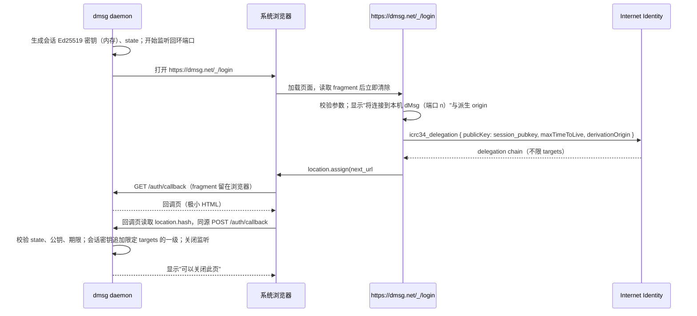

# dmsg-login/1：本机客户端的 Internet Identity 登录中转

2026-10-12 起草，同日在桌面方案 W1 中实现：登录页为 `src/dmsg_frontend` 的 `/_/login`，客户端一侧为 `dmsg daemon`（`src/dmsg_client` 的 `login` 模块与 `src/dmsg_cli` 的回调）。2026-10-14 按真实 Internet Identity 的行为修订：II 的 `icrc34_delegation` 不支持 `targets`，签出的 delegation 不限 canister，请求因此去掉 `targets`，改由 daemon 用会话私钥追加一级限定 targets 的 delegation（第 4 节）。dMsg 桌面端（`dmsg daemon`）与以后的移动端不内嵌 Internet Identity 登录；它们用系统浏览器打开 `https://dmsg.net/_/login`，由这个页面请 II 直接为客户端的会话公钥签发 delegation，再把结果交回客户端。页面本身没有登录态：不读取、不保存 dmsg.net 站点的会话，也不持有任何可用的私钥。

## 1. 为什么放在 dmsg.net

dmsg.net 是 II 的派生 origin（`derivationOrigin`），它的代码本来就能在用户经过 II 确认后为用户的 Principal 申请 delegation。登录页放在这里不新增信任点，而且两个派生站点的 `ii-alternative-origins` 都不需要改动：`https://panda.fans/.well-known/ii-alternative-origins` 已经包含 `https://dmsg.net`，所以同一页面也能以 `https://panda.fans` 为派生 origin 服务旧 Principal。网页应用的桥接页 `connect.dmsg.net` 不承载登录，也永远不列入任何 `ii-alternative-origins`。

现有的 `/_/oauth/deeplink` 复用站点自身的登录状态再追加 delegation，继续服务旧客户端，不改。

## 2. 流程



fragment 不会随 HTTP 请求发送，所以 daemon 的 `GET /auth/callback` 收不到结果；它返回一个只做一件事的 HTML：读取 `location.hash`，以同源 `POST` 交给 daemon。Chrome 的 Local Network Access 限制 HTTPS 页面向回环地址发起 `fetch`，但不限制顶层导航，所以登录页必须用导航（`location.assign`）而不是 `fetch` 或表单提交把结果带回。

## 3. 请求

URL 为 `https://dmsg.net/_/login#<base64url(规范 CBOR 请求)>`，没有 query。请求：

```text
LoginRequest = {
  v: 1,
  state: bstr .size 32,            ; daemon 生成的一次性随机值
  session_pubkey: bstr,            ; 会话公钥的 SPKI DER，只接受 Ed25519（44 字节）
  ttl_ms: uint,                    ; 申请的 delegation 时长，毫秒
  derivation_origin: tstr,         ; "https://dmsg.net" 或 "https://panda.fans"
  next_url: tstr                   ; 回调地址，见第 5 节
}
```

页面校验：字节是规范 CBOR、base64url 规范（无填充、尾位为零）；键集合闭合；`v` 为 1；`state` 非零；`session_pubkey` 是 Ed25519 SPKI DER（固定 12 字节前缀加 32 字节公钥）；`ttl_ms` 在 1 分钟到 8 小时之间；`derivation_origin` 在允许列表内；`next_url` 符合第 5 节。任一项不符时页面不联系 II，只显示错误，不跳转（因为 `next_url` 本身可能就是不合法的那一项）。

页面以 `@icp-sdk/signer` 向 II 调用 `icrc34_delegation`，`publicKey` 为 `session_pubkey`，`maxTimeToLive` 取 `ttl_ms`，`derivationOrigin` 取 `derivation_origin`，不传 `targets`：II 忽略它，签出的 delegation 不限 canister，而 `@icp-sdk/signer` 会把"请求了 targets 却收到不限 targets 的链"当作错误。页面不生成也不持有会话私钥。

## 4. 回调

成功时导航到 `next_url#<base64url(规范 CBOR 结果)>`：

```text
LoginResult = {
  v: 1,
  state: bstr .size 32,
  delegation: bstr                 ; DelegationChain.toJSON() 的 UTF-8 JSON（@icp-sdk/core 格式）
}
```

失败时：

```text
LoginError = { v: 1, state: bstr .size 32, error: tstr }
```

`error` 为 `user_cancelled`、`ii_error`、`derivation_origin_not_allowed`、`timeout` 之一。参数本身不合法时不回调（第 3 节）。

daemon 的 `GET /auth/callback` 返回回调页；回调页把 `location.hash` 原样 `POST /auth/callback`（`Content-Type: application/cbor`，body 为解码后的 CBOR）。daemon 在 POST 上校验：

1. 监听器只在登录期间存在（默认 10 分钟），只接受一次 POST，成功或失败后关闭；`GET /auth/callback` 在监听器关闭后返回 404。
2. 请求的 `Origin` 头等于回环 origin（`http://127.0.0.1:<port>` 或 `http://[::1]:<port>`）；不设置 CORS 头，拒绝带其他 `Origin` 的请求。
3. `state` 等于本次登录生成的值。
4. `delegation` 解析为 DelegationChain（JSON 中字节为 hex，`targets` 为 Principal 字节的 hex，`expiration` 为纳秒的 hex）：链首 `publicKey` 是登录的公钥，决定登录 Principal；最后一级 delegation 的 `pubkey` 等于会话公钥 DER；链长 1 到 8；各级的 `targets` 可有可无，按签名原样保留；不接受 `permissions`（II 中选择"仅查询"时会带上它）；链中最早的 `expiration` 晚于现在、且不晚于 `now + ttl_ms`。
5. daemon 生成一把新的 Ed25519 密钥，用会话私钥签一级 delegation 给它：`targets` 为本次登录的 canister（注册表与 user home 列出的 canister，1 到 32 个），`expiration` 取链中最早的值。IC 对整条链取各级 `targets` 的交集，所以这条链只能调用这些 canister。会话私钥随登录结束丢弃，内存里只留新密钥与这条限定过的链。签名的有效性由 IC 裁决：daemon 用该身份对每个 user home 做只读的 `my_account` 查询，任一失败即丢弃；已绑定账户的工作区还要求查到的账户就是本机账户。
6. 校验通过后把 delegation 保存在内存，不写盘；监听器关闭。

POST 的应答：成功 200；`Origin` 或 `Content-Type` 不符 403；其他校验失败 400；没有进行中的登录 404。回调页自身带 `Content-Security-Policy: default-src 'none'; script-src 'unsafe-inline'; connect-src 'self'; frame-ancestors 'none'` 与 `Referrer-Policy: no-referrer`。

## 5. `next_url` 白名单

`next_url` 只接受：

- `http://127.0.0.1:<port>/auth/callback`
- `http://[::1]:<port>/auth/callback`

不接受 `localhost`（解析结果不受页面控制）、其他路径、query 或 fragment。移动端阶段再增加 app link 形式，在本文件中登记。

## 6. 页面要求

- 路由 `/_/login` 使用独立布局，不加载站点的登录状态、认证 store 或其他业务模块。
- 页面只显示：连接目标"本机 dMsg（端口 n）"、所选派生 origin、"继续"按钮；按钮点击后才联系 II。不提供其他动作。
- 读取 fragment 后立即用 `history.replaceState` 清除，避免留在历史记录。
- 不写 cookie、localStorage、IndexedDB。
- 响应头沿用 dmsg.net 资产 canister 的策略：`frame-ancestors 'none'`；`upgrade-insecure-requests` 不影响到回环地址的跨主机导航；`form-action 'self'` 意味着不能用表单提交回调，必须用导航。

## 7. 安全边界

- 页面没有登录态，拿不到任何可用密钥；用户在 II 中完成认证，页面只是把 II 签给 `session_pubkey` 的 delegation 转交给 `next_url`。
- II 签给会话公钥的 delegation 不限 canister；它只在 daemon 校验回调的这一步与会话私钥同时存在，之后 daemon 只持有限定 targets 的链（第 4 节第 5 条）。
- `next_url` 只能是回环地址，所以这个页面不能被用来把 delegation 送到远端。
- 同一 OS 用户的恶意进程可以自己监听回环端口并打开登录页，用户看到的"将连接到本机 dMsg（端口 n）"无法区分请求方。这是回环回调流程（RFC 8252）的固有局限，与 OS 用户边界一致；dMsg 客户端的本机凭证边界见桌面方案。
- dmsg.net 主站代码的完整性是 II delegation 的信任前提，这一点与登录页放在哪里无关。

## 8. 验证要求

- 向量：`LoginRequest`、`LoginResult`、`LoginError` 的规范 CBOR 与 base64url 编码，以及应拒绝的请求与回调，由 `dmsg_protocol` 的测试生成并逐字节比对（`tests/vectors/client/login-v1.json`，`DMSG_WRITE_CLIENT_VECTORS=1` 时重写）；登录页的 `src/dmsg_frontend/src/lib/login/protocol.test.ts` 读取同一文件核验。向量中的 delegation 签名是占位值，只固定编码。
- 页面：参数缺失、键集合不闭合、`ttl_ms` 越界、不允许的 `derivation_origin`、`localhost` 与非回环的 `next_url` 都在联系 II 之前被拒绝；fragment 被清除；成功与失败回调的 fragment 格式。由 vitest 覆盖页面的协议与流程模块（`src/dmsg_frontend/src/lib/login/`），页面渲染另做浏览器检查。
- daemon：`state` 不符、公钥不符、带 `permissions`、过期或超出 `ttl_ms`、登录页错误都被拒绝；接受不限 targets 的链并追加由会话私钥签名、限定 targets 的一级（`src/dmsg_client/src/login_tests.rs`）；带外部 `Origin` 的 POST 返回 403 并关闭监听，重复 POST 与关闭后的 `GET /auth/callback` 为 404（端到端测试）。
- 端到端：Local 环境由测试扮演登录页，像 II 一样用生成的 Ed25519 登录身份签发不限 targets 的 delegation，经 daemon 的回调提交，IC 接受 daemon 追加的一级（`tests/dmsg_integration/tests/desktop.rs`）；daemon 没有测试专用的登录路径。真实 II 在 staging 手工验收。
