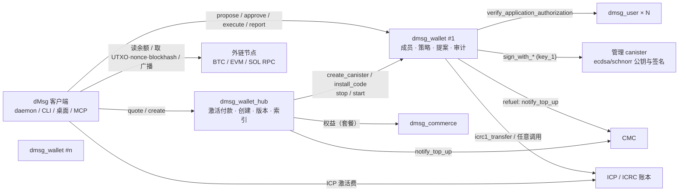
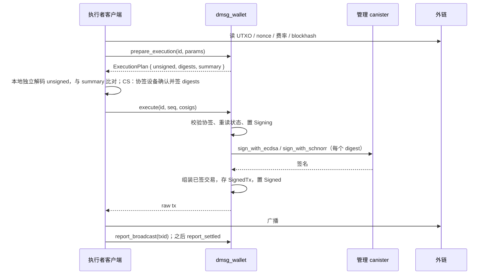

# dMsg Wallet 技术方案 v0.1 · 团队钱包的 canister、密钥与客户端实现

日期：2026-10-16。状态：技术设计基线，[产品方案](dMsg_wallet_product_2026-10-16_zh.md) 第 12 节的决策点已于 2026-10-16 确认；2026-10-17 已实现并在 PocketIC 验证，实现与本文的差异见[第 16 节](#16-实现记录2026-10-17)，两者不一致处以实现为准。本文保存在 `misc/`（该目录默认被 Git 忽略，本文件显式加入版本库），只引用私有设计文档的章节号。

## 1. 基线与范围

| 项目 | 核对 | 复用 |
| --- | --- | --- |
| `ic-panda` `9c602a88`（2026-10-15） | 占位 `src/dmsg_wallet`（空服务，主网 ID `ghcje-dyaaa-aaaas-qg7va-cai`） | `dmsg_types`（`ApplicationApproval`、`AppRegistration`、`ProductRegistration`、设备能力）、`dmsg_protocol`（确定性 CBOR、批准摘要、验签）、`dmsg_runtime`（`storage`、`certified`、`calls::call_classified`、`budget`、`admin::validation`、`ledger::read_transfer`）、`dmsg_user` 的 `approve_application` / `verify_application_authorization`、`dmsg_commerce` 的应用与产品登记 |
| 工作区依赖 | `ic-cdk 0.20`、`ic-cdk-management-canister 0.3`（`ecdsa_public_key`、`sign_with_ecdsa`、`schnorr_public_key`、`sign_with_schnorr`、`create_canister_with_extra_cycles`、`install_code`、`canister_status`、`update_settings`）、`ic-stable-structures 0.7`、`icrc-ledger-types 0.2`、`ic-secp256k1 0.3` / `ic-ed25519 0.6`（`derive_subkey_with_chain_code`，离线推导公钥）、`k256 0.14`、`ed25519-dalek 3`、`sha3 0.12` | 新增：`bitcoin`（交易、BIP341 sighash、bech32m）、`p256`（协签 P-256 验签）、`bs58` |
| 客户端 | [桌面客户端计划 v2](dMsg_desktop_client_plan_2026-10-08_zh.md)：`dmsg_client` 模块、daemon `方法组/动作` 命名、审批中心（`approval/respond` 只接受 `human: true`）、`dmsg mcp` 的 `dmsg_*` 工具与能力授权 | 新模块 `wallet`；现有 `wallet/use`、`wallet/balance` 改名 `payer/*`（产品方案 D-1） |
| ICP 事实 | `key_1`（ECDSA secp256k1、Schnorr BIP340、Schnorr Ed25519）在 34 节点 fiduciary 子网 `pzp6e`，每次签名 26,153,846,153 cycles；`test_key_1` 在 13 节点子网，10 B；公钥查询免费；创建 canister 13 节点子网 500 B；提案 140289 后 ECDSA ≈ 3.5 次/秒、Schnorr ≈ 6.5 次/秒，队列 20/30 | 费用与预算见第 9 节 |

范围：钱包工厂（hub）、钱包实例 canister、密钥与地址、策略与提案、ICP/ICRC 执行、BTC/ETH/SOL 的签名与客户端广播、协签、链上双控、客户端与 MCP 接入、测试。不在范围：法币、交易所、DEX 交互、NFT、质押（可后续作为“canister 调用”与“通用 EVM 调用”扩展）。

遵守 [AGENTS.md](../AGENTS.md)：不考虑接口兼容与数据迁移；身份在入口读一次；每个同步段读一次时间；跨 canister `.await` 返回后重读时间、状态与配置。

## 2. 结论摘要

1. **两个 canister 类型**：`dmsg_wallet_hub`（工厂，接管保留的主网 ID）与 `dmsg_wallet`（实例，每团队一个）。hub 负责激活付款、创建、版本登记、成员索引与 cycles 看门狗入口；实例负责成员、策略、提案、签名、审计。
2. **密钥只在 ICP**：实例的所有外链地址由管理 canister 按 `derivation_path = ["dmsg-wallet/v1", chain, index]` 派生；公钥可用 `ic-secp256k1` / `ic-ed25519` 离线复核。ICP/ICRC 资产用实例 principal + subaccount 持有，不需要阈值签名。
3. **执行分两类**：ICP/ICRC 与 canister 调用由实例直接发出跨 canister 调用；BTC/ETH/SOL 由实例从意图构造交易、校验执行参数、签名并保存已签字节，成员客户端广播并回报。实例不做 HTTPS outcall。
4. **批准复用 dMsg 账户体系**：成员批准是 `ApplicationApproval`（新用途 `WalletProposal`，`service` = 实例），由成员的 user home 核验；Principal 成员直接以 caller 批准；`WalletApprove` 成为独立设备能力。
5. **协签（CS）在签名前核验**：实例持有协签人公钥（P-256 / Ed25519 / secp256k1），`execute` 必须附带对精确待签摘要的协签签名，支持 Secure Enclave/TPM 原始签名、FIDO2 断言与 WebAuthn 断言三种封装。
6. **防双花靠链的原生规则**：BTC 重签必须同输入集（RBF）；EVM 每地址同一时间一笔未结算已签交易、重签同 nonce；SOL 默认用 durable nonce，一个 nonce 只能成交一笔。
7. **升级由实例接受、hub 执行**：实例用 Admin 阈值提案“接受版本 X”，任何人再调用 hub 升级；hub 只安装 SNS 登记过哈希的版本。实例可锁定代码。
8. **cycles 是真正的单点**：冻结阈值 365 天；实例可预授权从自身 ICP 储备经 CMC 铸 cycles 的 `refuel` 规则，任何人可触发。

## 3. 部署拓扑与信任边界



| 主体 | 决定 | 不决定 |
| --- | --- | --- |
| 实例 `dmsg_wallet` | 成员、策略、提案状态、签什么、签了什么、审计 | 外链余额与确认（只记录客户端回报，审计模式可选核对） |
| hub | 谁能创建、创建成本、可安装的版本、成员→钱包索引 | 任何钱包内部决定；不能主动升级或读取资金 |
| user home | 成员设备批准的真伪与设备能力 | 批准是否满足钱包策略 |
| 管理 canister / 签名子网 | 密钥与签名 | 签什么 |
| 客户端 | 执行参数（UTXO、nonce、费率、blockhash）、广播、回报、显示 | 任何授权（实例重算一切） |
| SNS governance | hub 参数、版本登记、hub 的 controller | 单个钱包的升级（必须实例先接受） |

controller：hub 的 controller 为 SNS governance（与其它 dMsg canister一致）；实例的 controller 只有 hub。实例 `LockCode` 提案通过后，hub 把实例 controllers 设为空（`update_settings`），实例永久不可升级、不可删除（cycles 耗尽除外）。

## 4. 密钥与地址

### 4.1 派生路径

`key_name`：`Production` 用 `key_1`，`Staging` 用 `test_key_1`，`Local` 用 `dfx_test_key`（PocketIC 默认）。所有地址的路径固定为三段：

```text
derivation_path = [ b"dmsg-wallet/v1", chain_tag, index.to_be_bytes() ]
chain_tag ∈ { b"btc", b"btc-segwit", b"eth", b"sol" }   // EVM 各链共用 b"eth" 的密钥
```

实例在创建地址时调用一次 `*_public_key` 并把公钥存入 `Address` 记录；之后不再查询。客户端用主公钥（`*_public_key` 的 `chain_code` + 根公钥）和 `ic-secp256k1::PublicKey::derive_subkey_with_chain_code` / `ic-ed25519` 离线推导同一路径，核对实例展示的地址；地址复核工具同时提供给第三方审计。

### 4.2 各链地址（CK）

| 链 | 密钥 | 地址 | 签名入参 |
| --- | --- | --- | --- |
| BTC P2TR（默认） | Schnorr `bip340secp256k1` | x-only 内部公钥 `P`，输出公钥 `Q = P + H_TapTweak(P)·G`，bech32m v1 | `sign_with_schnorr(message = BIP341 sighash, aux = Bip341 { merkle_root_hash: [] })` |
| BTC P2WPKH（可选） | ECDSA secp256k1 | `OP_0 <hash160(pk)>`，bech32 v0 | `sign_with_ecdsa(message_hash = BIP143 sighash)`，DER + `SIGHASH_ALL` |
| ETH / EVM | ECDSA secp256k1 | `keccak256(x‖y)[12..]`，EIP-55 展示；所有 EVM 链共用 | `sign_with_ecdsa(keccak256(0x02 ‖ rlp(unsigned)))`，恢复 `y_parity` 用 `k256` 试 0/1 与已知公钥比对；`s` 取低值 |
| SOL | Schnorr `ed25519` | 32 字节公钥的 base58 | `sign_with_schnorr(message = 完整 message 字节)` |
| ICP | 无 | `(实例 principal, subaccount = index.to_be_bytes() 左填充 32 字节)`；同时展示 AccountIdentifier | 不签名 |

`index = 0` 是每条链的默认地址；新增地址是 `AddAddress` 提案（Admin 阈值，无延时）。

### 4.3 协签人密钥（CS）

什么算“设备硬件密钥”（产品方案 D-8）：

| 来源 | 私钥可导出 | 在场证明 | 可信显示 | 档位 |
| --- | --- | --- | --- | --- |
| macOS Secure Enclave（P-256，`kSecAttrTokenIDSecureEnclave`，访问控制 `biometryCurrentSet`） | 否 | Touch ID / 登录密码 | 无 | 硬件密钥，默认 |
| Windows TPM（CNG Platform Crypto Provider，ECDSA_P256） | 否 | Windows Hello | 无 | 硬件密钥 |
| Linux TPM2（`tss-esapi`） | 否 | PIN（策略可要求） | 无 | 硬件密钥 |
| FIDO2 安全密钥（CTAP2） | 否 | 触碰 + PIN/UV | 无 | 次选 |
| 浏览器 passkey（WebAuthn 平台认证器） | 否 | 生物识别 | 无 | 仅桥接页 |
| OS keyring 中的软件密钥（钥匙串 / 凭据管理器 / Secret Service，即 `dmsg_cli::secure::SystemStorage`） | 是：`get_secret` 返回明文，同用户进程可读 | 无 | 无 | 软件密钥，弱，仅回退 |
| vault 中的软件密钥 | 是，且随密文同步到所有持根设备 | 无 | 无 | 软件密钥，最弱 |

硬件密钥给的是“私钥不可复制 + 签名时人在场”，不是可信显示；确认内容由桌面应用渲染，并与 7.7 的独立解码器比对。`SystemStorage` 在钱包里只保存硬件密钥的句柄或标签，以及回退软件密钥的密文，不保存硬件密钥本身。Secure Enclave 要求 daemon 二进制带 Developer ID 代码签名，`cargo build` 的开发构建拿不到它，会回退到软件密钥并在策略中标记为弱。

```rust
pub struct Cosigner {
    pub id: u32,
    pub member: MemberId,            // 归属成员，用于撤销成员时一并失效
    pub kind: CosignerKind,          // P256 | Ed25519 | Secp256k1
    pub public_key: Vec<u8>,         // SEC1 压缩 / 32 字节
    pub envelope: CosignerEnvelope,  // Raw | Fido2 { rp_id_hash, counter } | WebAuthn { rp_id_hash, origins, counter }
    pub label: String,
    pub added_at: u64,
}
```

地址的 `cosign: Option<CosignPolicy { cosigners: Vec<u32>, threshold: u8 }>`。协签消息：

```text
cosign_msg = SHA-256("dmsg-wallet/cosign/v1" ‖ wallet_id ‖ plan_id ‖ digest_index ‖ digest)
Raw      : 验 sig 覆盖 cosign_msg（Secure Enclave 用 ecdsaSignatureMessageX962SHA256 对 cosign_msg 再做一次 SHA-256，实例按同样方式验）
Fido2    : 验 P-256 sig 覆盖 auth_data ‖ cosign_msg；auth_data.rp_id_hash == 登记值，UP=1，UV 按策略，counter 单调
WebAuthn : 解析 client_data_json：type == "webauthn.get"，challenge == base64url(cosign_msg)，origin ∈ 登记 origins；验 sig 覆盖 auth_data ‖ SHA-256(client_data_json)
```

协签人登记是 `AddCosigner` 提案（Admin 阈值）：客户端在本机生成或注册密钥（Secure Enclave：`security-framework`；Windows：CNG/TPM；Linux：TPM2 或软件回退；FIDO2：CTAP2 `makeCredential`，rp id `wallet.dmsg.net`），把公钥与封装参数作为提案内容。实例不做注册仪式验证（它看到的只是公钥），安全性来自“之后每次协签都必须用该公钥通过”。

### 4.4 链上双控地址（NC，T4）

| 链 | 结构 | 花费 | 恢复 |
| --- | --- | --- | --- |
| BTC Taproot | 内部密钥 = BIP341 NUMS 点 `H`；叶 L1 `<ck_x> OP_CHECKSIGVERIFY <cs_x> OP_CHECKSIG`；叶 L2 `<n> OP_CSV OP_DROP <ck_x> OP_CHECKSIG`；可选叶 L3 `<m> OP_CSV OP_DROP <rec_x> OP_CHECKSIG` | 脚本路径 L1：实例按 BIP341 带 tapleaf 的 sighash 签（`aux = None`），协签人用链曲线密钥签，客户端拼 control block 与见证 | L2：UTXO 确认 n 块后实例单独（仍受 m-of-n）可花；L3：团队恢复密钥（建议本身是硬件 2-of-3）在 m 块后可花。相对时间锁随 UTXO 年龄生效，策略可设“到期前刷新”提案 |
| ETH Safe | Safe v1.4.1 代理，owners `[ck_eoa, cs_eoa]`，threshold 2 | 实例签 EIP-712 `SafeTx` 哈希；协签人用硬件钱包签同一 typed data；任何 EOA（默认实例的 CK EOA）广播 `execTransaction` | Safe 恢复模块或 2-of-3 加入 DAO 密钥，T4 决定 |
| SOL Squads v4 | `multisig_create_v2` 成员 `[ck, cs]`，threshold 2，vault 0 | `vault_transaction_create` → `proposal_create` → 两次 `proposal_approve` → `vault_transaction_execute`，每步是普通 Solana 交易，由各自密钥签 | Squads 自带时间锁与支出限额；成员变更由 config transaction |

NC 的协签密钥必须是 secp256k1（BTC/ETH）或 Ed25519（SOL）；客户端支持硬件钱包（Ledger/Trezor 的标准 app：BTC PSBT、EIP-712、Solana 消息）与 vault 软件密钥两种来源。

## 5. 数据模型

类型放在 `dmsg_types::wallet`，确定性 CBOR 与摘要放在 `dmsg_protocol::wallet`，与现有合同同样 `deny_unknown_fields`。

```rust
pub type WalletId = Principal;                // 实例 canister
pub type ProposalId = u64;                    // 实例内单调

pub enum MemberId { Account(AccountId), Principal(Principal) }

pub struct Member { pub id: MemberId, pub role: Role, pub label: String, pub added_at: u64, pub agent_ids: Vec<String> /* 允许代该成员提案的 Agent ID */ }
pub enum Role { Admin, Approver, Proposer, Viewer, Recovery }   // Recovery：只能提案成员类变更，固定 7 天延时；供团队指定的恢复成员（如离线保管的 Principal）使用

pub struct Policy {
    pub version: u64,                          // 每次变更 +1；未执行的批准绑定它
    pub approver_threshold: u8,
    pub admin_threshold: u8,
    pub tiers: Vec<Tier>,                      // 按资产、金额升序；见 7.3
    pub address_book_cooldown_ms: u64,
    pub daily_limits: Vec<(AssetKey, u128)>,
    pub spendable_assets: Vec<AssetKey>,       // 空 = 只收不发
    pub call_targets: Vec<Principal>,          // canister 调用白名单
    pub evm_chains: Vec<u64>,
    pub proposal_ttl_ms: u64,                  // 默认 7 天
    pub unfreeze_delay_ms: u64,                // 默认 24 小时
    pub daily_signatures: u32,
    pub refuel: Option<RefuelRule>,            // 见 7.9
}
pub struct Tier { pub asset: AssetKey, pub up_to: u128, pub approvals: u8, pub delay_ms: u64, pub book_only: bool }

pub enum AssetKey { Icp, Icrc(Principal), Btc, Evm { chain_id: u64, token: Option<[u8; 20]> }, Sol { mint: Option<[u8; 32]> } }

pub struct Address { pub index: u32, pub chain: Chain, pub kind: AddressKind, pub public_key: Vec<u8>, pub chain_code: [u8; 32], pub text: String, pub label: String, pub cosign: Option<CosignPolicy>, pub native: Option<NativeControl> /* NC 参数 */ , pub sol_nonce_account: Option<[u8; 32]> }

pub enum Intent {
    Transfer { from: u32, asset: AssetKey, to: Destination, amount: u128, max_fee: u128, memo: Option<Vec<u8>> },
    Batch { from: u32, asset: AssetKey, items: Vec<(Destination, u128)>, max_fee: u128 },
    CanisterCall { canister: Principal, method: String, arg: Vec<u8>, cycles: u128, consent: Option<ConsentRecord> },
    AddAddress { chain: Chain, kind: AddressKind, label: String, cosign: Option<CosignPolicy> },
    SetCosigners { address: u32, cosign: Option<CosignPolicy> },
    AddCosigner(Cosigner), RemoveCosigner(u32),
    AddMember(Member), RemoveMember(MemberId), SetRole(MemberId, Role),
    SetPolicy(Policy), AddressBook(AddressBookChange),
    Freeze, Unfreeze, Refuel { icp_e8s: u64 },
    AcceptUpgrade { version: u32, module_hash: [u8; 32] }, LockCode,
    CancelEvmNonce { address: u32, nonce: u64 },   // 同 nonce 0 值自转，用于废弃已签未上链交易
}

pub struct Proposal {
    pub id: ProposalId, pub intent: Intent, pub policy_version: u64,
    pub proposer: MemberId, pub via_agent: Option<String>,
    pub created_at: u64, pub expires_at: u64,
    pub requirement: Requirement { approvals: u8, delay_ms: u64, admin: bool },   // 创建时按策略冻结
    pub status: Status, pub approvals: Vec<(MemberId, u64)>, pub rejections: Vec<(MemberId, u64)>,
    pub ready_at: Option<u64>, pub vetoed_by: Option<MemberId>,
    pub plans: u32, pub signed: Vec<SignedTx>, pub broadcasts: Vec<Broadcast>, pub settled: Option<Settlement>,
}
pub enum Status { Open, Approved, Delayed, Ready, Signing, Signed, Broadcast, Settled, Rejected, Expired, Vetoed, Cancelled, Failed }

pub struct ExecutionPlan { pub seq: u32, pub params: ExecutionParams, pub unsigned: Vec<u8>, pub digests: Vec<[u8; 32]>, pub summary: DecodedSummary, pub created_at: u64, pub expires_at: u64 }
pub enum ExecutionParams {
    Btc { utxos: Vec<Utxo>, fee_rate_sat_vb: u32, locktime: u32 },
    Evm { nonce: u64, max_fee_per_gas: u128, max_priority_fee_per_gas: u128, gas_limit: u64 },
    Sol { blockhash_or_nonce: [u8; 32], compute_unit_price: u64, create_ata: bool },
    Icp,
}
pub struct SignedTx { pub plan: u32, pub raw: Vec<u8>, pub txid: [u8; 32], pub signed_at: u64, pub signatures: u8 }
pub struct Broadcast { pub plan: u32, pub txid: [u8; 32], pub reported_by: MemberId, pub at: u64, pub note: String }

pub struct AuditEvent { pub seq: u64, pub at: u64, pub actor: Option<MemberId>, pub kind: AuditKind, pub proposal: Option<ProposalId>, pub prev_hash: [u8; 32], pub hash: [u8; 32] }
```

`proposal_digest = SHA-256(canonical_cbor(("dmsg-wallet/proposal/v1", environment, wallet_id, id, intent, policy_version, proposer, created_at)))`。成员批准、协签、审计都引用它。

## 6. 接口

### 6.1 `dmsg_wallet_hub`

| 类别 | 方法 | 调用者 |
| --- | --- | --- |
| 报价 | `quote_activation(account_id) -> ActivationQuote { price_e8s, cycles_to_wallet, deposit: Account, quote_id, expires_at }` | 任何人（update，读 commerce 权益） |
| 创建 | `create_wallet(CreateWallet { quote_id, block, init: WalletInit, approval: ApplicationApproval })` | 付款 principal；`approval` 由创建者账户设备签，经其 home 核验 |
| 退款 | `claim_activation_refund(quote_id)` | 付款 principal（创建失败或过期） |
| 升级 | `upgrade_wallet(wallet_id)`：hub 调实例 `accepted_upgrade()`（update）取得接受的版本，`stop_canister` → `install_code(Upgrade)` → `start_canister` | 任何人 |
| 锁定 | `lock_wallet(wallet_id)`：实例已接受 `LockCode` 时清空 controllers | 任何人 |
| 看门狗 | `refuel_wallet(wallet_id)`：转调实例 `refuel()`；`wallet_health(wallet_id)`（`canister_status` 摘要，缓存） | 任何人 |
| 索引 | `sync_members(members)`（实例回调）、`list_wallets_of(member_id)`、`get_wallet_record(wallet_id)`、`hub_stats` | 实例 / 任何人（query） |
| 版本 | `admin_upload_wasm_chunk`、`admin_register_version(hash, notes)`、`admin_retire_version`、`admin_set_pricing(price_e8s, cycles_to_wallet, quotas)`、`admin_set_revenue_account`、`admin_set_pause`，及同参数 `validate_*` | controller / SNS governance |
| 维护 | `convert_revenue()`：把已收 ICP 中应铸的部分经 CMC 铸成 hub 的 cycles 池，其余转入 DAO 收入账户 | 任何人，有界 |

`canister_inspect_message` 拒绝非 controller/governance 的 `admin_*` 与匿名 `create_wallet`。

### 6.2 `dmsg_wallet`

| 类别 | 方法 | 调用者 |
| --- | --- | --- |
| 读取 | `get_wallet`、`get_wallet_certified`、`get_proposal(id)`、`get_proposal_certified(id)`、`list_proposals(filter, cursor)`、`list_addresses`、`list_members`、`get_policy`、`address_book`、`audit(cursor, limit)`、`wallet_stats` | Viewer 及以上（公开透明开启时任何人） |
| 提案 | `propose(Intent, op_id)` | Proposer 及以上；dMsg 账户成员由登录 Principal 调用并附设备批准；Agent 经成员客户端调用并标 `via_agent` |
| 批准 | `approve(id, MemberApproval)`、`reject(id, MemberApproval)`、`veto(id, MemberApproval)`、`cancel(id)`（仅提案人，未进入 Signing） | Approver（veto）/ 任意成员（reject 计数仅 Approver） |
| 执行 | `prepare_execution(id, ExecutionParams) -> ExecutionPlan`、`execute(id, plan_seq, cosigs: Vec<CosignerSig>) -> ExecuteResult`、`report_broadcast(id, plan_seq, txid, note)`、`report_settled(id, plan_seq, evidence)`、`reconcile(id)` | Proposer 及以上 |
| 接受 | `join(MemberApproval)`：被邀请成员确认加入（AddMember 执行后处于 `Invited`） | 被邀请者 |
| 冻结 | `freeze()` | Approver 及以上，立即生效，写审计 |
| 运行 | `refuel()`、`accepted_upgrade()`、`prune(after)` | 任何人 |
| 核对（可选） | `attest_btc(id, plan_seq)`（Bitcoin API 查 txid 的输出是否已在链上）、`attest_evm`、`attest_sol`（RPC canister） | 审计模式开启时任何人；实例付 cycles |

`MemberApproval` 为 `Account { approval: ApplicationApproval }` 或 `Principal`（caller 即成员）。所有 update 方法在入口读取 `msg_caller()` 与 `time()` 一次；`propose`/`approve`/`execute` 跨 canister 返回后重读提案、策略版本、冻结状态与时间。

## 7. 流程

### 7.1 创建与激活

1. 客户端 `quote_activation(account)`：hub 向 commerce 读该账户 `dmsg` 产品权益（新增复制调用 `read_entitlement(beneficiary)`，返回套餐档位），按 `quotas`（Plus 1 / Pro 3 / Max 10）减去 hub 索引中该账户作为创建者的现存数量；无余额返回 `QuotaExceeded`。报价 15 分钟有效，`deposit.subaccount = digest(hub, quote_id)`。
2. 客户端在审批窗口显示报价，设备批准 `ApplicationApproval { purpose: WalletCreate, action_digest = quote_hash, service = hub }`，向 ICP 账本转 `price_e8s`（`created_at_time` 去重）。
3. `create_wallet`：hub 先本地检查报价未过期、未使用；`dmsg_runtime::ledger::read_transfer(ICP ledger, block)` 核对收款子账户、金额与来源；向创建者 home `verify_application_authorization`；返回后重读报价与配置；写入 `Paid` 订单（同一消息）。随后 `create_canister_with_extra_cycles(settings { controllers: [hub], freezing_threshold: 365 天, reserved_cycles_limit, log_visibility: public }, cycles_to_wallet)`，再 `install_code(Install, 当前版本, WalletInit { environment, key_name, creator, members, policy, channel_hint, hub })`。每一步的结果写订单状态：`Paid → Created(canister) → Installed → Ready`；任一步失败保留可重试状态，`reconcile_activation(quote_id)` 续做；创建 canister 失败则订单 `Failed`，付款人可 `claim_activation_refund`（扣账本手续费）。
4. 实例 `init`：创建者为 Admin；其他成员状态 `Invited`，`join` 后生效；默认策略来自模板；为 ICP 与各链建 `index = 0` 地址（此时调用 `*_public_key`，免费）。实例回调 `hub.sync_members`。
5. `convert_revenue`：hub 把 `Paid` 订单累计的 ICP 分两笔处理：`cycles_to_wallet` 等值部分转到 CMC 的 hub 子账户并 `notify_top_up(block, hub)` 回填 cycles 池；其余 `icrc1_transfer` 到 DAO 收入账户（种子团队钱包）。每次处理有界（≤ 32 个订单）。

### 7.2 批准核验

dMsg 账户成员：客户端先在成员的 home 调 `approve_application(ApplicationApproval { app_id: "dmsg-wallet", purpose: WalletProposal, service: wallet_id, beneficiary: { product_id: "dmsg-wallet", schema: "dmsg-wallet-v1", subject: wallet_id bytes }, actor: 登录 principal, action_digest: proposal_digest, operation_id: digest(wallet_id, proposal_id, member) , expires_at: ≤ 5 分钟 }, Approval { 设备签名，要求能力 WalletApprove })`，再调实例 `approve(id, Account { approval })`。实例：

1. 本地：提案 `Open`/`Delayed`（veto）、未过期、`approval.service == self`、`approving_account` 是成员且角色足够、`action_digest == proposal_digest`、`policy_version` 未变。
2. 调该账户 home 的 `verify_application_authorization(approval_id, approval)`（按 AccountId 指纹定位 home，home 列表来自 `WalletInit.user_homes`，与其它服务同一机制）。
3. 返回后重读提案与策略版本，再记入 `approvals`；达到 `requirement.approvals`（Admin 类提案要求 Admin 角色计数）进入 `Approved`，按 `delay_ms` 进入 `Delayed`（`ready_at = now + delay`）或 `Ready`。

`dmsg_user::external::service_for(WalletProposal)` 返回 `expected.service` 本身：只要 caller 等于设备签名中指定的 service 即可，因为设备明确把批准签给了这个 canister。`WalletCreate` 的 service 固定为 hub。

Principal 成员：`approve(id, Principal)`，caller 必须等于成员 principal。钱包由团队成员管理，SNS governance 不作为成员；需要 SNS 治理的资金留在 SNS 国库，钱包也因此没有 admin 方法与 `validate_*`。

### 7.3 策略评估

`propose` 时算出 `Requirement` 存入提案（之后策略变化使提案失效，而不是改变要求）；支出类在每次批准时按当时的窗口再算一次，更严则提高批准数与延时并延长期限，拆成多个同时挂起的提案也落入合计金额的档：

```text
amount_24h = 该资产 24 小时窗口内 已执行 + 已签 + Approved/Delayed/Ready 的金额之和 + 本提案金额（提案与每次批准时各算一次）
tier       = tiers[asset] 中第一个 up_to ≥ amount_24h 的档；没有则最高档 + 1 人（上限 n）
book_only  = tier.book_only && 目的地不在地址簿（或冷却中） → 拒绝提案
approvals  = max(tier.approvals, 1)；提案人自己的批准计入，但 approvals ≥ 2 时提案人不能是唯一批准人
delay      = tier.delay_ms
daily      = amount_24h > daily_limits[asset] → 最高档
Admin 类   = approvals = admin_threshold，delay 按意图：SetPolicy/RemoveMember/SetCosigners/Unfreeze/AcceptUpgrade/LockCode 24 小时，其余 0
Recovery   = 提案人角色为 Recovery 时只接受 AddMember/RemoveMember/SetRole，approvals = admin_threshold，delay = 7 天；Recovery 的批准不计入任何阈值
冻结       = Frozen 时只允许 Unfreeze / Freeze / 成员类提案的创建与批准，不允许 execute
```

`Delayed` 期间任一 Approver `veto` → `Vetoed`，写审计；解除需 Admin 阈值的 `Unfreeze` 式提案（实现为重新提案）。滚动窗口用 `spend_window` 表，`prune` 清理 48 小时前的记录。

### 7.4 ICP / ICRC 执行

- `Transfer { asset: Icp | Icrc }`：`execute` 在同一消息内把提案置 `Signing` 并记录 `created_at_time = now`、`memo = proposal_digest[..32]`，再 `icrc1_transfer`（ICP 账本同样走 ICRC-1）。成功 → `Settled { block }`；账本明确拒绝 → `Failed(reason)`（`BadFee` 时允许 `revise_fee` 后重试，同 memo 去重）；结果未知 → 保持 `Signing`，`reconcile` 用 `icrc3_get_blocks` 按 memo 与 `created_at_time` 找回区块（复用 `dmsg_runtime::ledger`）。24 小时去重窗口内不重复发送。
- `Batch`：顺序逐笔，每笔独立状态，失败不回滚已成功的（账本不支持原子批量），审计逐笔。
- `CanisterCall`：`propose` 时实例先 `icrc10_supported_standards` 探测目标，支持 ICRC-21 则调 `icrc21_canister_call_consent_message` 取同意文本存入 `consent`（所有批准者看到同一文本）；不支持则要求提案附客户端解码的参数摘要并标记“未取得目标同意文本”。目标必须在 `call_targets` 白名单。`execute` 用 `ic_cdk::call` 附 `cycles`，回复原样保存（≤ 64 KiB，超出存摘要）。dMsg 收入归集（`dmsg_commerce.collect_checkout_revenue`、`dmsg_handle` 的收款账户）就是这类调用。
- `Refuel`：见 7.9。

### 7.5 外链执行



`prepare_execution` 的校验（任一失败即拒绝，不写状态）：

| 链 | 校验 |
| --- | --- |
| BTC | 每个 UTXO 的 `script_pubkey` 等于本钱包某个地址（实例自己推导）；`sum(in) − sum(out) ≤ max_fee`，且 `fee / vsize ≤ fee_rate`；找零输出回到 `from` 地址；输出不低于 dust；输入 `nSequence = 0xFFFFFFFD`（RBF）；`locktime` ≤ 当前高度估计（执行者提供，仅防 fee sniping）；输入个数 ≤ 32（每输入一次签名）。错报的 UTXO 金额会使 BIP341/BIP143 签名在链上无效，不构成风险 |
| EVM | `chain_id` 在白名单；`to` 与 `value`/`data` 由意图生成（ERC-20：`a9059cbb ‖ pad32(to) ‖ pad32(amount)`，`value = 0`）；`gas_limit × max_fee_per_gas ≤ max_fee`；`nonce`：该地址没有未结算的已签交易时任意（执行者负责），有则必须等于其 nonce（即只允许 fee bump）；`max_priority ≤ max_fee_per_gas` |
| SOL | 指令由意图生成：System `Transfer`，或 SPL `TransferChecked(amount, decimals)`（+ ATA `CreateIdempotent`，`create_ata` 为真时），前置 ComputeBudget `SetComputeUnitLimit`/`SetComputeUnitPrice`，`price × limit ≤ max_fee`；地址有 `sol_nonce_account` 时首条指令为 `AdvanceNonceAccount` 且 `blockhash_or_nonce` 必须不等于该地址上一次使用的 nonce 值；没有 nonce 账户时 `blockhash` 由执行者提供 |

`execute`：

1. 本地：提案 `Ready`/`Signed`（重签）、plan 未过期、未冻结、当日签名预算有余；CS 地址要求 `cosigs` 满足 `threshold`，按 4.3 逐个验签并推进 counter。
2. 置 `Signing`，记录 plan 与 cosigs 摘要（同一消息内提交，之后即使 trap 也能从审计看到“已进入签名”）。
3. 逐个 digest 调用管理 canister（`call_classified`），附 cycles = 签名成本上界；每次返回后重读提案：若已被 `freeze`，停止后续签名，但已取得的签名保留并记录（签名一旦存在不能撤回，这是设计上接受的边界，产品方案 10.1）。
4. 全部签名返回后组装：BTC 见证 `[sig]`（P2TR）或 `[sig‖01, pk]`（P2WPKH）；EVM `rlp(... y_parity, r, s)`；SOL `compact(sigs) ‖ message`。计算 txid（BTC 双 SHA-256、EVM keccak、SOL 首签名），存 `SignedTx`，置 `Signed`。
5. 调用结果未知（`CallFailure` 保留 unknown）：提案保持 `Signing`，`reconcile` 不能重放签名调用（签名不幂等），只能由执行者带同一 plan 再 `execute`；实例按 `plan_seq` 去重，同一 plan 的第二次签名会得到不同签名值但语义相同，审计记录两次。

### 7.6 重签与防双花

| 链 | 规则 | 理由 |
| --- | --- | --- |
| BTC | 同一提案的新 plan 必须使用与首个已签 plan 完全相同的输入集，只能改费用与找零 | 任一输入被花即其余版本失效（RBF） |
| EVM | 同一提案的新 plan 必须同 nonce；一个地址同一时间只允许一笔 `Signed`/`Broadcast` 未 `Settled` 的交易，下一笔的 plan 被拒绝直到 `report_settled` | 同 nonce 只能成交一笔；避免两笔不同 nonce 的同意图交易都上链 |
| EVM 废弃 | `CancelEvmNonce` 提案：同 nonce、`to = self`、`value = 0`、更高费用；走小额档 | 标准做法 |
| SOL | 地址创建后第一笔提案 `AddAddress` 的后续动作是创建 nonce 账户（一次普通转账 + `InitializeNonceAccount`，租金 ≈ 0.0015 SOL）；之后每笔用 durable nonce，重签必须同 nonce 值 | 一个 nonce 只能成交一笔，与 blockhash 过期时间无关 |
| SOL 无 nonce | 允许（例如地址刚建、租金未到位），但重签只能在上次签名 150 秒后 | 150 块（≈ 60–90 秒）后旧交易必死 |
| ICP | `created_at_time + memo` 去重，24 小时窗口 | 账本规则 |

执行者回报不是安全依据，只影响活性：EVM 的“未结算”锁可由 Admin 阈值提案 `ReleaseEvmNonce` 强制解除（审计记录），审计模式下可由 `attest_evm` 用 EVM RPC canister 的 `eth_getTransactionCount` 自动解除。

### 7.7 协签设备

| 来源 | daemon 实现 | 签名 |
| --- | --- | --- |
| macOS Secure Enclave | `security-framework`：`SecKeyCreateRandomKey` 带 `kSecAttrTokenIDSecureEnclave` 与 `biometryCurrentSet` 访问控制 | `Raw`，签名要求 Touch ID |
| Windows TPM | CNG `NCryptCreatePersistedKey`（Platform Crypto Provider，ECDSA_P256） | `Raw`，Windows Hello |
| Linux | `tss-esapi`（TPM2 可用时）；否则软件密钥存入 OS keyring，标记为弱，策略可禁止 | `Raw` |
| FIDO2 安全密钥 | CTAP2 over HID（`ctap-hid-fido2`），`getAssertion(rp_id, client_data_hash = cosign_msg)` | `Fido2` |
| 浏览器 passkey | connect.dmsg.net 桥接页 WebAuthn `navigator.credentials.get({ challenge: cosign_msg })`，断言经 dmsg-connect/1 转述 | `WebAuthn` |

协签确认屏必须显示 `DecodedSummary`（链、来源地址、目的地址全文、金额、费用上限、提案 ID）；daemon 用自己的解码器从 `unsigned` 重算摘要，与实例返回的 `summary` 不一致即拒绝（防实例与客户端任一侧出错）。

### 7.8 成员变更与账户事件

- `AddMember` 执行后成员为 `Invited`；`join` 需本人批准（dMsg 账户：`WalletJoin` 用途的 `ApplicationApproval`）。
- `RemoveMember` 使其批准、协签人、Agent 授权立即失效；进行中的提案重算是否仍达阈值。
- 成员账户 `security_epoch` 变化不通知实例；但其未消费批准在 home 侧已失效，实例在 `verify` 时得到拒绝即可。实例在每次 `approve` 回调后重算计数，不缓存“已核验”。

### 7.9 cycles、升级与锁定

- `refuel()`：任何人可调。规则 `RefuelRule { min_balance, icp_e8s, max_per_day, reserve_subaccount }`：`canister_cycle_balance() < min_balance` 且当日次数未满时，从储备子账户向 CMC 的实例子账户转 `icp_e8s`（memo `TPUP`），`notify_top_up(block, self)`；两步分别记录，未知结果用 `reconcile`。
- hub 看门狗是外部运维任务（与现有“维护外置”原则一致）：遍历 `list_wallets`，对低余额实例调 `refuel_wallet`；频道告警由成员客户端发。
- 升级：实例 `AcceptUpgrade { version, module_hash }` 提案（Admin 阈值 + 24 小时）通过后，`accepted_upgrade()` 返回它；任何人调 hub `upgrade_wallet`，hub 核对版本已登记且哈希一致，`stop_canister`（实例此时没有对 hub 的在途调用，不会死锁）→ `install_code(Upgrade)` → `start_canister`；失败自动 `start_canister` 并记录。实例 `post_upgrade` 只重建认证树根。
- `LockCode` 通过后 `accepted_upgrade()` 返回 `Locked`，hub `lock_wallet` 把 controllers 设为空；之后 hub 对它只剩索引与看门狗。

## 8. 存储、认证与升级

| 区域 | 结构 | 边界 |
| --- | --- | --- |
| 钱包记录 | `StableCell<CompactStored<Wallet>>`（存储版本、成员 ≤ 64、地址 ≤ 256、协签人 ≤ 64、策略、计数、未结算 nonce、24 小时支出窗口） | 单条；满载约 38.6 KB |
| `proposals` | `StableBTreeMap<u64, CompactStored<Proposal>>`，另有 `op_id → id` | 终态提案保留 10,000 条；每个新提案顺带删 2 条最旧的终态提案，`prune` 每次 ≤ 100 条（审计仍保留） |
| `plans` | `StableBTreeMap<(u64, u32), PlanRecord>`（计划、一份签名规格、组装数据） | 每提案 ≤ 8 个 plan；已签交易存在提案的 `signed` |
| `jobs` | `StableBTreeMap<u64, Job>`（ICRC 转账确切参数、CMC 充值、在途标记；键 0 为策略自动充值） | 执行结束即删 |
| `audit` | `StableLog<CompactStored<AuditEvent>>`，`hash = digest("dmsg-wallet/audit/v1", ...)` | 只追加；链头在钱包视图中认证 |
| `address_book` | `StableBTreeMap<canonical(Destination), CompactStored<BookEntry>>` | ≤ 4,096 条 |
| `cert` | `dmsg_runtime::cert_map`，叶：`wallet`（`WalletView`）、`proposal/<id>` | `certified_batch` 返回证书 + 树 |

stable 记录用整数键的紧凑编码（协议类型的表示在 `dmsg_runtime::stable_types::wallet`），认证叶与摘要仍用协议的确定性 CBOR。heap 只缓存解码后的钱包记录；`post_upgrade` 校验存储版本、重新认证钱包视图，与其它 dMsg canister 的升级模型一致（[dmsg_architecture_zh.md §6](../docs/dmsg_architecture_zh.md)）。

hub：`orders`（激活订单，≤ 100 万）、`wallets`（记录 + 版本）、`member_index`（`MemberId → Vec<WalletId>`，每成员 ≤ 256）、`versions`（Wasm 字节分块，≤ 16 个版本，每个 ≤ 4 MiB）、`pricing`、`revenue` 账务（`received = minted_to_pool + transferred_to_dao + refunded + pending`，每次保存校验守恒）。

## 9. 费用与预算

| 操作 | cycles | 说明 |
| --- | ---: | --- |
| 创建实例（hub 所在 13 节点子网） | 500 B + 初始余额 2.5 T | 激活费覆盖；初始余额支持约 95 次 `key_1` 签名或数年闲置 |
| `key_1` 签名 | 26.15 B / 次 | BTC 每输入一次；EVM、SOL 每笔一次；NC 的 Taproot 与 Safe 各一次（协签人在链下） |
| `test_key_1` 签名 | 10 B / 次 | Staging |
| ICRC 转账 / canister 调用 | ≈ 20–50 M | 含 xnet 开销 |
| 成员批准核验（home 调用） | ≈ 5–10 M | 由实例付；home 侧按现有每小时 120 次跨 canister 配额计 |
| 存储 | 13 节点 ≈ 329 B / GiB / 30 天；实例 < 10 MiB | 可忽略 |
| 审计模式核对 | `bitcoin_get_utxos` 10 B；EVM/SOL RPC canister 按其报价 | 可选 |

实例策略 `daily_signatures`（默认 50）与 `refuel` 规则共同保证余额；`wallet_stats` 返回 cycles 余额、当日签名数、`freezing_threshold` 折算的天数。hub 的 cycles 池由 `convert_revenue` 回填，低于水位时 `hub_stats` 告警，运维经 SNS 提案补充。

激活经济（示例，参数由治理定）：`price_e8s` 设为约 10 USD 等值 ICP；`cycles_to_wallet = 3 T`（≈ 4.05 USD）；差额归 DAO。ICP/XDR 汇率由 CMC 决定，hub 不需要价格权威。

## 10. 客户端

### 10.1 `dmsg_client`

- 现有 `wallet.rs`（付款身份、ICRC 余额/转账/授权日志）改名 `payer.rs`；daemon `wallet/use`、`wallet/balance` → `payer/use`、`payer/balance`；CLI `dmsg payer`。
- 新模块 `wallet/`：`registry`（hub 调用、钱包列表、本地缓存）、`proposal`（提案构造、`proposal_digest`、策略预评估的本地复算）、`approval`（接入审批中心：请求种类 `wallet_proposal`、`wallet_join`、`wallet_create`、`wallet_cosign`）、`exec`（执行参数采集、`prepare`/`execute`/`report`）、`chains/{icp,btc,evm,sol}`（RPC 读取、独立解码器、广播）、`cosign/{se,tpm,fido2,webauthn}`、`audit`（审计日志校验：重算哈希链、核对认证根）。
- 独立解码器只依赖 `bitcoin`、`alloy-consensus`（或自写 RLP）、自写 Solana message 解析，与 canister 的编码器是两份实现，差异即拒绝（7.7）。
- RPC 配置：`~/.dmsg/config.toml` 的 `[chains.bitcoin] api = "https://mempool.space/api"`、`[chains.evm.<chain_id>] rpc = ...`、`[chains.solana] rpc = ...`，默认公共端点，可换自建节点；私有云端后续可提供可选的 RPC 中继，不是必需。
- 余额：ICRC 由账本 query；外链由上述 RPC；客户端缓存并标注“来源与时间”。

### 10.2 daemon、CLI、桌面

- 方法：`wallet/create`、`wallet/list`、`wallet/show`、`wallet/join`、`wallet/propose`、`wallet/approve`、`wallet/reject`、`wallet/veto`、`wallet/cancel`、`wallet/execute`、`wallet/broadcast`、`wallet/report`、`wallet/addresses`、`wallet/address/new`、`wallet/book`、`wallet/policy`、`wallet/members`、`wallet/cosigners`、`wallet/audit`、`wallet/refuel`；事件 `wallet/changed`。`approve`/`veto`/`join`/`cosign` 经审批中心，`approval/respond` 只接受 `human: true`，与现有规则一致。
- CLI：`dmsg wallet create|list|show|join|propose|approve|reject|veto|execute|broadcast|report|address|book|policy|members|cosigner|audit|refuel`。`--json` 创建的审批请求只能等待，不能批准。
- 桌面：新视图“钱包”（列表、余额、提案、地址、成员、策略、审计）；审批窗口对 `wallet_proposal` 渲染认证读取的提案（全地址 + 校验和 + 地址簿标签、金额、资产、链、费用上限、提案人/智能体、进度、延时到期）；`wallet_cosign` 渲染 `DecodedSummary` 并触发生物识别。
- 频道绑定：`WalletInit.channel_hint` 指向一个频道；每个状态变化由触发它的成员客户端在频道发一条 `wallet/event` 系统消息（密文，与普通消息同路径）；其他成员客户端收到后拉取实例的认证状态。canister 不接触云端。

### 10.3 MCP 与智能体

`dmsg_agent` 新增 `dmsg_wallet_list`、`dmsg_wallet_balances`、`dmsg_wallet_propose_transfer`、`dmsg_wallet_proposal_status`、`dmsg_wallet_execute`、`dmsg_wallet_report_broadcast`；能力 `wallet.read`、`wallet.propose:<wallet_id>`、`wallet.execute:<wallet_id>`。没有批准类工具；`propose` 由 daemon 以成员身份提交并填 `via_agent = Agent ID`，实例要求该 Agent ID 列在成员的 `agent_ids` 中。

## 11. 对现有 canister 与类型的改动

| 位置 | 改动 |
| --- | --- |
| `dmsg_types::user` 设备能力 | 新增 `WalletApprove` |
| `dmsg_types::integration::ApprovalPurpose` | 新增 `WalletCreate`、`WalletProposal`、`WalletJoin` |
| `dmsg_user::external::service_for` | 上述用途返回 `expected.service`（`WalletCreate` 固定 hub） |
| `dmsg_commerce` | 治理登记应用 `dmsg-wallet`（origins：`https://dmsg.net`，capabilities `[Checkout]`，`action_authority` = hub）与产品 `dmsg-wallet`（subject schema `dmsg-wallet-v1` = principal 字节）；新增复制调用 `read_entitlement(beneficiary)` 供 hub 读套餐 |
| `dmsg_handle` / `dmsg_payment` | 无代码改动；收款账户由治理设置 |
| `icp.yaml` | `dmsg_wallet_hub` 接管 `ghcje-dyaaa-aaaas-qg7va-cai`；`dmsg_wallet` 不再是独立部署项，而是 hub 登记的 Wasm |
| `Cargo.toml` 工作区 | 新增 `bitcoin`、`p256`、`bs58`；dev-deps `alloy-*`、`solana-sdk` 仅用于向量生成 |
| `token-listing`、`dmsg-cloud` | 同步 `dmsg_types` / `dmsg_protocol` 版本（新枚举变体） |

## 12. 测试与验证

| 层 | 内容 |
| --- | --- |
| 向量（`tests/vectors/wallet`） | 每链地址派生（固定主公钥 + 路径 → 地址）；BTC P2TR/P2WPKH sighash 与已签交易；EIP-1559 原始交易与 txid；SOL legacy message 与签名；Taproot 2-of-2 脚本树、control block；协签三种封装；`proposal_digest`。参考值由 `bitcoin`、`alloy`、`solana-sdk` 在构建机生成，canister 与客户端的两套实现都必须吻合 |
| 单测 | 策略评估（分档、滚动窗口、拆单、地址簿冷却、冻结）；状态机；重签规则；守恒检查 |
| PocketIC（`tests/dmsg_integration`） | hub 创建流程（含失败退款与 reconcile）；成员批准经 home；ICP/ICRC 执行与未知结果对账；canister 调用与 ICRC-21；`sign_with_*` 使用 PocketIC 的 `dfx_test_key`，签名用参考库离线验证；升级（接受 → stop/install/start）与锁定；`refuel` 经本地 CMC 替身；升级后状态与认证树保持 |
| 外链端到端 | regtest `bitcoind`（广播已签 P2TR 交易并确认）、`anvil`（EIP-1559 广播、同 nonce 替换）、`solana-test-validator`（durable nonce 流程）；只在 CI 可选阶段跑 |
| 桌面冒烟 | `desktop_wallet`：创建、两成员批准、ICP 转账、BTC regtest 转账、协签（软件密钥封装为 `Raw`）、审计校验 |
| 主网灰度 | Staging 用 `test_key_1` 小额跑通四链；Production 先只开放 ICPanda DAO 钱包 |

未核实项（实现时先确认）：PocketIC 对 `sign_with_schnorr` 的 `Bip341` aux 支持；`bitcoin`、`p256` 在 wasm32 下的编译与 Wasm 体积（预计 < 3 MiB）；`ic-cdk-management-canister 0.3` 的 `SchnorrAux` 类型名；Secure Enclave 与 TPM 的 Rust 绑定成熟度。

## 13. 工作包与顺序

| 包 | 内容 | 依赖 |
| --- | --- | --- |
| WT0 | 类型与协议：`dmsg_types::wallet`、`dmsg_protocol::wallet`、`WalletApprove`、`ApprovalPurpose` 变体、向量骨架 | 决策点 |
| WT1 | `dmsg_wallet`：成员、策略、提案、批准核验、ICP/ICRC 执行、canister 调用、审计、认证、升级钩子；`dmsg_wallet_hub`：报价、创建、版本、索引、收入转换 | WT0 |
| WT2 | 客户端：`payer` 改名、`wallet` 模块、daemon 方法、审批中心种类、CLI、桌面视图、频道绑定、冒烟测试 | WT1 |
| WT3 | 外链 CK：BTC/EVM/SOL 编码器与签名、客户端解码器与广播、重签规则、durable nonce、费用估算 | WT1 |
| WT4 | 协签：Secure Enclave/TPM/FIDO2/WebAuthn、`AddCosigner`、`wallet_cosign` 审批种类 | WT2、WT3 |
| WT5 | MCP 工具与 Agent 提案；审计模式核对；透明页（`dmsg_frontend` 读认证查询） | WT2 |
| WT6 | NC：Taproot 脚本树、Safe、Squads；硬件钱包协签 | WT4 |
| WT7 | 治理与上线：commerce 登记、hub 参数、ICPanda DAO 钱包创建、收款账户提案、文档同步 | WT1–WT5 |

WT1 与 WT2 可并行（合同由 WT0 冻结）；WT3 可在 WT1 完成 ICP 路径后并行。与产品方案第 11 节的对应：T1 = WT0–WT2 + WT7 的 DAO 钱包上线；T2 = WT3；T3 = WT4 + WT5；T4 = WT6。

## 14. 风险

| 风险 | 对策 |
| --- | --- |
| 签名子网拥塞导致 `execute` 超时 | `call_classified` 区分未知；重试同 plan；预算与提示 |
| 实例被删除（cycles） | 365 天冻结阈值、`refuel`、看门狗、告警、NC 恢复分支；文档明确“不充值即丢失” |
| 编码器错误导致签了错误交易 | 两套实现比对；向量；外链先 Staging 小额；转账类不接受任意 calldata |
| home 核验的信任 | Principal 成员与 CS/NC 不经 home；SNS 治理 |
| 成员批准配额（每账户每小时 60 次成功批准） | 团队钱包频率远低于此；批量转账是一个提案 |
| Wasm 体积与指令上限 | 编码器手写最小实现；大对象分块；`prune` 有界 |
| 升级 stop 卡住（实例有在途调用） | 实例所有对外调用都有超时的 `call_classified`；hub 升级前等待 `canister_status` 为 stopped，超时则 `start` 并报告 |
| 协签设备绑定失败（平台差异） | 软件密钥回退并在策略中标记为弱，可禁止 |

## 15. 需要同步的文档

与产品方案第 13 节相同，另加：`src/dmsg_wallet/README.md`、`src/dmsg_wallet_hub/README.md`（接口、部署、验证）、`docs/protocol/wallet_zh.md`（公开合同：批准字节、协签消息、地址派生、向量）、`docs/dmsg_canisters_zh.md` 增量条目、`AGENTS.md` 客户端代码位置、`tests/vectors/wallet/README.md`。

## 16. 实现记录（2026-10-17）

实现位置：`src/dmsg_types/src/wallet.rs`、`src/dmsg_protocol/src/wallet/`、`src/dmsg_wallet`、`src/dmsg_wallet_hub`、`src/dmsg_client/src/wallet/`、`src/dmsg_cli/src/wallet_{methods,commands}.rs`、`src/dmsg_cli/src/enclave.rs`、`src/dmsg_agent/src/tools.rs`、`src/dmsg_desktop/src/renderer/views/Wallet.svelte`、`tests/dmsg_integration/tests/control_plane/wallet.rs`、`tests/dmsg_test_cmc`。公开合同见 [docs/protocol/wallet_zh.md](../docs/protocol/wallet_zh.md)。

### 16.1 与本文不同的实现

| 本文 | 实现 | 原因 |
| --- | --- | --- |
| 账户成员以登录 Principal 调用钱包（6.2、7.2） | 每台设备一把“钱包密钥”（Ed25519，LDK 加密存于本机工作区），`WalletJoin` 设备批准把它的 Principal 绑定到成员（每成员最多 4 个）；`approve_application` 仍由登录 Principal 在 home 调用 | 登录委托只到达固定的 ≤ 32 个 canister，无法覆盖动态的钱包实例 |
| 提案也附设备批准 | 提案只需已绑定的 Principal；每次决定才需要设备批准。提案人的批准单独计入 | 智能体提案不能要求每次人工签名；授权集中在决定 |
| `proposal_digest` 含 `id`、`created_at` | `digest("dmsg-wallet/proposal/v1", (environment, wallet, op_id, intent, policy_version, proposer, via_agent))`；决定再包一层 `decision_digest(proposal_digest, Approve/Reject/Veto)` | id 由钱包分配，摘要须在提交前可算；决定种类须进入批准字节 |
| Recovery 提案需 Admin 阈值 + 7 天 | 无需批准，延时 7 天，期间任一 Admin/Approver 可否决 | Admin 全部失联时恢复才有意义 |
| commerce 新增 `read_entitlement` | hub 调用已有的 `refresh_entitlement`，无记录视为 Free | 现有接口已满足 |
| hub 用 `read_transfer` 核对付款区块 | hub 读取报价专属收款子账户余额 | 不依赖 ICP 账本的 ICRC-3 区块格式 |
| 付款 principal 调用 `claim_activation_refund(quote_id)`（6.1） | 报价调用者调用 `claim_activation_refund(quote_id, to)` 并指定 hub 以外的退款账户；客户端以本机钱包密钥报价与领取，`to` 为付款身份的默认账户 | hub 只认识报价调用者；客户端报价与创建用钱包密钥，付款用付款身份，两者不是同一个 Principal |
| CMC 充值用 legacy memo | `icrc1_transfer` 带 8 字节小端 ICRC-1 memo `TPUP`（CMC `get_u64_memo` 在旧 memo 为 0 时读取它） | 与 ICRC 转账统一 |
| 实例回调 `hub.sync_members` | 任何人调用 hub `sync_wallet(wallet)` 拉取 `member_ids` | 钱包不依赖 hub 的接口与可用性 |
| 地址 `index` 每链从 0 起 | 地址 `id` 钱包内唯一并兼作派生序号；默认 0 = ICP、1 = BTC P2TR、2 = EVM、3 = SOL；chain tag 另有 `icp`、`btc-native` | 一个编号同时定位地址、子账户与派生路径 |
| `Intent::Freeze`、`SetRole` | 冻结为直接方法 `freeze()`；`UpdateMember` 替代 `SetRole`（可改角色、标签、Agent ID）；新增 `ReleaseEvmNonce`、`InitSolNonce`；`CancelEvmNonce`、`InitSolNonce` 带 `max_fee` | 冻结须立即生效；Agent 授权需可修改 |
| 状态 `Signing` | `Executing`（覆盖账本调用、canister 调用与签名）；新增 `Stale`（策略版本已变） | — |
| `report_broadcast` / `report_settled` | `report(ChainReport { outcome: Broadcast / Settled / Failed })` | — |
| NC 协签人用 secp256k1 | 新增 `CosignerKind::Bip340`，双控 Taproot 的协签人对每个输入的脚本路径 sighash 直接签名；`ExecutionParams::Bitcoin.timelock` 选择链密钥单独花费的 L2 | — |
| 本地密钥 `dfx_test_key` | PocketIC 的 fiduciary 子网只有 `key_1`，测试 hub 配置 `key_1` | — |
| 每台设备的协签实现 | 客户端 `CosignProvider` 接口；daemon 在 macOS 且使用系统凭据存储时接入 Secure Enclave（P-256，`PrivateKeyUsage | UserPresence`）；否则软件 P-256 密钥封存于本机工作区并声明非硬件 | 开发构建无签名与钥匙串权限时自动回退 |
| 向量参考值由 `bitcoin`、`alloy`、`solana-sdk` 在构建机生成（第 12 节） | `tests/vectors/wallet` 由本实现生成（`DMSG_WRITE_WALLET_VECTORS=1`），每次测试逐字节比对；`plans-v1.json` 由 canister 的构建器产生、客户端解码器验收；与 `bitcoin`、`alloy`、`solana-message` 的交叉核对在 `dmsg_wallet` 的 `chains::tests` 与 PocketIC 套件中 | 向量与独立库各司其职：前者固定字节，后者证明字节正确 |
| `desktop_wallet` 含两成员批准、BTC regtest 转账与协签（第 12 节） | 两个账户：A 经审批中心报价、付款并创建，B 经设备批准加入并批准 ICP 转账，A 执行，两端核对审计链；BTC regtest 与协签留给链上端到端 | daemon 不带 regtest 节点与 Esplora；协签由 PocketIC 套件以真实门限签名覆盖 |

### 16.2 工作包完成情况

| 包 | 完成 | 未完成 |
| --- | --- | --- |
| WT0 | `dmsg_types::wallet`、`dmsg_protocol::wallet`、`WalletApprove`、三个 `ApprovalPurpose`、user home 核验规则、SDK 与 CDDL 重新生成；2026-10-17 补 `tests/vectors/wallet`：`protocol-v1.json`（全部承诺的原像与摘要、审计链、地址与收款脚本）与 `plans-v1.json`（canister 构建器生成的 11 个计划与 6 个篡改样例，由客户端解码器验收） | TypeScript 端的钱包摘要实现（SDK 目前只有三个审批用途名） |
| WT1 | 钱包与 hub 全部接口；分块安装；升级、锁定、退款、收入转换、refuel；认证叶与审计链；2026-10-17 审查修复：延时过后首次 `prepare_execution` 不再误报过期，签名在开始时计入日签名数并在签完后重查 EVM/Solana 约束，跨 canister 返回后的错误不再让提案卡在 `Executing`，冻结时不接受内部变更的批准，`prune` 先套用期限并跳过在途提案（新提案顺带清理），同一计划的广播回报只记一次，重复 `join` 不写审计，`bootstrap` 失败自动重试，缺失的 user home 按需向 hub 补取（删去 `refresh_homes`），支出在每次批准时按当时窗口重算要求；存储改为整数键的紧凑编码，计划只存一份签名规格，sighash 的整笔哈希只算一次 | 超过 10,000 条提案后的清理没有 PocketIC 用例 |
| WT2 | `payer` 改名；客户端 `wallet` 模块、审批中心任务、daemon `wallet/*`、CLI `dmsg wallet`、桌面“团队钱包”视图与审批窗口；2026-10-17 补桌面端到端 `desktop_wallet`（两个账户经审批中心创建并付款、加入、批准与执行 ICP 转账、核对审计链）；同日补激活退款：hub 改为 `claim_activation_refund(quote_id, to)`，由报价调用者指定 hub 以外的退款账户，客户端 `wallet_refund`（daemon `wallet/refund`、CLI `dmsg wallet refund <quote>`）以本机钱包密钥领取，退到付款身份（付款日志记下的付款 Principal，没有日志时为当前付款身份）的默认账户，无需审批；创建任务的审批详情显示 `quote_id`；PocketIC 套件覆盖过期报价与创建失败（hub cycles 不足）两种退款，`desktop_wallet` 以 `dmsg wallet refund` 把创建失败的付款退回付款身份；桌面“团队钱包”视图列出本机付过款而未建成钱包的激活付款（daemon `wallet/deposits`，按 hub 订单与收款子账户余额），可退的一键退款；已用完的报价（钱包已创建或已退款）从本机删除 | 频道绑定（`wallet/event` 系统消息）；Electron 界面（`pnpm test:e2e` 的模拟 daemon）只覆盖钱包视图的激活付款退款；过期报价的退款不能在桌面端到端运行（需推进 PocketIC 时间） |
| WT3 | BTC P2TR/P2WPKH、EVM（ETH、ERC-20、nonce 取消）、SOL（SOL、SPL、ATA、durable nonce）编码与签名；客户端独立解码、Esplora/JSON-RPC 读取与广播、重签规则 | regtest/anvil/test-validator 端到端；主网 `test_key_1` 小额 |
| WT4 | canister 侧 Raw/FIDO2/WebAuthn 验签；`AddCosigner`/`SetCosign`；协签审批任务；Secure Enclave 与软件密钥 | Windows/Linux TPM、FIDO2（CTAP2）、桥接页 WebAuthn 的客户端适配 |
| WT5 | MCP 工具 `dmsg_wallet_list|balances|propose_transfer|proposal_status|execute|report_broadcast`，能力 `wallet.read`、`wallet.propose:<wallet>`、`wallet.execute:<wallet>` | 审计模式 `attest_*`；`dmsg_frontend` 透明页 |
| WT6 | 双控 Taproot（L1 双签、L2 时间锁、可选 L3 恢复叶）的地址、签名与见证 | EVM Safe、Solana Squads、硬件钱包协签 |
| WT7 | 构建、测试、release 脚本与 icp.yaml 纳入 hub；`.icp` 映射改为 `dmsg_wallet_hub`；production.toml 指向 hub；文档同步 | 主网部署、commerce 登记与版本登记的 SNS 提案、ICPanda DAO 钱包创建与收款账户切换（运维操作） |
