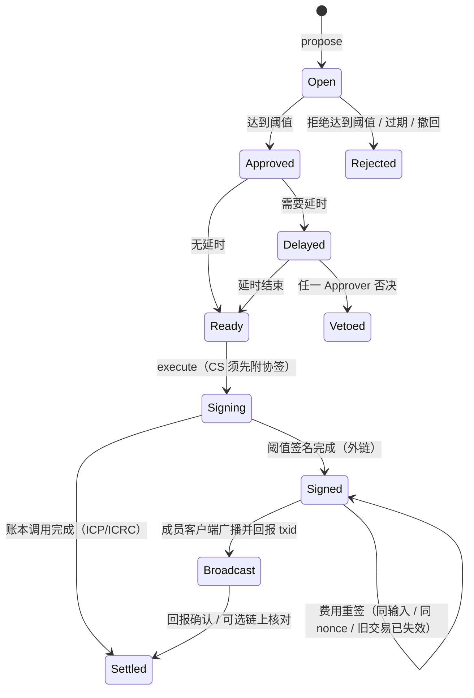

# dMsg Wallet 产品方案 v0.1 · 团队钱包

日期：2026-10-16。状态：产品设计基线；第 12 节的决策点已于 2026-10-16 确认。2026-10-17 已实现 T1–T3 的主体与 T4 的 Taproot 双控，实现与本文的差异及未完成项见技术方案 [第 16 节](dMsg_wallet_implementation_2026-10-16_zh.md#16-实现记录2026-10-17)，以实现为准。本文保存在 `misc/`（该目录默认被 Git 忽略，本文件显式加入版本库）；公开合同以 `docs/` 与各 canister README 为准，本文只引用私有设计文档的章节号，不复制其正文。

## 0. 基线与依据

| 项目 | 本次核对 | 说明 |
| --- | --- | --- |
| `ic-panda` | `9c602a88`（2026-10-15），工作区有 proposals 与 `dmsg_cli` 的本地改动，与本文无关 | `src/dmsg_wallet` 目前是占位 crate，保留主网 ID `ghcje-dyaaa-aaaas-qg7va-cai`，无方法、无状态 |
| `dmsg-cloud` | `3611c6e`（2026-10-14），未核对远端 | PRD v1.1、技术实施 v1.1、商业化 v1.0 及其实施、PANDA 会员对比、Agent Protocols v1.0 |
| 公开实现 | [dmsg_architecture_zh.md](../docs/dmsg_architecture_zh.md)、[dmsg_canisters_zh.md](../docs/dmsg_canisters_zh.md)、各 canister README、[integration.md](../docs/protocol/integration.md) | 账户/设备/批准模型、commerce 与 membership 的接入方式、收入归集入口 |
| 客户端 | [桌面客户端计划 v2](dMsg_desktop_client_plan_2026-10-08_zh.md)：daemon、CLI、桌面壳、审批中心、`dmsg mcp` | 钱包作为 daemon 新模块接入审批中心与 MCP |

与现有设计的关系：PRD v1.1 §3 与 §4 把钱包交易排除在 R1 之外，并把账户与钱包类功能推迟到 R2 之后；商业化 v1.0 §4.2 也不借收款功能开放通用跨链钱包。本文不推翻这些边界：钱包是 R2 之后的独立产品线（下文称 T 系列），与消息、秘密库、来信、会员并列。商业化 §9.1 要求上线前落实各资产的收款账户、归集周期、支出权限与链上对账的归属，本文第 9 节用种子钱包给出答案。需要同步修订的文档见第 13 节。

## 1. 一句话定义

**dMsg Wallet 是一个“无助记词、链上策略、团队共管”的多链钱包：每个团队一个 ICP canister，私钥由 ICP 签名子网以阈值方式持有，谁能花、花多少、花到哪由 canister 内的策略和 m-of-n 批准决定；收款不需要任何在线动作，发送由 canister 签名、团队成员的客户端广播，canister 本身不访问其它链。**

它解决的问题只有一个：**让一个团队安全地持有和支出多链资产，而不把安全寄托在任何一台硬件设备、任何一个人或任何一家托管商身上。**

## 2. 为什么是现在：调研结论

### 2.1 Ledger 供应链植入事件（2026-10）

2026-10-12 Ledger 确认经东南亚经销商 CryptoBilis 售出的设备被植入硬件模块：一块藏在屏幕垫片后的电路板（LTE 基带、ARM 微控制器、天线、嵌入式 SIM）搭在 Secure Element 与显示屏之间的 SPI 总线上，被动读取显示数据，在初始化时逐字识别屏幕上的 24 个 BIP-39 助记词并通过蜂窝网络外传。Bitquery 估计 311 个钱包在五条链上被盗约 9,290 万美元；MetaPod、Challenger、MediaMarkt 等零售渠道随后也确认售出过被植入设备，2026 年累计损失报道超过 2 亿美元。Ledger 的 Genuine Check 只验证 Secure Element 的证书，植入物不改动 SE，所以全部通过。同年 1 月 Ledger 还经第三方电商 Global-e 泄露了客户联系与订单信息。

这件事对钱包设计的三条教训：

1. **只要助记词曾经以任何形式“存在”（显示、输入、备份），它就是单点。**Secure Element 再安全，也挡不住在它之外读取屏幕的总线。
2. **“设备是正品”不等于“设备可信”。**可验证的应当是代码与策略（可复现构建、链上可读的模块哈希、治理记录），而不是一张出厂证书。
3. **个人硬件钱包不是团队金库。**团队需要的是“多人、多设备、有延时、可否决、可审计”的支出流程，单签硬件钱包天然没有。

### 2.2 Bybit 事件（2025-02）与“盲签”

Bybit 的 Safe 多签在前端被篡改后，签名人看到的是正常转账，硬件钱包签的却是另一份载荷；最后一位签名人承认没有在设备上核对。结论：多签的安全上限是“签名人实际核对的内容”，而不是签名人数。因此钱包必须做到 **所签即所见**：批准对象是 canister 中的权威记录而不是某个前端渲染的内容，交易字节由 canister 根据已批准意图生成，不接受任意 calldata。

### 2.3 现有方案对照

| 方案 | 密钥在哪 | 多链 | 团队策略 | 无助记词 | 依赖 | 适合 |
| --- | --- | --- | --- | --- | --- | --- |
| Ledger / Trezor | 单台硬件 | 是 | 无 | 否 | 硬件供应链 | 个人 |
| Safe（EVM） | 各 owner 自持 | 仅 EVM | 阈值、Guard、Module | 否（owner 各自保管） | 每条 EVM 链各部署一次 | EVM 团队 |
| Squads v4（Solana） | 各成员自持 | 仅 Solana | 阈值、时间锁、支出限额、角色 | 否 | Solana 程序 | Solana 团队 |
| Fireblocks 等 MPC 托管 | 厂商 + 客户分片，SGX 策略引擎 | 是 | 完整策略引擎 | 是 | 厂商、SaaS、合规 KYC | 机构 |
| OISY（ICP Chain Fusion Signer） | ICP 阈值密钥，按用户派生 | 是 | 无（个人） | 是（II passkey） | NNS 控制的 signer canister | 个人 |
| **dMsg Wallet** | **ICP 阈值密钥，按团队 canister 派生** | **是** | **阈值、分级额度、延时、否决、地址簿、冻结** | **是** | **ICP 子网 + SNS 治理的代码** | **团队、DAO、项目方** |

dMsg Wallet 的位置：Safe/Squads 的策略能力 + MPC 托管的无助记词体验 + 没有厂商托管，且跨链统一一套策略与审批流。

### 2.4 ICP chain-key 能力核对（2026-10）

| 能力 | 现状 | 对钱包的意义 |
| --- | --- | --- |
| 阈值 ECDSA secp256k1 | `key_1` 在 34 节点 fiduciary 子网 `pzp6e`，`test_key_1` 在 13 节点子网 | BTC（P2WPKH）、ETH 与全部 EVM 链 |
| 阈值 Schnorr BIP340 | 同上 | BTC Taproot（P2TR），支持 BIP341 tweak |
| 阈值 Schnorr Ed25519 | 同上 | Solana、TON、Polkadot、NEAR 等 |
| 密钥派生 | 每个 canister 由主密钥按 principal 派生根密钥，再按 `derivation_path` 派生子密钥；secp256k1 为广义 BIP-32，公钥可离线推导 | 一个团队 canister 可以有无限个地址，客户端能独立复核地址 |
| 签名成本 | `key_1` 每次 26,153,846,153 cycles（≈ 0.035 USD，按 1 T cycles = 1 XDR ≈ 1.35 USD） | 每笔外链交易每个输入一次签名 |
| 吞吐 | 提案 140289 后全网 ECDSA ≈ 3.5 次/秒、Schnorr ≈ 6.5 次/秒，预签名 100 个，突发可超 100 次/秒；队列 ECDSA 20、Schnorr 30 | 团队钱包的频率远低于上限 |
| 备份 | 密钥向备份子网 resharing，节点变更不改公钥 | 地址长期稳定 |
| vetKD | `key_1` 可用，26.15 B cycles/次 | 本方案不用 |
| Bitcoin API | `bitcoin_get_utxos` 10 B、`bitcoin_send_transaction` 5 B + 20 M/字节 | 可选的链上核对，不在主路径 |
| EVM RPC / SOL RPC canister | NNS 控制，多提供商共识 | 可选的链上核对，不在主路径 |
| HTTPS outcalls | v2 按用量计费 | 不用：发送由客户端广播 |
| chain-key 代币 | ckBTC、ckETH、ckERC20（ckUSDC `xevnm-…`、ckUSDT `cngnf-…`）、ckSOL、ckDOGE | 作为普通 ICRC-1 资产持有，桥接由用户自行发起 |
| 签名标准 | ICRC-21（调用同意文本）、ICRC-25/27/49（signer 交互、账户、调用）已 adopted | 通用 canister 调用的可读展示；后续让钱包充当 dapp 的 signer |

结论：ICP 已经具备“一个 canister 同时拥有 BTC、ETH、SOL、ICP 地址并签名”的全部原语；签名成本与吞吐对团队钱包绰绰有余；缺的是策略、审批、审计、客户端与商业闭环，这正是 dMsg 已有的东西。

## 3. 产品决定

| # | 决定 | 理由 |
| --- | --- | --- |
| P1 | **一个团队一个 canister。**团队钱包是独立 canister，由钱包工厂创建；工厂保留现有主网 ID | 资产、策略、审计日志、cycles 全部隔离；一个团队的策略错误不影响其他团队；可以按团队锁定代码版本 |
| P2 | **无助记词。**任何时刻都不存在可导出的完整私钥；没有“备份助记词”步骤 | 直接消灭 Ledger 事件的攻击面；恢复依靠团队成员与策略，而不是一张纸 |
| P3 | **收款零动作、发送客户端广播。**地址由公钥派生，收款不需要 canister 在线；发送时 canister 只负责按已批准意图构造并签名交易，成员客户端广播并回报 | canister 不做 HTTPS outcall，不依赖第三方 RPC 的可用性与费用；广播失败可重试，不影响资金安全 |
| P4 | **所签即所见。**批准对象是 canister 内的权威意图记录；交易字节由 canister 从意图生成，转账类意图不接受任意 calldata；通用 canister 调用必须附 ICRC-21 同意文本摘要 | Bybit 教训 |
| P5 | **三种地址，逐级加强。**链钥地址（CK）→ 协签地址（CS）→ 链上双控地址（NC），见第 5 节 | 用户设想的“纯 ICP 阈值地址”与“叠加链下签名”分别是 CK 和 CS；NC 是把第二种做成链上可验证的 2-of-2，即使 canister 代码被恶意升级也动不了 |
| P6 | **策略在链上。**阈值、分级额度、延时与否决、地址簿冷却、每日限额、冻结，全部由 canister 执行 | 客户端只是界面；云端只传通知 |
| P7 | **成员即 dMsg 账户。**批准由成员的 dMsg 设备签名，经成员所在 user home 核验，复用审批中心、设备能力与账户恢复；同时允许纯 Principal 成员（SNS governance、硬件签名器、其它 canister） | 不另造身份体系；设备撤销、账户恢复、Agent Delegation 的规则直接适用 |
| P8 | **付费会员 + 一次性 ICP 激活。**创建钱包要求创建者账户持有有效付费套餐，并向工厂支付一次 ICP；ICP 的一部分铸成新 canister 的 cycles，余额归 DAO 收入 | 用户要求；cycles 成本必须由使用者承担 |
| P9 | **资金永不因订阅过期而锁住。**套餐到期只影响新建钱包、新增外链地址等增量能力，已有钱包的查看、批准、执行、提现永远可用 | 托管资金的产品底线 |
| P10 | **ICPanda DAO 团队钱包是第一个用户。**接收 handle 注册收入、commerce 商户收入、payment 平台费，并公开透明页 | 吃自己的狗粮，同时落实商业化 §9.1 的收款与国库要求 |

## 4. 用户、场景与价值

### 4.1 目标用户

| 用户 | 现状痛点 | 钱包给什么 |
| --- | --- | --- |
| 3–20 人的产品/开发团队、DAO 运营小组（种子：ICPanda DAO 团队） | 收入散落在个人硬件钱包与交易所；谁有权动钱靠信任；换人靠重做钱包 | 一个地址集、一套策略、可追溯的每一笔支出、成员进出不换地址 |
| 项目方金库（TokenList、alink 等 dMsg 生态项目） | 多链收款地址各自为政；Safe 只管 EVM | BTC/ETH/SOL/ICP 一套审批流 |
| 需要“人 + 智能体”协作付款的团队 | 智能体不能持有私钥；人审批太重 | 智能体只能提案与执行，人只在策略要求时批准 |
| 对 Ledger 事件心有余悸的个人高净值用户 | 想要“没有助记词”的冷存储 | 1-of-1 或 2-of-2（自己两台设备）钱包，延时 + 否决当保险 |

### 4.2 价值验证指标（内测）

- 一个团队从创建到完成第一笔 BTC/ETH/SOL/ICP 支出的时间与失败率。
- 被策略拦下的提案数（额度、地址簿、冷却）占比：说明策略有用而不是摆设。
- 成员更换（撤销设备、移除成员）后不换地址、不中断收款。
- ICPanda DAO 钱包公开透明页的访问与对账一致性。

## 5. 核心概念

### 5.1 钱包、地址与子账户

- **钱包（Wallet）**：一个 canister。属性：名称、成员、角色、策略、地址集、地址簿、提案与审计日志、cycles 储备。
- **地址（Address）**：某条链上的一个收款/支出端点。每个地址有：链、种类（CK/CS/NC）、派生序号、协签人集合（CS/NC）、可选标签与用途（例如“收入”“运营”“冷储”）。
- **ICP 子账户**：ICP/ICRC-1 资产天然以 `(钱包 principal, subaccount)` 持有，不需要阈值签名；每个 ICP“地址”就是一个 subaccount，同时展示 ICRC-1 账户与旧版 AccountIdentifier 以兼容交易所。
- **资产**：ICP、任意 ICRC-1 代币（含 PANDA、ckBTC、ckETH、ckUSDC、ckUSDT、ckSOL）、BTC、ETH 及 EVM 原生币、ERC-20、SOL、SPL。资产白名单由钱包策略维护，未列入的代币只能收不能发（避免被空投代币诱导签名）。

### 5.2 三种地址

| 种类 | 谁签名 | 安全上限 | 代价 | 适用 |
| --- | --- | --- | --- | --- |
| **CK 链钥地址** | canister 的阈值密钥；canister 内 m-of-n 批准 + 策略 | ICP 签名子网诚实（≥ 2/3）+ canister 代码正确 + 治理不作恶 | 最低；每个输入一次签名 | 日常运营、收入归集 |
| **CS 协签地址** | 同 CK，但 canister 在调用阈值签名前，必须收到 k-of-l 个协签人对**精确待签摘要**的链下签名 | 在 CK 之上再要求协签设备在场；dMsg 账户、user home、云端全部被攻破也签不出 | 协签设备的一次确认；无额外链上费用 | 中高额资金、需要“最后一道物理确认”的团队 |
| **NC 链上双控地址** | 链上 2-of-2：canister 阈值密钥 + 协签人的链上密钥（Taproot 脚本路径 / Safe / Squads） | 不依赖 canister 代码与治理：即使 canister 被恶意升级，没有协签人也动不了；反之协签人单独也动不了 | 链上脚本/合约费用；协签密钥是链曲线密钥，需要硬件签名器或 vault 保管；带延时恢复分支 | 冷储、长期国库 |

协签密钥（CS）的来源，按推荐顺序：

1. **设备硬件密钥**：daemon 在 macOS Secure Enclave / Windows TPM / Linux TPM2 中生成的 P-256 密钥，不可导出，签名时要求生物识别或 PIN。
2. **FIDO2 安全密钥**（YubiKey 等）：daemon 经 CTAP2 直接取断言，签名覆盖 `authData || clientDataHash`。
3. **浏览器 passkey**（经 connect.dmsg.net 桥接页，WebAuthn 断言）。
4. 软件密钥：存在 vault 里（随密文同步到所有持根设备）或 OS keyring 里（macOS 钥匙串、Windows 凭据管理器、Linux Secret Service；设备本地，但解锁后以明文交给进程）。两者都能被复制，是最弱一档，只用于测试、低额或无 TPM 时的回退，策略可以禁止。

前三种才是“设备硬件密钥”：私钥在硬件内生成、不可导出，签名在硬件内完成，签名时要求人在场。keyring 只是加密存储，不是签名器，存入其中的私钥不算硬件密钥（决策 D-8）。这些密钥永远不离开设备，也不存在“备份”——协签人丢失设备时，由管理员阈值 + 延时轮换该地址的协签人集合（第 6.3 节）。硬件密钥不等于可信显示：Secure Enclave、TPM、FIDO2 都没有屏幕，确认内容仍由桌面应用渲染并与独立解码器比对；只有 NC 地址配硬件钱包才有可信显示。NC 的协签密钥必须是链曲线（secp256k1 / Ed25519）密钥，推荐硬件钱包：**被植入的 Ledger 单独拿到助记词也转不走 NC 地址的资金**，这是对 Ledger 事件最直接的回答。

### 5.3 成员、角色与智能体

| 角色 | 权限 |
| --- | --- |
| Admin | 变更成员、角色、策略、地址、协签人、代码版本；冻结/解冻；本身也是 Approver |
| Approver | 批准/拒绝/否决提案；冻结 |
| Proposer | 创建提案、准备执行参数、广播并回报 |
| Viewer | 只读（含审计日志） |

成员身份两种：**dMsg 账户**（AccountId；批准由该账户持 `WalletApprove` 能力的设备签名，经 user home 核验）和 **Principal**（直接以 caller 身份调用；用于 SNS governance、ICRC-25 硬件签名器、其它 canister）。一个账户可以限定“只有这台带硬件密钥的桌面可以批准钱包操作”，这是把 `WalletApprove` 做成独立设备能力的原因。

智能体（Agent Delegation 下的 Agent ID）经 `dmsg mcp` 使用钱包：**只能提案、准备执行与广播，不能批准、不能改策略**；提案记录“由账户 X 的智能体 Y 发起”。这样团队可以让智能体做记账与发薪的准备工作，人只负责点头。

### 5.4 策略引擎

策略是钱包的核心对象，所有规则都在 canister 内评估：

| 规则 | 说明 | 默认建议 |
| --- | --- | --- |
| 基础阈值 | Approver 中 m-of-n；Admin 操作有独立的 m′-of-n′ | 2-of-3 / 2-of-3 |
| 分级额度 | 按资产、按单笔金额分档，每档不同的阈值与延时；提案人不能把同一意图拆成多笔规避（按 24 小时滚动累计计档） | 小额 1 人即批、无延时；中额阈值；大额阈值 + 24 小时延时 |
| 延时与否决 | 达到阈值后进入延时期，任何 Approver 可以否决；否决需要 Admin 阈值解除 | 大额 24 小时 |
| 地址簿与冷却 | 已登记收款地址可按低一档处理；新地址登记后冷却期内不能使用，或只能按最高档处理；全地址显示 + 校验和，杜绝“地址投毒”（只比首尾几位） | 冷却 24 小时 |
| 每日限额 | 每资产 24 小时滚动支出上限，超过即需最高档 | 由团队设定 |
| 资产白名单 | 可支出资产与 canister 调用目标白名单 | 空白名单 = 只收不发 |
| 冻结 | 任一 Approver 可立即冻结全部支出；解冻需 Admin 阈值 + 延时 | 延时 24 小时 |
| 过期 | 提案有效期；批准绑定钱包策略版本，策略/成员一变，未执行的批准全部失效 | 7 天 |
| 执行预算 | 每日阈值签名次数与 cycles 上限 | 由团队设定 |

策略变更本身也是提案，走 Admin 阈值与延时，变更前后的版本都进审计日志。

### 5.5 提案生命周期

意图类型：转账（单笔/批量）、ICP 通用 canister 调用（附 ICRC-21 同意文本摘要）、新增地址、轮换协签人、成员与角色、策略、地址簿、冻结/解冻、cycles 充值、代码升级、锁定代码。

## 6. 关键体验

### 6.1 创建

1. 创建者（持付费套餐的 dMsg 账户）在桌面“钱包”页点“创建团队钱包”，填名称、邀请成员（从联系人/频道成员选）、选模板策略（“小团队 2-of-3”“DAO 国库”“个人冷储”）。
2. 审批窗口显示激活费（ICP 数量、其中多少转成 cycles、多少归 DAO）与条款；设备批准后，客户端向工厂的订单子账户付 ICP。
3. 工厂核验入金 → 创建 canister（cycles 由工厂的 cycles 池支付，再用收到的 ICP 回填）→ 安装当前治理批准的钱包版本 → 初始化成员与策略 → 返回钱包 ID。
4. 被邀请成员在自己的客户端看到“加入钱包”请求，设备批准后成为成员（成员资格需本人同意，不能被动加入）。
5. 钱包自动绑定一个 dMsg 频道（新建或选择已有），之后所有提案、批准、执行在频道里以系统消息呈现，团队在同一处讨论与决策。

### 6.2 日常支出

1. 提案人（或其智能体）选择地址、资产、收款方（优先从地址簿选）、金额、备注，客户端显示策略评估结果：需要几人批准、是否延时、费用上限估算。
2. 成员在审批窗口看到的是**从 canister 认证读取的提案**：完整收款地址（带校验和与地址簿标签）、金额、资产、链、费用上限、提案人、当前批准进度。批准 = 设备对提案摘要签名。
3. 达到阈值（和延时结束）后，任意 Proposer/Approver 点“执行”：ICP/ICRC 由 canister 直接转账；外链由客户端取 UTXO/nonce/费率/blockhash 交给 canister 构造交易，canister 校验后签名，客户端广播并回报 txid。CS 地址在签名前弹出协签设备确认（Touch ID / 安全密钥），确认屏显示解码后的交易摘要。
4. 频道里出现“已广播 txid… / 已确认”消息；透明页与审计日志同步。

### 6.3 变更与恢复

- **成员换设备 / 丢设备**：走 dMsg 账户自身的设备撤销与恢复（1–7 天等待期），钱包不感知；但账户 `security_epoch` 变化会使该成员未消费的批准失效。
- **成员离开**：Admin 阈值提案移除；地址不变。
- **协签设备丢失（CS）**：Admin 阈值 + 延时轮换该地址的协签人；延时期间任何 Approver 可否决。
- **NC 协签密钥丢失**：Taproot 地址的延时恢复分支允许 canister 单独（仍受 m-of-n）在相对时间锁之后花费；Safe/Squads 用各自的恢复模块。
- **canister 代码漏洞**：工厂只安装 SNS 提案登记过哈希的版本；升级必须由钱包自身的 Admin 阈值提案“接受”，工厂不能主动推送；钱包可以“锁定代码”放弃升级权（警告：之后无人能修 bug）。
- **cycles 耗尽**：这是 CK/CS 地址资金的真正单点（canister 被删除即密钥永远不可用）。对策：创建时冻结阈值设为 365 天；钱包可预授权“从自身 ICP 储备自动铸 cycles”的规则，由工厂看门狗或任何成员客户端触发；低余额在频道与透明页告警；NC 地址另有链上恢复分支。

## 7. 智能体与开放接口

- `dmsg mcp` 新增工具：`wallet_list`、`wallet_balances`、`wallet_propose_transfer`、`wallet_proposal_status`、`wallet_execute`、`wallet_report_broadcast`。没有 `approve`。
- CLI：`dmsg wallet create|list|show|propose|approve|reject|veto|execute|broadcast|address|policy|members|audit`。
- 后续：钱包作为 ICRC-25/27/49 signer 接入 ICP dapp（经 dmsg-connect/1 转述请求，每次调用仍走提案与批准）；EVM 侧可考虑 WalletConnect，但每笔都要落成提案，不做会话授权。

## 8. 商业化

| 项目 | 建议 | 归属 |
| --- | --- | --- |
| 创建资格 | 有效付费套餐：Plus 1 个钱包、Pro 3 个、Max 10 个（可被其它成员邀请加入的数量不限） | — |
| 激活费 | 固定 ICP 数量，DAO 治理参数；建议初值按约 10 USD 等值设定，其中至少 3 T cycles 等值进入新 canister（创建 0.5 T + 初始余额），余额为 DAO 收入 | DAO 收入 → 种子团队钱包 |
| 运行成本 | 每次阈值签名 ≈ 0.035 USD、存储每 GiB 每月 ≈ 0.44 USD（13 节点）；由钱包自己的 cycles 支付；成员可随时充值，也可预授权从钱包 ICP 自动铸 cycles | 用户承担 |
| 高级能力 | CS 协签、NC 链上双控、批量转账、透明页自定义域名：Pro/Max | 套餐权益 |
| 不收费 | 收款、查看、批准、执行、提现、审计导出 | 资金底线（P9） |

商业化 v1.0 §4.1 的支付矩阵需新增一行“钱包激活费：固定 ICP；DAO 收入”，这是除 handle 外第二个以非稳定币计价的项目，理由是它直接对应 cycles 成本。

## 9. 种子用户：ICPanda DAO 团队钱包

| 收入来源 | 现有入口 | 接入方式 |
| --- | --- | --- |
| handle 注册 PANDA 收入 | `dmsg_handle.admin_collect_token(to, amount)`，controller/SNS governance 调用 | SNS 提案把 `to` 设为团队钱包的 PANDA 收款账户 |
| commerce 商户收入（ckUSDC/ckUSDT） | `dmsg_commerce.collect_checkout_revenue`，必须由产品注册中 `merchant.owner` 调用 | 产品注册的 `merchant` 设为团队钱包 principal；钱包用“canister 调用”提案归集 |
| payment 平台费 | `PaymentInit.platform` 收款账户，安装后不可改 | 新实例把 `platform` 设为团队钱包账户；已部署实例由 SNS 提案处理 |
| 钱包激活费 | 工厂 | 工厂的 DAO 收入账户 = 团队钱包 |
| SNS 国库拨款 | SNS `TransferSnsTreasuryFunds` | 直接转入钱包的 ICP/PANDA 账户 |

建议的策略：成员为 DAO 核心运营者的 dMsg 账户（Admin 2-of-3、Approver 3-of-5），SNS governance principal 作为“恢复成员”——只能发起成员变更提案且带 7 天延时；小额运营支出 2 人即批，大额 3 人 + 24 小时；收入归集地址进地址簿；公开透明页展示成员数、策略摘要、每笔提案与执行记录、各链地址与 txid（金额以链上为准）。这回答了 `Evolved.md` 承诺的“金库资金决策透明公开”。

## 10. 安全模型与边界

### 10.1 威胁与对策

| 威胁 | 对策 | 剩余风险 |
| --- | --- | --- |
| 单个成员设备被控 | m-of-n；设备能力 `WalletApprove` 限定批准设备；延时与否决 | 低于阈值的勾结无效 |
| 成员 dMsg 账户被接管（恢复流程被滥用） | 账户恢复有 1–7 天等待期且任何设备可争议；Admin 可移除成员；CS/NC 不受影响 | 多名成员同时被接管 |
| 提案前端被篡改（Bybit） | 批准对象是 canister 认证记录；交易字节由 canister 从意图生成；协签设备显示解码交易 | 成员不看确认屏 |
| 私有云端被控 | 云端只传密文与通知；批准与执行不经云端 | 可拖延通知 |
| user home 代码错误/被恶意升级 | 核验批准依赖 home；SNS 治理；Principal 成员与 CS/NC 不经 home | SNS 层面作恶 |
| 工厂/SNS 恶意升级钱包代码 | 升级必须钱包 Admin 阈值接受；可锁定代码；NC 地址不依赖代码 | 接受了恶意版本 |
| 签名子网 ≥ 1/3 节点合谋 | NC 地址仍需协签人；CK/CS 无解 | 协议层假设 |
| cycles 耗尽导致 canister 被删 | 365 天冻结阈值、自动铸 cycles 规则、看门狗、告警；NC 恢复分支 | 一年无人理会 |
| 地址投毒 / 相似地址 | 地址簿 + 冷却 + 全地址校验和显示 | 首次新地址 |
| 空投代币诱导签名 | 资产白名单；不支持任意合约交互 | — |
| 已签未广播的交易被日后广播 | 它是策略已批准的支出；审计日志记录全部签名；重签受同输入/同 nonce/过期规则约束 | 无 |

### 10.2 明确不承诺

- 不托管：ICPanda DAO、运营方、云端都无法代替成员批准或恢复资金；成员全部丢失 = 资金丢失（NC 恢复分支除外）。
- 不做法币、不做交易所、不做自动交易；不评估收款方合法性。
- 不保证外链 RPC 的可用性；广播由成员客户端完成，可以用任何节点。
- 不隐藏链上与 canister 可见的元数据：成员账户 ID、提案时间、金额、地址对 canister 和 ICP 节点可见；透明页是否公开由钱包策略决定。
- R 系列阶段的 canister 未审计前，不向公众开放大额使用；内测只用 `test_key_1` 与小额。

## 11. 发布阶段与验收

| 阶段 | 交付 | 门禁 |
| --- | --- | --- |
| T0 设计定稿 | 本文与技术方案的决策点确认；类型与接口合同冻结 | 决策点清零 |
| T1 ICP 团队钱包 | 工厂、钱包 canister（成员/策略/提案/审计）、ICP 与 ICRC-1 转账、canister 调用（ICRC-21）、激活付费、daemon/CLI/桌面接入、频道绑定；ICPanda DAO 钱包上线接收收入 | PocketIC 全流程；桌面冒烟；资金守恒；升级保留状态；透明页 |
| T2 外链 CK | BTC P2TR、ETH/EVM（ETH + ERC-20）、SOL（SOL + SPL）地址与签名；客户端广播与回报；费用重签；批量转账 | 本地 regtest/anvil/test-validator 端到端；主网 `test_key_1` 小额；地址离线复核工具 |
| T3 协签 | CS 地址：Secure Enclave/TPM、FIDO2、WebAuthn 协签；MCP 工具；智能体提案 | 协签验签向量；丢设备轮换演练 |
| T4 链上双控 | NC：Taproot 2-of-2 + 恢复分支；Safe 2-of-2；Squads 2-of-2；ICRC-25 signer | 恢复分支实测；第三方审计 |

## 12. 决策点（2026-10-16 已全部确认）

| # | 问题 | 决定 |
| --- | --- | --- |
| D-1 | 命名：工厂 vs 实例谁用 `dmsg_wallet` | 实例用 `dmsg_wallet`（“一个 canister 一个钱包”），工厂新建 `dmsg_wallet_hub` 并接管 `icp.yaml` 中保留的主网 ID；客户端现有 `wallet/use`、`wallet/balance`（付款身份）改名为 `payer/*`，`wallet/*` 留给团队钱包 |
| D-2 | 激活费与套餐配额 | 固定 ICP 数、≈ 10 USD 等值初值；Plus 1 / Pro 3 / Max 10 |
| D-3 | 默认控制模型 | 工厂为唯一 controller，升级须钱包 Admin 阈值接受；“锁定代码”作为显式选项 |
| D-4 | T2 链范围 | BTC（P2TR）、ETH + 一条 L2（Base）、SOL；EVM 链 ID 由策略白名单添加 |
| D-5 | 额度计价 | 原生单位；USD 换算只作展示（复用 commerce 价格权威），不参与策略判定 |
| D-6 | ICPanda DAO 钱包是否纳入 SNS governance 为恢复成员 | 纳入，仅能发起成员变更且 7 天延时 |
| D-7 | 是否提供 1-of-1 个人钱包 | T1 允许（策略模板“个人冷储”），不单独营销 |
| D-8 | 协签默认来源 | 设备硬件密钥：在 macOS Secure Enclave / Windows TPM / Linux TPM2 内生成的 P-256 密钥，私钥不可导出，签名在硬件内完成，可绑定生物识别或 PIN；FIDO2 安全密钥次之。OS keyring（macOS 钥匙串、Windows 凭据管理器、Linux Secret Service，即 daemon 现有的 `SystemStorage`）只是加密存储，解锁后把私钥明文交回进程，存入其中的私钥仍是可复制的软件密钥，不算硬件密钥，归第 4 档，仅作无 TPM 时的回退并标记为弱 |
| D-9 | 外链确认是否做链上核对 | 默认不做；DAO 钱包可开启“审计模式”用 Bitcoin API / EVM RPC / SOL RPC canister 核对 txid |

## 13. 需要同步修订的文档

- PRD v1.1：§3 发布范围增加 T 系列；§4 导航增加“钱包”；§10 的“资产授权语义”门禁指向本方案；§15 产品边界补“团队钱包不托管”。
- 商业化 v1.0：§4.1 支付矩阵新增“钱包激活费”；§9.1 收款与国库表以第 9 节填写；§14 治理参数新增激活费与套餐配额。商业化实施 v1.0 §6 增加钱包配额的 entitlement。
- 技术实施 v1.1 §2 部署拓扑、§13 调用预算：新增工厂与钱包实例。
- `docs/dmsg_architecture_zh.md`/`.md` §3 组件表与 §8 多实例、`docs/dmsg_canisters_zh.md`、`AGENTS.md` 客户端代码位置：新增 `dmsg_wallet_hub`、`dmsg_wallet` 与客户端 `wallet` 模块。
- `dmsg_types`：新增 `WalletApprove` 设备能力与 `ApprovalPurpose::WalletProposal`；`token-listing` 与 `dmsg-cloud` 需同步版本。

## 14. 参考

- Ledger 植入事件：Help Net Security 2026-10-12；TechTimes 2026-10-13；KuCoin News（2026 累计损失）；CoinDesk 2026-01-05（Global-e 数据泄露）。
- Bybit 事件分析：Halborn、Certora、Cobo、Candide（盲签）。
- ICP：[Chain-key cryptography](https://docs.internetcomputer.org/references/t-sigs-how-it-works)、[Cycles cost formulas](https://docs.internetcomputer.org/references/cycles-cost-formulas)、[Chain-key signing performance improvements](https://forum.dfinity.org/t/chain-key-signing-performance-improvements/64672)、[Chain-key tokens](https://docs.internetcomputer.org/concepts/chain-fusion/chain-key-tokens/)、[Solana integration](https://docs.internetcomputer.org/guides/chain-fusion/solana/)、[Chain Fusion Signer](https://docs.internetcomputer.org/guides/chain-fusion/chain-fusion-signer/)、[ICRC standards](https://docs.internetcomputer.org/references/icrc-standards/)、[wg-identity-authentication](https://github.com/dfinity/wg-identity-authentication)。
- 对照方案：[Safe smart account](https://docs.safe.global/advanced/smart-account-overview)、[Squads v4](https://github.com/Squads-Protocol/v4)、[Fireblocks policy engine](https://www.fireblocks.com/platforms/governance-policy-engine)、[OISY asset control](https://docs.oisy.com/security/asset-control-recovery-and-governance-in-oisy-wallet)。
- Bitcoin：BIP 340/341/342、BIP 125（RBF）。
