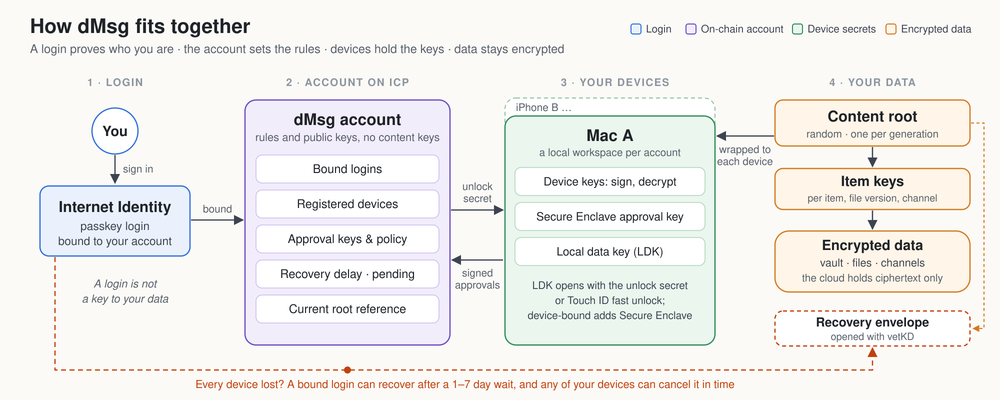

# When Local Data and the System Keychain Are Both Stolen: Hardware Binding and Account Recovery in dMsg

[中文版](dMsg_after_DarkSword_blog_2026-10-25_zh.md)

*October 25, 2026 · How dMsg protects local data and sensitive approvals—and where those protections end. This describes the implementation in this repository; availability depends on the installed release and device.*

## From web exploits to info-stealers

In March 2026, Google's Threat Intelligence Group described **DarkSword**, an iPhone exploit chain targeting iOS 18.4–18.7. Visiting a malicious or compromised website could compromise the device, and its GHOSTBLADE payload collected keychain items, messages, and other sensitive data. Google reported that all vulnerabilities in the chain had been patched by iOS 26.3 and urged users to update. [Google's investigation](https://cloud.google.com/blog/topics/threat-intelligence/darksword-ios-exploit-chain)

Macs face similar threats. Sophos documented how Atomic macOS Stealer tricks users into entering their login password and steals sensitive files, including keychain data. [Sophos's investigation](https://www.sophos.com/en-us/blog/atomic-macos-stealer-leads-sensitive-data-theft-on-macos)

Still, **not every compromise makes every keychain item readable**. Protection depends on the platform, access controls, and the specific attack. Apple's Secure Enclave provides a separate hardware boundary, keeping private keys unexportable even when software on the main processor is compromised. [Apple Platform Security](https://support.apple.com/guide/security/secure-enclave-sec59b0b31ff/web)

For dMsg, the practical question is: **if someone copies the local workspace and system credential store, what else do they need?**

## What dMsg is

dMsg is one of ICPanda DAO's products: a private workspace with a password vault, encrypted files, channels and letters, document signing, team wallets, and scoped access for AI agents. Its client, protocols, and canisters are open source. The protections described below are not a claim of independent security certification or proof that dMsg resists a specific exploit chain.

## 1. Encrypt before data leaves the device

Vault items and file versions each use their own random AES-256-GCM keys. Files are split into ~1 MiB chunks and verified on download; channels use their own epoch keys. The account's content root protects the keys needed to read private data, and is wrapped separately for each device using HPKE with X25519.

The cloud stores and delivers ciphertext. Internet Computer canisters maintain account authority, registered devices, recovery state, and execution policies. Under the protocol, neither service receives plaintext content roots.

Content encryption does not hide all metadata. Routing relationships, sizes, timing, and authorization requests remain visible where needed. Formal signing also intentionally exposes the authorization data and commitments required for verification. See [encryption design and its boundaries](../docs/dmsg_encryption.md).

## 2. No extra dMsg password or seed phrase

You sign in with Internet Identity (II); dMsg does not add its own password or seed phrase. **II itself still has authentication and recovery mechanisms that you must protect.** A compromised II remains a serious risk, as section 6 explains.

When unlocking via login, the account canister releases an unlock secret (`unlock_secret`) only to a bound login identity and an eligible, non-revoked registered device. The client uses it to unwrap the local data key (LDK). Simply being able to sign in with II is not enough to pull down all of your content.

By default, dMsg locks after 15 minutes of inactivity and releases content keys from memory (standard memory release, not forensic erasure). If you explicitly enable background-online mode or resident agents, the system retains the limited credentials those features need, without keeping read access to the locked vault.

## 3. Fast unlock requires the original Secure Enclave

On supported Macs, fast unlock uses a secret derived through Secure Enclave key agreement. The system credential store holds a key handle and supporting public material rather than an exportable plaintext private key.

Copying that material to another Mac does not reproduce the original hardware key. On the original Mac, however, the default policy allows Touch ID **or the Mac login password**. If an attacker already has your login password and is running code on the original device, default fast unlock alone will not stop them.

## 4. Device-bound unlock protects both local paths

Optional **device-bound unlock** makes login unlock require the original Mac's hardware secret as well, just like fast unlock. Both local paths require user presence, and if the hardware key is unavailable, the client does not silently fall back to login-only wrapping.

This protects a current workspace copied along with its credential store, but it does not close the separate cloud recovery path or undo an earlier leak: device binding rewraps the existing local data key, so an older unbound copy or a previously extracted key can still decrypt data protected by that key.

The optional **Touch ID only** policy removes the password fallback and binds the hardware key to the currently enrolled fingerprints. Adding or removing fingerprints in macOS settings can invalidate the key. Keep another authorized device or verify your recovery route before turning it on.

## 5. Approval keys add a server-verified signature

Every device already signs with its software key. You can also register a Secure Enclave **approval key** and require it for account-control, device-control, and agent-principal-control operations; optional policy categories extend this requirement to payments and formal attestations.

This extra signature is bound to the specific approval's operation commitment and context, and the user home canister verifies it before accepting the operation. Copying only the software device key and login credentials is not enough to pass these checks.

This is not a universal gate over every external wallet transaction or local agent action. A valid P-256 signature also cannot, by itself, prove Apple hardware origin or local access-control settings to a remote canister. And if the screen itself is compromised, a Touch ID prompt does not guarantee that what you see on screen matches what is being signed.

## 6. Revoke lost devices—and watch the recovery path

From another administrator device, you can revoke a lost device. A revoked device can no longer obtain unlock secrets or submit approvals, and its approval key is retired. When content keys rotate, clients exclude the revoked device from new envelopes. A running dMsg client that detects its own revocation resets its local workspace—though none of this deletes copies an attacker has already taken or guarantees a remote wipe of an offline machine.

If **all devices are lost**, a bound II login can request recovery. After the waiting period (3 days by default, configurable from 1 to 7 days), the new device replaces all old devices and login bindings, retires old approval keys, and clears the hardware approval policy.

How is encrypted content recovered? Each content-root generation has an encrypted recovery envelope. Once recovery completes, the canister authorizes the new device to obtain a vetKD-derived decryption key for the current generation, encrypted to that device's transport public key. The device opens the envelope, recovers the content root, and rotates it immediately. Whether older data can be recovered depends on the cloud ciphertext and key history still being intact; local files never backed up from a lost machine cannot be recovered.

**An attacker who controls your bound II can use this same recovery path.** If no valid device cancels the request before the waiting period ends, the attacker can take over the account and recover backed-up content. To prevent permanent lockouts when all devices are lost, hardware approval keys do not block this last-resort path.

Because of that, the waiting period needs active monitoring, not just a timer. `dmsg daemon` checks the **selected account's** certified public recovery status in the background—including while locked—polling roughly once a minute when normal security reads have not recently updated it. When a pending request is found, the desktop app shows a system notification. Clicking it opens **Settings → Account security**, where you can unlock or sign in and cancel the recovery through the approval flow. `dmsg status` also shows a warning in the CLI, and `dmsg recovery dispute` initiates cancellation.

A given request triggers one desktop notification per run, so reconnects do not spam you, while a new request notifies again. Recorded warnings persist across network outages and daemon restarts, and the CLI explicitly labels unknown or stale status.

Keep in mind that these are local alerts, **not guaranteed push delivery**. The daemon and desktop app must be running, the device must be online, and the OS must allow notifications. Sleep, network issues, or having a different account selected can delay detection. Cancelling a recovery request also does not fix a compromised II—you must remove unauthorized authentication and recovery methods from II as well.

## What this doesn't protect against

- **An unlocked, compromised client.** Malware may read plaintext or keys directly from memory and abuse existing access. The Secure Enclave does not protect application memory.
- **A tampered or misleading approval screen.** Check the action and prompt carefully. High-value actions may warrant confirmation on a second device or via multisig.
- **Past leaks.** Device binding and revocation cannot claw back secrets, exported files, or credentials that were copied earlier.
- **Unenabled or unavailable protections.** Device binding and approval-key enforcement are opt-in. The Secure Enclave integration described here currently targets macOS; other platforms use their native credential stores.
- **Service and software trust boundaries.** Recovery depends on cloud data and related services. Metadata visibility, client distribution, canister upgrades, and notification delivery remain part of the trust boundary.

## 5-minute security checklist

1. Update your OS. Users at elevated risk can also consider Apple's [Lockdown Mode](https://support.apple.com/en-us/105120) alongside updates.
2. In **Settings → Account security**, bind your supported Mac, register an approval key, and then require it in your policy.
3. Consider enabling **Touch ID only**, and make sure you have a recovery plan for fingerprint changes or hardware failure.
4. Keep a second valid device with dMsg running and notifications allowed so you can spot unexpected recovery requests in time.
5. Protect II's own authentication and recovery methods. If an unauthorized recovery request appears, cancel the dMsg recovery and clean up your II credentials.

The goal of these mechanisms is straightforward: make copied local storage and software keys insufficient on their own, while keeping the final recovery path visible and under your control.

- Learn more: [dmsg.net](https://dmsg.net/)
- Technical detail: [dMsg encryption design](../docs/dmsg_encryption.md) · [Account and recovery protocol](../docs/protocol/account_root.md)
- Source: [ICPanda DAO / ic-panda](https://github.com/ldclabs/ic-panda)
